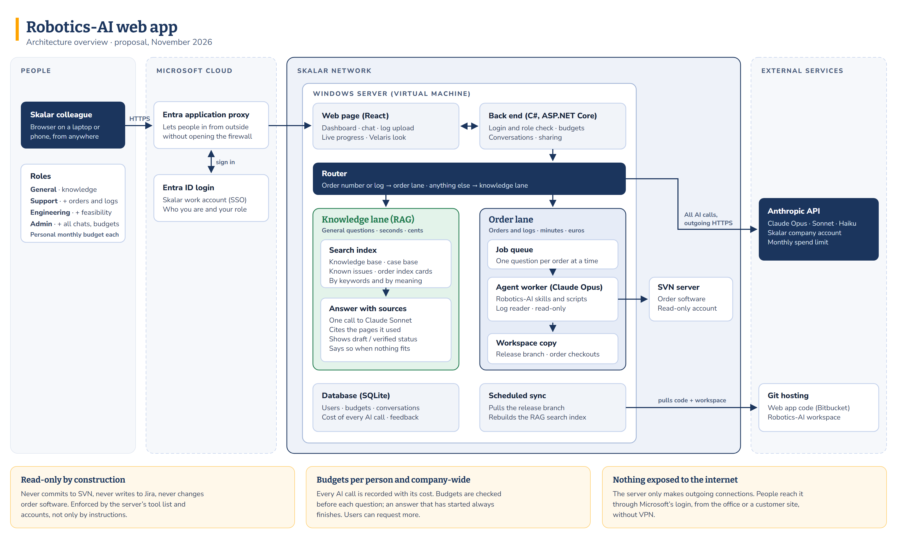

# Architecture

> **Status:** proposal for discussion, November 2026. Nothing on this page is built yet.

<!-- Publishing: attach architecture.png (rendered from architecture.html in this folder) and insert it as an image. -->

## Principles

1. **A new front door, not a new assistant.** Behind the website runs the same Robotics-AI workspace Software Engineering uses: the same instructions, skills, scripts and knowledge. An improvement to the workspace improves the website once it is released.
2. **Two lanes.** General questions take a fast, cheap path through a search index. Questions about an order or a log take the full investigation.
3. **Read-only by construction.** The server can only read SVN, has no write access to Jira, and its AI agent can only use an approved list of tools and scripts.
4. **Nothing exposed to the internet.** The server lives inside the Skalar network and only makes outgoing connections. Users reach it through Microsoft's login.
5. **Start small.** One server carries the test group. Scale only when measured use asks for it.

## Components

| Component | What it does | Technology |
|---|---|---|
| **Web page** | Dashboard, chat, log upload, live progress, sharing, feedback | React |
| **Back end** | Checks login and role, enforces budgets, stores conversations, streams progress to the page | C#, ASP.NET Core |
| **Login** | Skalar work account (single sign-on); roles come with the login | Microsoft Entra ID |
| **Outside access** | Lets users in from outside the network after they have signed in, without opening the firewall | Microsoft Entra application proxy |
| **Router** | Sends a question to the right lane: an order number or a log means the order lane; otherwise the knowledge lane. A small AI model decides unclear cases | Rules + Claude Haiku |
| **Search index (RAG)** | Finds the relevant passages in the knowledge base, case base, known issues and order index cards, by keywords and by meaning | Local embedding model and keyword index, stored in SQLite on the server |
| **Knowledge lane (RAG)** | Writes one answer from the passages found, citing them | Claude Sonnet |
| **Job queue** | Runs order questions in the background; one question per order at a time, several orders in parallel | Table in the database |
| **Agent worker** | Runs the Robotics-AI investigation: fetch the order from SVN, read its profile and tables, read the log | Claude Code (run by the back end, version pinned), Claude Opus |
| **Workspace copy** | The server's own copy of the Robotics-AI workspace (release branch), the software templates and checked-out orders | git, SVN |
| **Scheduled sync** | Updates the workspace copy from the release branch and rebuilds the search index | Scheduled task |
| **Database** | Users, budgets, conversations, jobs, the cost of every AI call, feedback | SQLite (pilot) |
| **AI provider** | All AI calls, under a Skalar company account with a monthly spend limit | Anthropic API |

## A question's journey

**General question:** "Do we support meter X?"

1. The router finds no order number and no log, so it picks the knowledge lane.
2. The search index returns the most relevant passages with their source and review status.
3. One AI call writes the answer and cites those passages.
4. If nothing relevant is found, the answer says so instead of guessing.

**Order question:** "99441979 stops after the second sample", with a log attached

1. The router sees an order number and a log, so it queues a job for order 99441979.
2. When nobody else is asking about that order, the agent worker starts. The page shows live progress.
3. The worker follows the same steps as in the workspace: update the order from SVN, read its system profile and sequences, read the log, check past cases, reason over the tables.
4. The answer appears in the conversation. Follow-up questions continue with everything the worker has already read.

## The knowledge lane: RAG

RAG (retrieval-augmented generation) means: first find the relevant passages in our own written knowledge, then let the AI answer from those passages only, citing them. The AI does not need to know Skalar's products; it reads the right pages at the moment of the question. Only a few passages are sent per question, which keeps general questions cheap.

**What is searched**

| Source | Who it is searched for |
|---|---|
| Knowledge base (`knowledge-base\`) | Everyone |
| Solved cases (case base) | Everyone |
| Known template issues | Everyone |
| Order index cards ("which order had feature X") | Everyone |
| Feature dossiers (how a feature was built) | Engineering only |

**Preparing the index** (when the workspace is released)

1. Every page is split at its headings into passages. The page header (type, audience, review status, date) is kept with each passage.
2. Each passage is turned into an *embedding*: a list of numbers that represents its meaning, so passages with similar meaning can be found even when they use different words. This runs on the server with a multilingual model, so a question asked in another language still finds the English pages, and no text is sent to another provider.
3. Each passage is also added to a keyword index, for exact terms such as method codes, error numbers and article numbers.
4. Only pages that changed since the last release are processed again.

**Answering a question**

1. The question is searched both by meaning and by keywords, and the two result lists are combined.
2. Results the user's role may not see are removed.
3. The best passages and the question go to Claude Sonnet, which writes the answer and cites each passage with its review status (draft, reviewed, verified).
4. If no passage is relevant enough, the answer says so.

**Checking quality.** A fixed set of real questions with known correct pages is run after every change to the index or the knowledge, to confirm that the right pages still come out on top.

## Security

- **Sign-in:** Skalar work account only. A test group is set up in Entra ID; widening access is a change to that group.
- **Roles** (General, Support, Engineering, Admin) come with the sign-in and decide how deep answers may go. Feature dossiers and code are only read for the roles that need them.
- **Read-only:** a read-only SVN account, no Jira write access, and an allowlist of tools and scripts for the agent. The agent works only in the server's own copy.
- **Uploads:** robot logs only in the first version, with a size limit. Files are deleted after a retention period.
- **Secrets** (API key, service accounts) are kept in the Windows credential store, never in code.

## Cost control

- The cost of every AI call is recorded per person, conversation and kind of question.
- Personal monthly budgets plus a company-wide limit, checked before each question.
- The cheaper model answers general questions; the most capable model is used only for order investigations.
- Prompt caching keeps the fixed instructions from being paid in full on every step.

## Code and releases

- The web app's code lives in its own repository in Skalar's Bitbucket.
- The server serves a **release branch** of the Robotics-AI workspace, not the branch where daily work happens. A change reaches users only when it is released on purpose.
- The Claude Code version on the server is pinned and updated on purpose, in the same way.

## Left out of the first version

| Left out | Why |
|---|---|
| Any change to software, SVN or Jira | Stays with Software Engineering in the workspace |
| Customer software uploads (zips) | Can be several GB; the server fetches order software from SVN itself. Planned for later |
| Jira tickets | Escalated tickets are handled by Software Engineering in the workspace |
| E-mail or Teams notice when an answer is ready | Live progress on the page comes first |
| Builds and emulation tests in the robot application | Need the application with a desktop session; stay on an engineer's PC |
