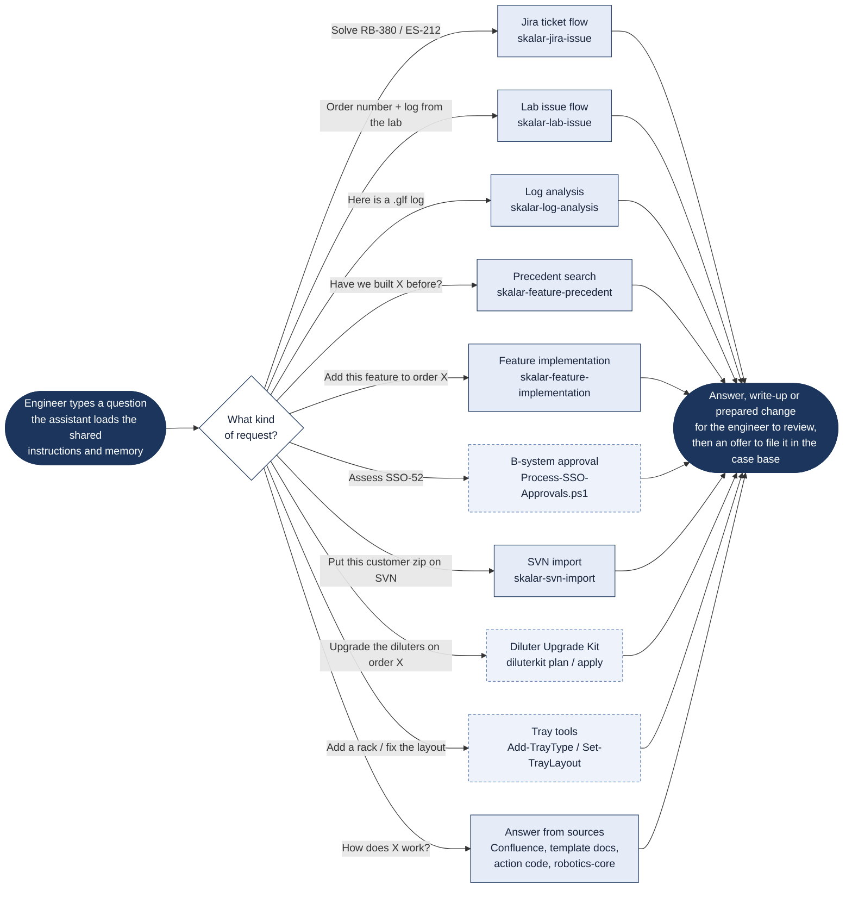

# What happens when you ask a question

> Asked as: any question typed into Claude Code, GitHub Copilot or Codex inside the Robotics-AI workspace

Every assistant opens the same instruction file first, so the same question gets the same treatment whichever tool is used. The request is then matched to a skill: a written procedure for that kind of work, with its own scripts and its own rules. Anything that does not match a skill is answered from the instructions, the documentation and the software itself.

## Key points

- The instruction file is the same for all three assistants (`CLAUDE.md` points at `.github/copilot-instructions.md`), so behaviour does not depend on which tool someone uses.
- A skill is chosen from the wording of the request. The engineer does not have to name it.
- The lab and ticket flows both end up in log analysis when a log is attached; the precedent search hands over to feature implementation once a reference order is chosen.
- The same house rules hold on every path: software is read only from the workspace (never from an engineer's own `C:\SPD_Projects` copy), nothing writes to Jira, and nothing is committed to SVN without the engineer saying yes in the conversation.
