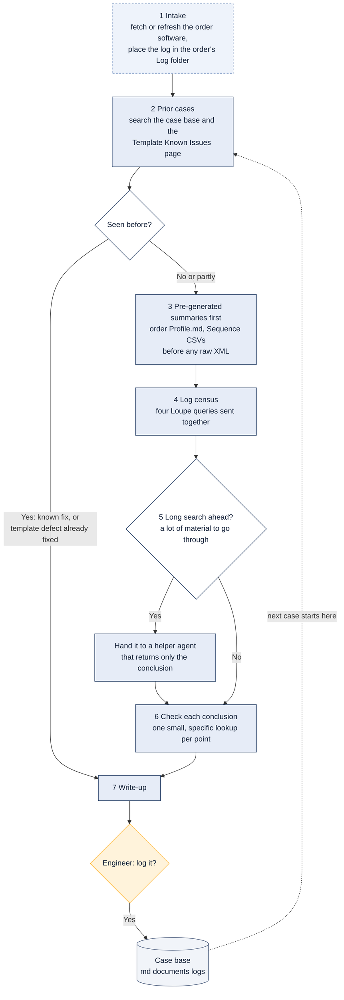

# The investigation spine

> Asked as: any investigation, whether it arrives as a lab issue, an RB/ES ticket or a port check

A lab issue, a Jira ticket and a port verification differ only at the start and the end. The middle is always the same seven steps, in the same order. Following them keeps an investigation short and focused: known problems are found first, cheap summaries are read before raw files, and nothing is checked twice.

## Key points

- Prior cases come before any new digging. Field issues repeat, and a past write-up is often most of the answer.
- The order's `Profile.md` lists its hardware and every application's settings in about 15 KB. Building the same picture from the raw XML is many times slower and more expensive.
- Step 6 checks the conclusions one at a time, each with its own narrow lookup, for example "did the gripper reach position 3 at 10:42?". One broad search that tries to confirm everything at once returns hundreds of lines and proves none of them clearly.
- Lookups that do not depend on each other run at the same time. Lookups that depend on an earlier answer wait for it, so speed never replaces a check.
- Each resolved case is filed back into the case base, so the next similar case starts with an answer.
