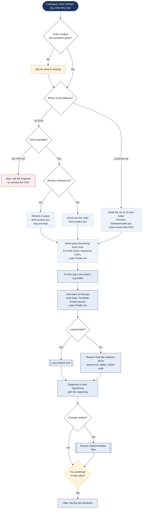

# A lab issue comes in

> Asked as: "99441979 stops after the second sample, here is the log" · "the lab committed again, check it"

A colleague in the lab, or at a customer install, reports a robot problem with an order number and usually a log file. The assistant gets the exact software that robot runs, checks whether the problem is already known, and always ends with a diagnosis or a best hypothesis with its reasoning. It never ends with only a request for more information.

## Key points

- The software is always the exact version under investigation: refreshed from SVN, or installed from the customer's zip. If SVN cannot be reached the assistant stops instead of using another copy.
- A refresh never deletes the order folder, so logs and notes stay where they were.
- When the lab says "we committed again" or "here is a new zip", the same step runs again and everything read earlier is treated as out of date.
- No log is not a dead end. The assistant answers from the software and says which log would settle what is still open.
- The resolution is filed only after the fix has been confirmed on the robot.

## For a web version

Fit: Good. The chat proof of concept already runs this flow as its Lab channel; the work is reading and reasoning.
Needs: Workspace files; Windows scripts; SVN via VPN; Log reader; File upload
Writes: refreshes the order folder, which discards local edits, so a shared service needs one queue per order
