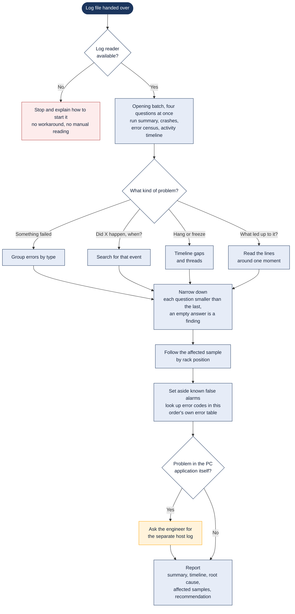

# Reading a robot log

> Asked as: "why did this run hang?" · "what went wrong in this .glf?"

The robot writes binary `.glf` log files that can hold hundreds of thousands of lines. The assistant never reads them as text. It asks questions through a dedicated log reader (the Loupe server), starting with a fixed overview and then narrowing one question at a time, so that only the lines that matter end up in front of it.

## Key points

- Without the log reader there is no analysis. The assistant stops and says how to fix it rather than guessing from the raw file.
- The four opening questions always go out together, which turns several rounds into one.
- Searches are capped at 20 to 30 results and never paged through. A wide search fills the conversation with lines that are then re-sent on every later round.
- Error codes differ per robot, so a code is looked up in that order's own error table, never in a template or another order.
- A "COM port opened" line without a reply points to cabling or power, so the assistant stops looking at code there.

## For a web version

Fit: Good. Read only from start to finish; the user uploads a log and gets a report.
Needs: Workspace files; Log reader; File upload
Writes: nothing
