# Solving an RB or ES ticket

> Asked as: "solve RB-380" · "investigate ES-212"

Service tickets from the Robot Aftersales (RB) and Escalation (ES) boards are pulled into a local folder by a scraper script: the ticket text, every attachment, the order's SVN software and, when the customer sent it, their own running software. The assistant diagnoses from that folder and writes an analysis with a draft reply. It never writes to Jira; the engineer decides what to post.

```mermaid
flowchart TD
    Q([Engineer: solve RB-380]):::start --> SCRAPE["Fresh copy of the ticket<br/>Process-ServiceTickets.ps1<br/>Jira writes switched off"]:::script
    SCRAPE --> OK{Download worked?}:::decision
    OK -->|No| STOP1[Stop and report<br/>never diagnose from an old copy]:::rule
    OK -->|Yes| FOLDER[("Service Items folder<br/>ticket text, attachments, SVN software,<br/>customer software, logs")]:::store
    FOLDER --> READ[Read the ticket<br/>and the attachment list]:::ai
    READ --> SW{Which software<br/>is the evidence?}:::decision
    SW -->|"Customer zip attached"| CUST[Customer's software is the source<br/>SVN only for comparison]:::ai
    SW -->|"Ticket links a zip the<br/>scraper could not fetch"| DL[Engineer downloads it<br/>into the ticket folder]:::human --> INST["Install it<br/>Process-SoftwareFolder.ps1"]:::script --> CUST
    SW -->|"No customer software"| SVNSW[SVN software]:::ai
    CUST & SVNSW --> PRIOR[Search the case base<br/>re-check any match against this ticket]:::ai
    PRIOR --> ROUTE{What does it need?}:::decision
    ROUTE -->|Log| LOGA[[Log analysis flow]]:::ai
    ROUTE -->|Code| CODE[Action code reference]:::ai
    ROUTE -->|Setup question| DOCS[Template docs, Confluence]:::ai
    LOGA & CODE & DOCS --> XCHK[Cross-check with a second source<br/>facts, inferences, open questions apart]:::ai
    XCHK --> ENOUGH{Enough evidence?}:::decision
    ENOUGH -->|No| ASKFOR[Smallest concrete request<br/>for what is missing]:::ai
    ENOUGH -->|Yes| LOCAL[Diagnose, and if needed fix<br/>locally in the ticket folder]:::ai
    ASKFOR & LOCAL --> ANALYSIS[("analysis.md<br/>cause, confidence, verification,<br/>draft Jira reply to copy")]:::store
    ANALYSIS --> ENG{Engineer decides:<br/>post to Jira, commit to SVN}:::human
    ENG --> CONF{Fix confirmed<br/>on the robot?}:::human
    CONF -->|Yes| LOGIT[Offer: log this ticket resolution]:::ai

    classDef start fill:#1b355d,stroke:#1b355d,color:#ffffff
    classDef ai fill:#e6ecf7,stroke:#1b355d,color:#16233a
    classDef script fill:#eef3fb,stroke:#6686b7,color:#16233a,stroke-dasharray:4 3
    classDef decision fill:#ffffff,stroke:#1b355d,color:#16233a
    classDef human fill:#fff3db,stroke:#ffa400,color:#16233a
    classDef rule fill:#fdecec,stroke:#b03a3a,color:#16233a
    classDef store fill:#f1f4f9,stroke:#47597a,color:#16233a
```

## Key points

- "Solve" covers diagnosis and a local fix only. Posting to Jira, changing the ticket, committing to SVN and deploying all need the engineer to ask for them.
- When the customer sent their own software, that is what gets diagnosed. SVN can differ from what actually runs on site.
- If the ticket points to customer software the scraper could not download, the assistant stops and asks for it instead of quietly using SVN.
- The draft reply is written for internal readers and never claims testing or a delivery date that has not happened.

## For a web version

Fit: Good. The chat proof of concept already runs this flow as its Helpdesk channel and ends with a draft reply for a person to send.
Needs: Workspace files; Windows scripts; SVN via VPN; Jira (read); Log reader; Engineer approval
Writes: the local ticket folder and analysis.md, never Jira
