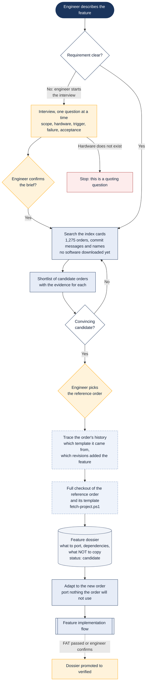

# Have we built this before?

> Asked as: "have we ever built a robot that rinses the probe with KCl between samples?" · "find a reference order for a dual EC flowcell"

Most special requests (B-features) have been built for some earlier customer. The workspace keeps a searchable index card for every delivered order (about 1,275) and a growing collection of feature dossiers. The assistant searches those, the engineer picks the right reference order, and the assistant turns it into a dossier that says exactly what to copy and what not to.

## Key points

- Nothing is downloaded until the engineer has chosen the reference order. The index cards are enough to shortlist.
- The engineer verifies the choice outside the tooling, for example from photos of the built system or by opening its software.
- The dossier records what not to copy as well as what to copy: a reference order also carries other customer-specific parts.
- Dossiers grow from live work. Each port adds or updates one, and it becomes "verified" once the first port passes FAT.
- The interview step is optional and only starts when an engineer asks for it.

## For a web version

Fit: Good for the search and shortlist, which only reads the committed index cards. The checkout and dossier after the engineer's pick need SVN.
Needs: Workspace files; Windows scripts; SVN via VPN; Engineer approval
Writes: a candidate dossier in the workspace
