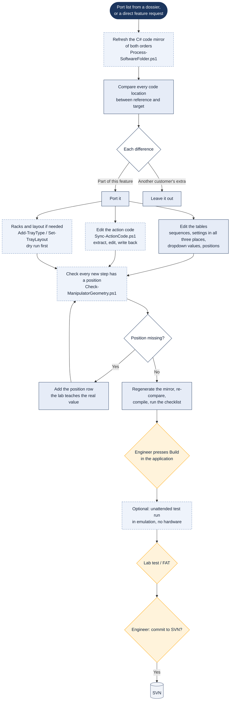

# Building a feature into an order

> Asked as: "port the KCl rinse from 99412345 into 99446390" · "add a setting to switch the sprayer off"

A robot's behaviour lives in XML tables (sequences, settings, positions) and in C# action code stored inside those XML files. The assistant changes both through workspace scripts, checks that every new movement has a position to go to, and builds the code. The final build in the real application and the test on the robot stay with the engineer.

## Key points

- Every difference between the reference and the target order is sorted. Only the parts of this feature are ported, so another customer's extras do not travel along.
- A new setting goes in three places (the shared table, every application, and the settings popup). Adding it in one place only fails silently, which is why it is a checklist item.
- The geometry check catches a new movement with no position defined. On the robot that would otherwise show up as a crash or a wrong move.
- The emulation test and the in-app Build are real compiles and runs. The assistant's own compile is an earlier, cheaper check.
- Nothing is committed to SVN until the engineer says so.

## For a web version

Fit: Engineer PC. It changes order software, and the Build and emulation test drive the robot application on Windows.
Needs: Workspace files; Windows scripts; SVN via VPN; Robot application; Engineer approval
Writes: order tables and action code in the local checkout; SVN only after a yes
