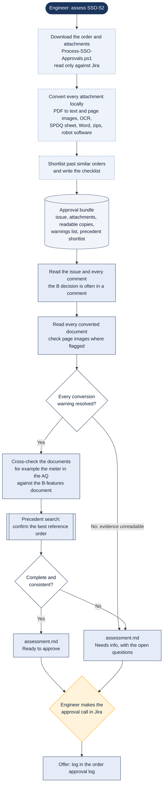

# Assessing a B-system order for R&D approval

> Asked as: "assess SSO-52" · "is this B-system ready to approve?"

Orders on the SSO board ("B-System Orders") wait for R&D approval. A script downloads the order and every attachment and converts them to readable text locally: the application questionnaire, the B-features document, the workfile's SPDQ sheet, photos and any robot software. The assistant then reads all of it, cross-checks the documents against each other, finds the best reference order and writes a verdict. The approval itself stays with a person.

## Key points

- Two stages. The script fetches and converts with no AI involved; the assistant reasons over the result.
- Scope is never taken from a file name. The AQ, the B-features document and the workfile are read as independent evidence, so a contradiction between them shows up.
- A conversion warning does not block approval once it has been checked against the original, but unreadable evidence does.
- Neither the script nor the assistant posts to Jira or changes the issue status.

## For a web version

Fit: Good. A reviewer asks one question and gets a written verdict; the work is reading.
Needs: Workspace files; Windows scripts; Jira (read); Engineer approval
Writes: a bundle folder and assessment.md in the workspace, nothing in Jira
