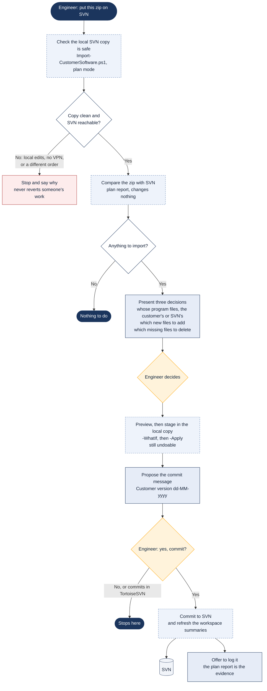

# Putting a customer's software on SVN

> Asked as: "put this customer zip on SVN" · "commit the customer's version"

When a customer sends the software that actually runs on their robot, SVN has to be brought in line with it without losing anything. The script plans first and changes nothing, a person makes three decisions, the changes are staged in the local copy, and the commit happens only after an explicit yes.

## Key points

- "Put it on SVN" allows planning and staging. The commit needs a separate, explicit yes in the conversation.
- Files missing from the zip are kept unless a person names them; new files are added only when chosen.
- If SVN holds a newer core than the customer, the assistant has to ask, because taking the customer's version would roll SVN back.
- The customer's zip is evidence and is never moved, renamed or deleted.

## For a web version

Fit: Engineer PC. It changes the system of record and every step waits on an engineer's decision.
Needs: Workspace files; Windows scripts; SVN via VPN; File upload; Engineer approval
Writes: the local SVN copy, then SVN itself after a yes
