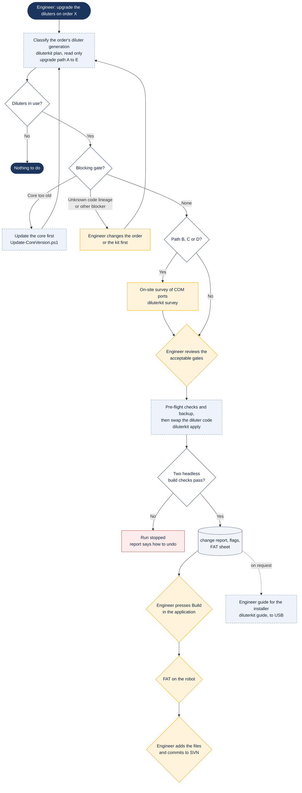

# Upgrading the diluters on an installed robot

> Asked as: "upgrade the diluters on 99325813" · "what path is this order?"

Older robots carry one of several diluter software generations. The Diluter Upgrade Kit brings an order's own software to the current diluter code in place, keeping the customer's positions, calibrations and customisation. It works in stages with gates: anything it cannot handle safely stops the run and says what has to change first.

## Key points

- The upgrade is always done in the order's own software, never by rebuilding the robot on today's template. The installed software is the customer's system of record.
- Most gates cannot be waved through: the order has to change first. A short list may be accepted, and only after an engineer has reviewed it.
- A failed build check stops the run with undo instructions. Nothing half-upgraded is left behind silently.
- The kit never writes to SVN. The engineer commits after the in-app Build and the FAT.

## For a web version

Fit: Engineer PC. It edits order software, needs the robot application to build it, and has an on-site survey.
Needs: Workspace files; Windows scripts; SVN via VPN; Robot application; Engineer approval
Writes: the local order checkout, backed up first; SVN only by the engineer
