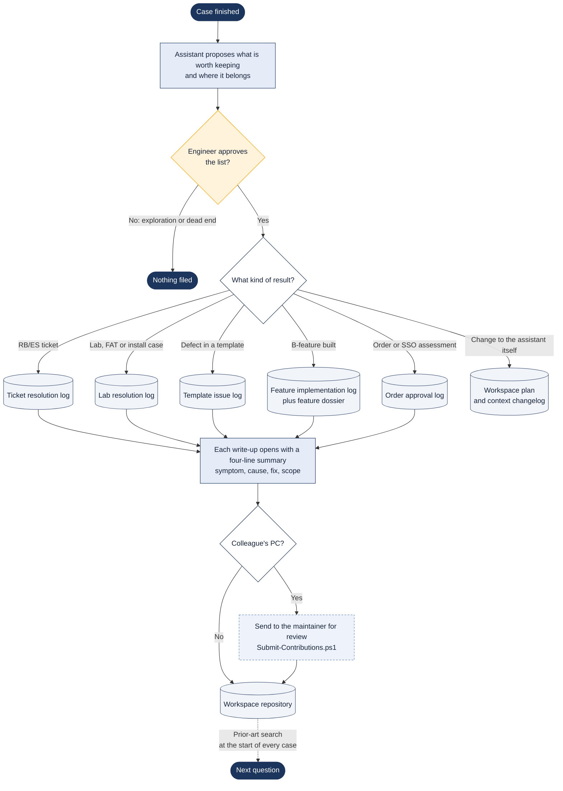

# How answers become knowledge

> Asked as: "wrap up" · "log this ticket resolution" · "add this to the feature catalogue"

The workspace improves because finished work is written down where the next question will find it. At the end of a case the assistant proposes what to keep and where, the engineer approves the list, and the write-up goes into the matching log. Every investigation flow starts by searching those same logs.

## Key points

- The four-line summary at the top of each write-up is what makes the case base cheap to search. A match is judged from those lines before the whole file is opened.
- Filing is by how the work arrived (ticket or lab), but every search covers all the logs.
- Nothing is filed without the engineer's OK, and filing never posts to Jira or commits to SVN.
- Colleagues who do not use git send their entries for review rather than changing the shared workspace directly.

## For a web version

Fit: Partial. The write-up can be drafted automatically, but someone has to decide what is correct before it becomes knowledge.
Needs: Workspace files; Engineer approval
Writes: the case-base logs in the workspace repository, after review
