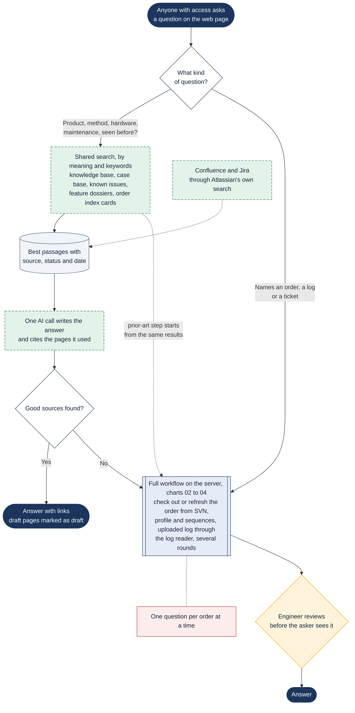

# Proposal: answering any robot question

> Asked as: "how often should the YSI membrane be replaced?" · "which BOD method uses seed correction?" · "have we seen a blank fail like this before?"

This chart is a proposal. Nothing on it is built yet. It shows how a web page open to everyone with access could answer any question about the robots, not only software questions. Knowledge questions are answered from a shared search over the written knowledge (RAG: retrieval-augmented generation). Questions about one order's software or a log still go through the full workflows above. Full reasoning: `md documents\Assessments & Plans\RAG Assessment.md`.

## Key points

- RAG fits the written knowledge: the product knowledge base, solved cases, known template issues, feature dossiers and order index cards. Together they are about 5 MB of text, so one index file is enough and no database server is needed.
- It does not fit the robot software, logs, action code or error codes. Those need exact answers for one order, which the existing tools give.
- A web question about one order's software still triggers the usual background work on the server: checking out or refreshing that order from SVN, regenerating its profile and sequences, and reading the uploaded log. RAG only speeds up the search for prior cases.
- A knowledge answer is one AI call, estimated at around €0.10 (not measured). A full order-lane chat costs €3.73 to €6.23 as measured.
- The more of the product knowledge base is written, the more questions the cheap lane can answer. Its pages already carry a status (draft, reviewed, verified) that the answer can show.
- When the search finds nothing good, the question goes to the full workflow or an engineer instead of getting a guess.
