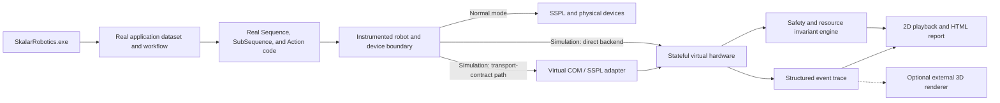

# Virtual Robot Software-in-the-Loop Test System — Implementation Plan

> **Status: PROPOSED.** Created 2026-08-03. This plan describes a staged route from the current
> optimistic emulation mode to a deterministic software-in-the-loop (SIL) test system. It does not
> authorize changes to Robotics Core, Robotics Plugin, application templates, SVN, Jira, or release
> packages. Estimates are provisional until the Phase 0 architecture spike is complete. Consolidated
> on 2026-08-03 with the useful static-validation and virtual-COM ideas from
> `Robot Test Harness Plan.md`; this document is the authoritative implementation roadmap.

## Decision summary

Build a Skalar-specific, deterministic virtual robot that runs the real `SkalarRobotics.exe` host,
the real application dataset, the real workflows, and the real `Skalar.Pack1.dll` action code. Only
the physical hardware and communication boundary is replaced.

The recommended sequence is:

1. Build a context-aware static package validator and a trace auditor around current emulation.
2. Run a time-boxed virtual-COM/SSPL feasibility spike against representative real programs.
3. Add a distinct **Simulation** mode with stateful virtual motors, sensors, IO, and devices.
4. Add automated scenarios, safety assertions, semantic regression traces, and reporting.
5. Roll the system out template by template.
6. Add a 3D renderer only if the deterministic kinematic model leaves a demonstrated gap.

Do not make a general-purpose physics simulator or a separate implementation of the Skalar
workflow engine. The real production workflow and action code must remain the system under test.

## Problem statement

Current emulation is useful for checking whether software can start and proceed through a workflow,
but it is optimistic at the hardware boundary. It cannot reliably answer questions such as:

- Did the intended manipulator move to the intended physical position and height?
- Did an XY move occur while a probe, needle, or gripper was still below travel height?
- Could two parallel branches collide or wait forever on each other's resources?
- Was a manipulator, motor, IO, pump, diluter, or vessel lock leaked?
- Did a pump, valve, stirrer, gripper, or meter perform a physically meaningful operation?
- Does initialization, error recovery, stop, and finalization leave the system safe?
- Did a new feature change the behavior of another application in the same software package?

The target is not to eliminate physical FAT. The target is to catch software, sequencing,
configuration, kinematic, resource-ownership, and device-state errors immediately after a change,
before robot time is required.

## Current-state evidence

The current architecture is suitable for an incremental SIL system:

- The XML is the runtime source of truth. It is compiled by the application into
  `SkalarPacks/Skalar.Pack1.dll`; the generated `SkalarPackSolution` is only a developer mirror.
- Actions already execute through the real Sequence/SubSequence engine and carry `SequenceInfo`,
  sample context, and `ProcessID`.
- `Action20x00` resolves the actual table-driven location, rack position, sample position, and
  target height before calling `MoveToPositionXY` or `MoveToPositionXYZ`.
- The movement layer already has safe-travel logic, coordinate calculation, endpoint collision
  handling, current/target motor positions, and manipulator definitions.
- Motors, IO, and pumps already use the central `ObjectLock` structure keyed by resource name and
  owned by `ProcessID`.
- Current SSPL emulation returns success without serial communication. A waited motor movement
  subsequently sets its current position directly to the target. This is why a workflow can pass
  without proving realistic motion or feedback behavior.
- The serial controller receives complete SSPL programs through the `A` / chunked program / `C`
  exchange. Generated programs use control flow, input, timing, motor, IO, and device-specific
  operations, so a virtual COM controller is potentially a firmware interpreter rather than a
  small command stub.
- `MotorConfiguration` supplies motion parameters and current/target state, but it is not a complete
  source of mechanical minimum/maximum limits or collision geometry. Those values need a separate,
  versioned and reviewable source.

Relevant BOD template entry points used for the initial design:

- `SSPL/SSPL_Serial.cs`: `Emulation`, serial bypasses, and `RunSSPL` fake return behavior.
- `SSPL/SSPL_Functions.cs`: `MoveMotor`, position updates, homing, IO, and raw SSPL functions.
- `Structure/2 - Movements/Tables and Functions/Motor.cs`: safe movement, collision checking, and
  motor locking.
- `Structure/1 - General/Tables and Functions/CommonActions.cs`: `ObjectLock`, `CheckObjectFree`,
  `LockObject`, and `UnlockObject`.
- `Structure/0 - SplitMergeSub`: action execution and parallel split/merge behavior.
- `Generated/Workflow`: application lifecycle state machines.

## Goals

The system must:

- Execute production workflow and action code, not a rewritten test copy.
- Load the selected template or order's real configuration tables.
- Validate action, subsequence, table, setting, hardware, and coordinate references before runtime,
  including recursively inherited `SequenceInfo` values.
- Model motor and manipulator state over time rather than snapping directly to success.
- Preserve and inspect existing `ProcessID` resource locking and parallel behavior.
- Detect general safety and consistency violations automatically.
- Support deterministic device replies and deliberate fault injection.
- Produce a replayable, reviewable record of every meaningful operation.
- Run a repeatable smoke/regression suite across all relevant applications in a package.
- Test the selected package with its exact Core and Plugin versions unless a version migration is
  itself the subject of the test.
- Keep Normal mode behavior unchanged and make simulation impossible to enable accidentally on a
  production installation.

## Non-goals

The first production-capable version will not attempt to model:

- Exact fluid dynamics, splashing, bubbles, wet chemistry, or probe response physics.
- Mechanical backlash, belt stretch, tube routing, cable drag, wear, or manufacturing tolerances.
- Calibration of real rack and height coordinates against a physical bottom plate.
- High-fidelity cap deformation, needle flex, or gripper contact forces.
- A photorealistic 3D representation of every order.
- Replacement of final physical FAT and safety validation.

These may be added later when a concrete defect class justifies the cost.

## Proposed architecture



### Architectural rule: two observation levels

A low-level SSPL emulator alone would have to infer meaning from motor numbers and command strings.
A high-level action simulator alone could miss malformed raw SSPL and device behavior. Use both:

1. **Semantic events** at the movement, IO, pump, diluter, gripper, measurement, and lock APIs.
   These events retain manipulator name, logical location, coordinates, `ProcessID`, action ID, and
   sample context.
2. **Virtual hardware responses** below those APIs. This layer owns motor progression, sensors,
   acknowledgements, timeouts, and device replies.

The production path must use the same high-level methods. Simulation changes only the backend and
adds passive observation/assertions.

The virtual-COM path is a compatibility and transport-contract adapter, not automatically the main
test oracle. It can prove that the real application serializes valid SSPL and can support unchanged
historical binaries. It cannot, by itself, recover action identity, inherited `SequenceInfo`, sample
context, `ProcessID`, or lock ownership. Expanding it into a general SSPL/firmware emulator requires
an explicit go/no-go decision after the Phase 0 command-coverage measurement.

### Runtime mode

Keep the existing behavior available as **Emulate** and introduce a separate **Simulation** mode.

| Mode | Purpose | Hardware behavior | Validation |
|---|---|---|---|
| Normal | Production and FAT | Real serial/devices | Existing runtime checks |
| Emulate | Fast optimistic/manual checks | Existing immediate fake success | Existing checks only |
| Simulation | SIL and regression tests | Stateful deterministic virtual hardware | Full invariant engine |

Phase 0 must decide how to represent the new mode without breaking compatibility with the existing
external `OperationModes` enum. A separate simulation profile/configuration is safer for the first
prototype than changing a shared enum used by historical binaries.

### Where the implementation should live

Keep substantial simulation logic out of per-order XML:

- A versioned external simulation runtime should own virtual state, scenario parsing, assertions,
  trace storage, and reporting.
- Application/template code should contain only thin, stable hooks at semantic operation and lock
  boundaries.
- The lowest-level robot/device transport should select either the real or virtual backend.
- Any C# hooks added to an application pack must be synced back to the XML source of truth using
  `Sync-ActionCode.ps1`; changes in the generated mirror alone do not run.

The Phase 0 spike must compare three injection approaches before code is committed:

1. A shared external DLL called by thin hooks in the pack's `Robot` partial class.
2. A virtual `Device`/transport implementation selected through `DevicePool`.
3. A host-level service exposed through Robotics Core and accessed from the pack.

The likely result is a hybrid of 1 and 2: semantic hooks are needed because `ObjectLock` and logical
movement context are inside the pack, while a virtual transport is needed for realistic feedback.

## Major components

### 0. Static package validator

Run a read-only validator before launching a scenario. It should load the runtime XML sources and
report definite errors separately from warnings.

Minimum checks:

- Every enabled `MethodType`, Sequence, SubSequence, action, and nested method reference resolves.
- Sequence/SubSequence traversal is recursive, ignores disabled `SequenceNumber = -1` rows, and
  detects missing targets and cycles that are not explicitly supported.
- Required action fields are evaluated after resolving inherited `SequenceInfo` through the parent
  action/subsequence chain; a field absent on a child row is not automatically an error.
- Logical locations, manipulators, motors, racks, rack positions, heights, IO, pumps, diluters,
  probes, devices, settings, and dropdown references resolve consistently.
- Action existence is checked against the runtime sources in `SkalarPacks.TreeDatabase.Xml` and all
  relevant `ExtensionUnit.*.xml` files, not only the generated `SkalarPackSolution` mirror.
- Shared versus per-application table placement is respected when validating settings and rows.
- Coordinates are finite and complete; mechanical envelopes are checked only when a reviewed
  machine profile supplies them.

The validator should emit stable rule IDs and machine-readable output so the same checks can run
locally, in CI, and as part of a scenario evidence bundle.

### 1. Simulation orchestrator

Responsibilities:

- Select a software package, application, method, and scenario.
- Verify the package builds and load the real compiled pack.
- Prepare settings, SampleAnalysis rows, standards, blanks, QCs, and virtual-device scripts.
- Start, pause, stop, and wait for the real application lifecycle.
- Collect completion state, exceptions, trace, invariant violations, and coverage.
- Restore or discard the temporary analysis dataset after the run.
- Preserve and report the package's original Core and Plugin fingerprint. Do not replace historical
  plugins with newer emulation implementations unless the scenario explicitly tests that upgrade.

The first version may drive a visible application window. Headless execution is desirable, but it
must not delay proving the virtual hardware and invariant model. A separate host-automation spike
will determine whether Robotics Core can safely expose a command-line test entry point.

### 2. Structured event stream

Use a versioned append-only format such as JSON Lines. Each event should include where applicable:

- Simulation time and monotonic sequence number.
- Software/template identity and core/plugin fingerprint.
- Application, method, Sequence/SubSequence, action class, and action description.
- Sample identity, rack, position, and parameter.
- `ProcessID`, thread/branch, resource name, and lock owner.
- Manipulator, logical location, X/Y/Z start and target, movement flags, and speed.
- IO, pump, valve, stirrer, gripper, diluter, meter, and sensor state.
- Result, error code, exception, and correlation ID.

The trace contract must be semantic and versioned. Regression comparison should ignore volatile
fields such as timestamps and thread IDs unless timing/ordering is itself under test.

#### Trace comparison and determinism contract

Parallel branches execute on real OS threads: `ParallelSubSequenceExecutor` and `PlanAndExecute`
use `BackgroundWorker`. Cross-branch interleaving is therefore not reproducible without replacing
the production execution engine, which this plan forbids. Determinism means **semantic equivalence
under a partial order**, not global byte equality.

Each branch execution must carry both its hierarchical `ProcessID` and a stable
`branchInstanceId`. A `ProcessID` describes the branch path but can be reused when the same flow is
executed again; the instance ID distinguishes those executions. It must be deterministically
assigned or canonicalized from branch creation order and parentage for comparison.

- **Within a branch instance:** semantic events must be identical between runs in event identity,
  order, and normalized payload.
- **Across branches:** incidental OS-thread interleaving is ignored, but causal relationships are
  preserved.
- **Automatic causal edges:** parent action to child action, split to branch start, device request
  to response, lock release to the next acquisition, and branch completion to merge are recorded
  and compared automatically.
- **Scenario-declared ordering:** a scenario may add required happens-before relationships, such as
  decap completing before a needle enters a vessel. These supplement the automatic causal edges.
- **Normalized out:** wall-clock timestamps, thread IDs, canonicalized correlation/branch IDs,
  virtual-time values that do not affect behavior, and unconstrained cross-branch event position.
- **Never normalized:** event identity, semantic payload, per-branch order, error/exception content,
  resource ownership, and automatic or declared causal edges.

Comparison uses a canonical serialization. Strict byte equality of the normalized trace is
required only for single-branch scenarios; multi-branch scenarios must satisfy the partial-order
contract above.

### 3. Virtual robot state

Build the model from the selected software's tables rather than hard-coding one BOD layout:

- `MotorConfiguration`: availability, motor number, direction, speed, acceleration, conversion,
  current/target position, and travel height.
- `ManipulatorDefinition`: manipulator group and X/Y/Z motor mapping.
- `Position` and rack/tray definitions: X/Y geometry and sample pitch.
- `HeightDefinition`: travel, dispense, measure, rinse, and other named heights.
- `IOConfiguration`, pump settings, and level detectors.
- `DeviceConfiguration`, probes, flow cells, diluters, grippers, and PBF configuration.

Mechanical limits and collision geometry must come from a versioned machine profile. Every profile
value must name its provenance: firmware constraint, mechanical drawing, validated positioning
data, measured reference robot, or reviewed engineering assumption. Do not infer complete motor
bounds from `MotorConfiguration` alone.

Minimum state model:

- Motor pose, target, velocity, busy/idle, homed, and fault state.
- Manipulator pose and swept path.
- Cover open/closed/locked.
- Digital inputs and outputs.
- Pumps/stirrers/valves on/off and resource ownership.
- Vessel identity, occupied/empty, capped/decapped, and optional approximate volume.
- Device connected/initialized/zeroed/calibrated state and scripted measurements.

### 4. Transport adapters and SSPL feasibility

Support two replaceable routes into the same virtual-hardware state where practical:

1. An in-process backend used by most deterministic SIL scenarios.
2. A virtual-COM/`DevicePool` adapter used to exercise the real serial and SSPL serialization path.

The virtual-COM adapter must implement the real handshake and preserve every received program and
response as evidence. Its supported SSPL grammar and commands must be explicit and versioned.
Unknown syntax or unsupported device operations fail clearly; they never return optimistic success.

Phase 0 must capture representative programs from initialization, Park, Syringe Check, and one
multi-sample analysis. Continue expanding the adapter only if that corpus shows tractable coverage
and the maintenance cost is justified. Otherwise retain it for focused transport-contract tests and
use the in-process backend for the main simulator.

### 5. Deterministic virtual time

Real analyses contain sleeps, polling loops, incubation, timeouts, and background workers. A useful
regression suite cannot wait in wall-clock time.

Introduce a clock abstraction for new simulation-facing waits and progressively route existing
wait helpers through it. In Simulation mode:

- Motor duration is calculated from distance, configured speed, and acceleration using a simple,
  deterministic approximation.
- `Thread.Sleep`-style process waits advance virtual time where safely interceptable.
- Sensor and device scripts schedule replies on virtual time.
- Repeating the same scenario produces the same per-branch behavior, causal relationships, and
  normalized output under the trace determinism contract.

Do not attempt a broad mechanical replacement of every `Thread.Sleep` at once. Start with the
shared `Utilities.Wait`, motor polling, device timeout, and initialization paths required by the
pilot scenarios, then expand from measured coverage.

### 6. Safety and consistency invariant engine

Every invariant carries both a **data tier** and a **minimum execution capability**:

- **Tier A — configuration/model derived.** Evaluable from the package tables, scenario initial
  state, semantic event stream, and virtual state without separately authored mechanical limits or
  3D geometry. Some Tier A rules need only static/trace data; position-dependent Tier A rules require
  the Phase 2 stateful motor model.
- **Tier B — machine-profile dependent.** Requires separately authored and reviewed mechanical
  limits, endpoint envelopes, or physical geometry. The rule identifies whether it needs a simple
  machine-profile envelope or full swept-volume geometry.
- **Capability: Static, Trace, or Stateful.** This records whether a rule can run in the package
  validator, needs runtime semantic events, or needs the stateful virtual backend.

A rule must not be enabled until its required data and execution capability exist and have been
reviewed. Until then it reports **`NotEvaluated`**, never `Pass`. Every report shows Pass, Fail, and
`NotEvaluated` counts, with the missing input or capability for every unevaluated rule.

The first invariant catalogue should include:

#### Geometry and movement

- Every logical target resolves to finite X/Y/Z coordinates. **(Tier A, Static/Trace)**
- Every target lies within the configured motor bounds or an explicitly approved envelope.
  **(Tier B — machine-profile limits, Stateful)**
- XY movement starts only when every affected Z manipulator is at or above travel height, unless
  the action explicitly declares and satisfies a reviewed exception. **(Tier A, Stateful)**
- The complete swept path remains outside rack, vessel, frame, and manipulator exclusion volumes.
  **(Tier B — authored geometry, Stateful; deferred until a recurring defect class justifies it)**
- Manipulator-to-manipulator separation stays above the configured safe distance at movement
  endpoints. **(Tier A using `CollisionSettings.SafeDistance`, Stateful)** Full-path separation,
  including concurrent motion, is **Tier B — authored geometry**.
- A move to a sample, source, rinse, waste, maintenance, or instrument position uses the expected
  rack/position and target-height category. **(Tier A, Trace)**
- Motor current and target state remain internally consistent after completion, stop, and failure.
  **(Tier A, Stateful)**

#### Resource ownership and concurrency

These rules are Tier A and require Trace capability unless a rule explicitly states otherwise.

- Only the owning `ProcessID` can release a lock.
- A process cannot command an incompatible target on a resource owned by another process.
- All locks acquired by an action/branch are released at the expected merge or terminal state.
- No lock remains after finalization.
- A wait-for graph is maintained; a cycle fails immediately as a deadlock instead of waiting 60
  seconds repeatedly.
- Split/merge completion cannot hide an exception from a child branch.

#### Process and hardware state

These rules are Tier A and generally require Stateful capability. A future rule requiring physical
clearance or authored geometry is Tier B.

- A capped vessel is not entered with a probe/needle unless the configured operation permits it.
- Pumps, stirrers, valves, reels, and continuous motors do not remain active after their owning
  action, stop flow, or finalization.
- A measurement requires the configured device, probe, initialization, and any required blank or
  calibration state.
- A diluter cannot dispense more than its modeled syringe contents or through an invalid port.
- Initialization establishes the required home and connected states before analysis movement.
- Graceful and abrupt finalization both end in an explicitly defined safe state.

Invariant severity should be `Error`, `Warning`, or `Information`. Only reviewed suppressions tied
to a specific action/template/order may downgrade a rule; global suppression should be avoided.

### 7. Scenario definition

Store scenarios as reviewable JSON or YAML outside production application XML. A scenario contains:

- Software package and application selector.
- Exact Core, Plugin, pack, XML, simulator, machine-profile, and expectation versions.
- Method and application settings overrides.
- SampleAnalysis rows and selected parameters.
- Initial virtual hardware state.
- Scripted device values, delays, and faults.
- Expected terminal state and optional semantic milestones.
- Enabled invariant profile and reviewed exceptions.

Example intent:

```yaml
name: bod-syringe-check-two-samples
application: SyringeCheck
method: Syringe check
samples:
  - { rack: 1, position: 1, type: Sample }
  - { rack: 1, position: 2, type: Sample }
devices:
  cover: closed
expect:
  terminal_state: Finished
  no_error_invariants: true
  final_location:
    TRANSPORT: RINSE
```

The format is illustrative; Phase 0 owns the final schema.

### 8. Reporter and playback

Produce one self-contained HTML report plus machine-readable JSON/JUnit output. The report should
show:

- Pass/fail summary by scenario and invariant.
- First causal failure, not only downstream consequences.
- Application → Sequence → SubSequence → Action execution tree.
- Timeline grouped by `ProcessID` and resource.
- Lock ownership and wait-for graph.
- Top and side views of manipulator trajectories.
- IO/device state timeline.
- Action, branch, location, and hardware-operation coverage.
- Semantic differences from an approved baseline trace.
- Pass, Fail, and `NotEvaluated` invariant counts, including the missing input or capability for
  every unevaluated rule.

The 2D viewer should be generated from the same table-driven model used by the invariant engine.
It must never be the source of truth for pass/fail.

## Test strategy

### Test pyramid

1. **Static package validation** — buildability; recursive Sequence/SubSequence traversal; inherited
   `SequenceInfo`; runtime action sources; shared/per-application tables; references; table
   consistency; and required coordinates.
2. **Component tests** — virtual motors, geometry, lock graph, device scripts, and invariant rules.
3. **Application SIL scenarios** — real host/workflow/action execution with virtual hardware.
4. **Template regression suites** — all critical applications and feature combinations.
5. **Physical correlation tests** — selected simulator traces replayed once on a robot to validate
   model assumptions.
6. **Physical FAT** — remains mandatory for delivery acceptance.

### Required scenario families

For each template, maintain at least:

- Initialization-only and finalization-only scenarios.
- Park, rinse/flush, maintenance, and hardware-control smoke scenarios.
- One sample per enabled primary parameter.
- Representative multi-parameter samples.
- Multiple samples sufficient to exercise planner concurrency and split/merge behavior.
- Blank, meter blank, standard, QC, calibration, and recalibration flows as applicable.
- Pause/resume, graceful stop, abrupt stop, and restart/recovery.
- Cover open, communication timeout, sensor stuck, meter error, diluter error, and pump/level timeout.
- Feature-specific scenarios for each B-feature or custom action.

Use pairwise or risk-based combinations rather than attempting the full Cartesian product of every
setting. Add a scenario whenever a field or FAT defect exposes a missing behavior class.

### Regression baselines

Golden traces are useful but can become brittle. Baseline only semantic events and approved state
transitions. The comparison system must classify differences:

- Expected behavior change — reviewed and baseline updated.
- Unexpected behavior change — test failure.
- Non-semantic noise — automatically ignored.

A new feature is not complete until its new expected trace is reviewed and the unaffected
application smoke suite remains clean.

## Delivery phases

Estimates below are rough engineering effort for one experienced C# engineer with regular input
from a robotics/domain engineer. Re-estimate after Phase 0.

### Phase 0 — static validation, architecture spike, and baseline (2–3 weeks)

Deliverables:

- Select the BOD template as the initial platform and record exact core/plugin versions.
- Inventory every existing emulation bypass and hardware operation reached by the pilot flows.
- Build a first context-aware static validator for methods, recursive Sequence/SubSequence flow,
  inherited action inputs, runtime action sources, configuration references, and coordinates.
- Author a first versioned BOD machine profile covering known per-motor mechanical minimum/maximum
  limits and endpoint collision inputs. Record the provenance of every supplied value—firmware
  constraint, mechanical drawing, validated positioning data, measured reference robot, or reviewed
  engineering assumption—and inventory missing swept-volume geometry without authoring it by
  default.
- Capture current emulation logs for Park, Syringe Check, and one representative analysis.
- Capture the complete SSPL programs produced by those flows and classify their grammar, commands,
  response requirements, timing behavior, and device dependencies.
- Build a minimal virtual-COM/`DevicePool` proof of concept that completes the real `A` / chunked
  program / `C` exchange for one initialization path and one short workflow.
- Capture or identify one known-good physical trace for correlation.
- Decide the runtime mode representation and the semantic/transport injection points.
- Define event, scenario, result, and invariant contracts.
- Prove that Normal mode can run without loading or calling simulation code.
- Write a short architecture decision record with the selected design and rejected alternatives.

Exit criteria:

- A minimal hook can observe one real `Action20x00` movement with action, `ProcessID`, logical
  location, and resolved coordinates.
- A prototype can observe one lock acquisition/release pair.
- The static validator finds seeded broken references without misreporting values inherited through
  a parent subsequence.
- The virtual-COM spike ends with a documented go/no-go decision: main Simulation transport,
  focused contract-test adapter, or rejection, based on captured SSPL coverage and maintenance cost.
- A versioned BOD machine profile exists, every supplied value names its provenance, missing values
  and geometry are explicit, and a domain engineer has reviewed it. Rules lacking required inputs
  are tiered and report `NotEvaluated` rather than `Pass`.
- The selected injection approach has an XML synchronization and release strategy.
- The team agrees which physical BOD configuration is the reference geometry.

### Phase 1 — trace auditor proof of concept (2–3 weeks)

Deliverables:

- Harden the Phase 0 validator with stable rule IDs, machine-readable results, and evidence-bundle
  integration.
- Structured trace collector, initially using existing logs plus minimal hooks where needed.
- Table loader for motors, manipulators, racks/positions, and heights.
- Basic 2D top/side playback.
- First invariants—Trace capability only, with no dependency on modeled motor position: unresolved
  or incomplete coordinate, unresolvable logical target, incompatible lock use, lock leak, lock
  release by a non-owning `ProcessID`, and incomplete observable final state. In Phase 1, final state
  means locks and commanded output states visible in the semantic event stream.
- Position-dependent rules—motor range, unsafe XY-at-low-Z, travel-height compliance, and physical
  final pose—are deferred to Phase 2. Current emulation snaps waited moves to their target, leaves
  unwaited movement state stale, and can overwrite position with zero through `GetPosition()`.
- HTML result for a manually initiated emulation run.

Seeded-defect demonstrations:

- Change one move to the wrong logical location and show it in the trace/playback.
- Attempt to release a resource using a non-owning `ProcessID`, and report the attempted owner,
  actual owner, resource, action, and originating Sequence/SubSequence row.
- Omit an unlock and report the owning `ProcessID` and acquisition site.
- Create incompatible parallel motor targets and show the wait relationship.

Exit criteria:

- The auditor catches all four seeded defects with actionable messages.
- The pilot package passes static validation with no unexplained Error-level findings.
- A known-good pilot run produces no unexplained errors.
- The team judges the trace/playback useful enough to fund the stateful backend.

The 2–3 week estimate assumes this rescope. Implementing a trustworthy shadow position model in
Phase 1 would move stateful-backend work forward and require re-estimation.

### Phase 2 — stateful virtual robot MVP (4–6 weeks)

Deliverables:

- Separate Simulation mode.
- Virtual motor movement with busy/idle, target progression, homing, and feedback through the
  selected in-process or transport backend.
- Cover, digital IO, pump, stirrer, valve, and basic sensor models.
- Virtual clock for pilot-path waits and timeouts.
- Wait-for graph and immediate deadlock detection.
- Deterministic fault injection for cover, input, motor, and communication failures.
- Normal/Emulate/Simulation isolation tests.
- Position-dependent invariants evaluated against modeled position: unsafe XY-at-low-Z,
  travel-height compliance, and machine-profile-gated motor range.

Seeded-defect demonstration:

- Force an XY move below travel height and fail the run with the modeled Z position, action,
  `ProcessID`, and requested XY target.

Exit criteria:

- Repeating a multi-branch scenario produces traces equivalent under the determinism contract:
  every branch instance has identical normalized semantics and all automatic and scenario-declared
  causal edges hold.
- Repeating a single-branch scenario produces byte-equivalent canonically serialized normalized
  traces.
- Motor position is not set to its target until the virtual movement completes.
- Existing safe-travel, collision, and lock code still executes in Simulation mode.
- A stopped or failed scenario leaves no active outputs or unexplained locks.
- Normal mode behavior and binaries are unchanged except for reviewed passive hooks/backend
  selection.

### Phase 3 — scenario runner and BOD regression suite (3–5 weeks)

Deliverables:

- Scenario loader and temporary analysis-data preparation.
- Assisted or headless host launcher, based on the Phase 0 result.
- JUnit/JSON/HTML outputs suitable for CI and local use.
- Semantic baseline comparison and reviewed baseline-update workflow.
- BOD smoke suite covering critical applications, lifecycle paths, and representative concurrency.
- One-command local test entry point.

Initial performance targets:

- A basic feature scenario completes in under one minute on a development PC.
- The BOD smoke suite completes in under fifteen minutes without UI interaction.
- A failed run identifies the first causal action/invariant without manual log searching.

Exit criteria:

- A developer can change a BOD feature, build the real application pack, run the suite, and receive
  an actionable report without a robot.
- All enabled BOD applications are either covered or explicitly listed with an owner and reason.
- At least one historical software defect is reproduced as a failing scenario and its fix passes.

### Phase 4 — device depth and template rollout (incremental)

Suggested order:

1. Waters or Soil, to validate a different measurement/manipulator pattern.
2. Testkit, including photometer blank/zero behavior.
3. Remaining Soil variants.
4. Clay Fraction/Lutum, Beer, and special hardware such as PBF.

For each template:

- Map configuration and unsupported hardware.
- Port only thin hooks; reuse the shared simulation runtime.
- Author and review the template's machine profile before enabling any Tier B invariant for that
  template, and add scenario profiles. Every report lists which Tier B rules remain `NotEvaluated`
  and why. Full 3D/swept-volume geometry remains deferred until a recurring defect justifies it.
- Correlate selected traces against a real robot.
- Record supported and unsupported operations visibly in every report.

Exit criteria per template:

- Critical application smoke suite passes.
- Unsupported operations fail explicitly rather than silently succeeding.
- A domain engineer approves the geometry and safe-state assumptions.

### Phase 5 — optional 3D/physics visualization

Do this only if 2D swept-volume checks cannot represent an important recurring defect class.

Evaluate an adapter that consumes the existing event stream, keeping the simulator engine and test
oracle independent of the renderer. Candidate tools include
[Webots](https://www.cyberbotics.com/doc/guide/installation-procedure?version=develop),
[CoppeliaSim](https://manual.coppeliarobotics.com/en/remoteApiOverview.htm), and
[RoboDK](https://robodk.com/doc/en/RoboDK-API.html).

Selection criteria:

- Custom multi-axis gantry and multiple-manipulator support.
- Headless/batch operation and deterministic stepping.
- Collision geometry import and tolerance envelopes.
- Stable external API from a Windows/.NET environment.
- Licensing, deployment, and long-term maintenance cost.

Do not make CI dependent on GPU rendering. The deterministic invariant engine remains authoritative.

## Work breakdown backlog

| ID | Work item | Phase | Depends on |
|---|---|---:|---|
| SIM-001 | Inventory emulation bypasses and hardware boundaries | 0 | — |
| SIM-002 | Define versioned event and result contracts | 0 | SIM-001 |
| SIM-003 | Select mode and injection architecture | 0 | SIM-001 |
| SIM-004 | Capture BOD emulation and physical baselines | 0 | — |
| SIM-005 | Implement context-aware static package validator prototype | 0 | SIM-001 |
| SIM-006 | Capture representative SSPL corpus and classify coverage | 0 | SIM-004 |
| SIM-007 | Build virtual-COM/DevicePool feasibility spike and decision record | 0 | SIM-003, SIM-006 |
| SIM-008 | Author and review the BOD machine profile: mechanical limits, endpoint collision inputs, missing-geometry inventory, and provenance | 0 | SIM-004 |
| SIM-009 | Tier the invariant catalogue and implement `NotEvaluated` reporting | 1 | SIM-002 |
| SIM-010 | Implement movement/action event hook | 1 | SIM-002, SIM-003 |
| SIM-011 | Implement lock/wait event hook | 1 | SIM-002, SIM-003 |
| SIM-012 | Load table-driven geometry | 1 | SIM-004 |
| SIM-013 | Implement first invariant rules | 1 | SIM-010–012 |
| SIM-014 | Build HTML timeline and 2D playback | 1 | SIM-010–013 |
| SIM-015 | Harden static validator and integrate its results into reports | 1 | SIM-005, SIM-014 |
| SIM-020 | Implement virtual motor backend | 2 | SIM-003, SIM-007, SIM-010 |
| SIM-021 | Implement virtual IO/sensor backend | 2 | SIM-003 |
| SIM-022 | Introduce virtual clock on pilot paths | 2 | SIM-020, SIM-021 |
| SIM-023 | Implement wait-for graph/deadlock detection | 2 | SIM-011 |
| SIM-024 | Implement fault scripts | 2 | SIM-020–022 |
| SIM-025 | Implement stateful travel-height and profile-gated motor-range invariants | 2 | SIM-008, SIM-009, SIM-020, SIM-022 |
| SIM-030 | Define and load scenarios | 3 | SIM-002 |
| SIM-031 | Automate application/analysis setup | 3 | SIM-030 |
| SIM-032 | Add semantic trace comparison | 3 | SIM-014, SIM-030 |
| SIM-033 | Produce JUnit/CI integration | 3 | SIM-031, SIM-032 |
| SIM-034 | Build and review BOD regression suite | 3 | SIM-020–033 |

## Verification of the simulator itself

A simulator can create false confidence if its model drifts from the robot. Validate it explicitly:

- Unit-test geometry, motor interpolation, lock graphs, device scripts, and every invariant.
- Run contract tests that feed the same command sequences to deterministic fakes and assert exact
  state transitions.
- Replay the captured SSPL corpus through the virtual-COM adapter and fail on unsupported grammar,
  commands, or response behavior.
- Record selected known-good real-robot traces and compare semantic commands and end states.
- Seed known defects deliberately and require the relevant rule to fail.
- For each model assumption, record its source: configuration table, code, mechanical drawing,
  measured robot, or engineering decision.
- Version geometry/model data with the simulator and show the version in every report.
- Treat an unsupported command/device as an error, never as automatic success.

## Production isolation and safety

- Simulation must require an explicit launch option/profile and display a persistent visual banner.
- A simulation run must never open a real serial port or connect to a configured network device.
- Normal mode must not accept scripted sensor/device replies.
- Test analyses and modified datasets must live in a temporary copy, not the production order folder.
- The simulation runtime must never be required for a production package to start.
- Release packaging must either exclude simulation tooling or disable it through a separately
  controlled engineering build/profile.
- A passed simulation report must state that physical FAT remains required.

## Risks and mitigations

| Risk | Consequence | Mitigation |
|---|---|---|
| The model repeats the same mistake as production code | False pass | Independent invariants, physical trace correlation, seeded defects |
| Hooks are copied inconsistently across templates | Different behavior by template | Thin hooks, shared DLL, scripted audit, template-by-template acceptance |
| XML/mirror confusion | Tested code is not runtime code | Sync through XML and verify rebuilt `Skalar.Pack1.dll` |
| UI-bound host blocks automation | No reliable CI | Ship assisted runner first; isolate headless host work as a spike |
| Real-time sleeps make suites slow | Developers stop running tests | Incremental virtual clock focused on covered paths |
| Parallel scheduling is nondeterministic | Flaky traces and an exit gate that cannot be met without changing the execution engine | Compare stable branch instances under the partial-order determinism contract; require byte equality only for single-branch scenarios; preserve automatic and declared causal edges |
| Device model scope grows without limit | Project stalls | Model only states used by selected scenarios; unsupported means explicit fail |
| Per-order geometry is inaccurate | Collision false positives/negatives | Load order tables, add tolerance envelopes, correlate against measured robot |
| Baseline traces become brittle | Excess maintenance | Compare normalized semantic events, not raw logs/timestamps |
| Virtual COM grows into an unbounded firmware emulator | Delivery stalls and behavior drifts | Time-box the spike, measure real SSPL coverage, version supported grammar, retain it as a narrow contract adapter if needed |
| Simulation accidentally reaches hardware | Safety and data risk | Hard transport isolation tests and visible Simulation profile |

## Team and ownership

Minimum ongoing involvement:

- **C# platform engineer:** runtime mode, hooks, virtual backend, runner, and reporting.
- **Robotics/application engineer:** movement semantics, safe-state rules, sequences, and template
  differences.
- **Lab/FAT engineer:** physical correlation, geometry validation, and acceptance of rule behavior.
- **Feature author:** scenario and expected semantic change for each new feature.

One technical owner must approve the event/scenario contracts and prevent per-template forks of the
simulation engine.

## Definition of done for a feature after adoption

A feature is ready for physical FAT when:

- The XML source builds into the real pack successfully.
- Static package validation has no unexplained Error-level findings.
- A feature-specific scenario exists and passes.
- Relevant application smoke scenarios pass.
- No unexplained Error-level invariant exists.
- New movement/device trace differences have been reviewed.
- All locks and active outputs are clean at termination.
- Unsupported simulation areas are called out in the report.
- Every relevant `NotEvaluated` rule is visible and explicitly accepted for physical follow-up.
- The remaining physical checks are listed explicitly.

Simulation success is evidence for software readiness, not physical release approval.

## Success measures

Track these after the BOD MVP:

- Percentage of enabled applications covered by at least one passing smoke scenario.
- Action IDs and SubSequence branches covered.
- Number of seeded/historical defects correctly detected.
- Median time from feature build to simulation result.
- Number of issues found before versus during physical FAT.
- False-positive and false-negative findings from physical correlation.
- Number and age of `NotEvaluated` rules by missing capability or model input.
- Number of template-specific simulator code forks; the target is zero.

## Immediate next steps

1. Approve BOD as the pilot template and nominate a physical reference configuration.
2. Select three pilot flows: Park, Syringe Check, and one representative multi-sample analysis.
3. Prototype the static validator against the BOD package, including recursive inheritance cases.
4. Capture current emulation traces, complete SSPL programs, and one known-good physical trace for
   those flows.
5. Run the virtual-COM feasibility spike and record whether it will be a main backend or a focused
   transport-contract adapter.
6. Author and review the first BOD machine profile, tier the initial invariant catalogue, and make
   missing model inputs explicitly `NotEvaluated`.
7. Complete Phase 0 by deciding the injection points, contracts, and safety isolation strategy.
8. Build the Phase 1 trace auditor and demonstrate the four seeded defects.
9. Make the Phase 1 go/no-go decision before committing to the stateful backend.

The first useful deliverable is therefore not a complete digital twin. It is a BOD trace auditor
that can show the actual calculated path, resource ownership, and first safety violations from a
real application run. That provides value quickly and creates the event foundation required for
the full virtual robot.

---

# Handover log

**This section is the single handover point for this project.** Every time work lands, add an entry
here: what was built, what state it is in, and what still needs to happen. Do not scatter progress
across other documents.

**Scope rule (deliberate):** this project stays in its own lane until it is funded and past the
Phase 1 go/no-go. Do **not** promote it into `AI_WORKSPACE_PLAN.md`, and do not add it to the
workspace improvement checklist. The plan header's "does not authorize changes" clause still holds.

Related documents:
- `Virtual Robot Simulation Test Plan - Review.md` — the review of this plan, its finding
  scorecard, and the replacement-text appendix.
- `Robot Test Harness Plan.md` — superseded. Retained only as evidence/workings; not a plan of
  record.

Entry format: date, what changed, state, what is still open.

---

## 2026-08-03 — `SIM-005` static package validator, first working version

**Built:** `Tools&Scripts\Validate-Package.ps1`. Read-only. No build, no host application, no
robot, no VPN. Runs in seconds per package.

It walks every enabled `MethodType` through `Sequence` → `SubSequence`, resolving inherited
`SequenceInfo` down the parent chain, and reports references that cannot resolve. Rows with
`SequenceNumber = -1` are skipped as intentionally disabled.

**Key design decision — required-field rules are derived, not hardcoded.** The script scans the
package's own action C# in `SkalarPacks.TreeDatabase.Xml` and `ExtensionUnit.*.xml` for
`SequenceInfo.<Field>` usage per action class, and only demands a field where that action actually
reads it. This came out of the 99441075 Waters case: `Action40x00` consumes `LOCATION` in Waters but
is not a `LOCATION` consumer in BOD. A hardcoded list would be wrong on at least one template and
would rot as actions change.

**Rules implemented:**

| ID | Check | Severity |
|---|---|---|
| SKV001 | Enabled `MethodType` with no `Sequence` rows for its `MethodNumber` | Error |
| SKV002 | `SubMethodNr` target has no `SubSequence` rows (dangling) | Error |
| SKV003 | Cycle in `SubSequence` traversal | Error |
| SKV004 | `SequenceAction` with no matching Action class in the runtime sources | Error |
| SKV005 | Action reads a `SequenceInfo` field unresolvable after inheritance | Warning\* |
| SKV006 | `LOCATION` + manipulator group resolves to no `Position` row | Warning\* |
| SKV007 | `TargetHeight` resolves to no `HeightDefinition` row | Warning\* |
| SKV008 | Manipulator has no `ManipulatorDefinition` row | Warning\* |
| SKV009 | `SubSequence` method unreachable from any enabled `MethodType` | Warning |
| SKV010 | `Settings.MethodToRun` missing or pointing at a disabled `MethodType` | Error |
| SKV011 | Action reads a field unset here; may be runtime-supplied | Information |

\* Context-dependent rules are **not yet calibrated** and report as Warning by default. `-Strict`
promotes them to Error. See "still open" below.

**Baseline across the five checked-out templates:**

| Template | Errors | Warnings | Action classes | Traversal hits |
|---|---|---|---|---|
| BOD | 1 | 14 | 110 | 1,482 |
| Waters | 3 | 13 | 82 | 447 |
| Testkit | 1 | 77 | 201 | 13,312 |
| Soil | 1 | 29 | 112 | 502 |
| Lutum | 1 | 13 | 156 | 499 |

All 7 errors are `SKV001` — an enabled method that appears in the dropdown and does nothing when
selected: Waters `Fluoride calibration` (14) and `Chloride calibration` (15); BOD and Testkit
`Measure only COD150` (29). **Candidate findings, not confirmed defects** — they need someone who
knows the templates to say whether those methods are deliberately parked.

**Two false-positive bugs found and fixed during the run**, both caught only by running against
five templates rather than one:

1. Action codes are not hex. The class-matching regex `[0-9A-Fa-f]{2}x[0-9A-Fa-f]{2}` silently
   missed `Action00xT1`, `Action00xAI`, `Action00xGA`. Testkit reported **109 errors** for actions
   that exist. Widened to `\w{2}x\w{2}`: Testkit now finds 201 action classes instead of 171 and
   `SKV004` is zero across all five templates.
2. Findings needed deduplication. BOD initially reported 535 errors that were 17 distinct defects,
   each reached by many traversal paths. Output now collapses to distinct defects with an
   occurrence count and affected-method list, which reads as blast radius.

**One finding worth a look on its own:** `SKV007` flags `SAMPLE / GROUP: TRANSPORT / MeasureHeight`
as having no `HeightDefinition` row in BOD. `Positioning.FindHeight` logs a Trace on a miss and
**returns height 0** silently, so if that combination is genuinely reached the manipulator moves to
Z=0 rather than raising an error. Either the row is missing or the traversal pairs those two values
wrongly; both answers are useful.

### Still open

- **Calibrate SKV005–008 (blocking `-Strict` becoming the default).** Seed the known defects from
  case 99441075 into a copy — strip `LOCATION` from a top-level `Sequence` row — and confirm they
  are caught. Then walk the current warnings with a domain engineer to separate real gaps from
  context-merging artefacts. This is the Phase 0 exit criterion "finds seeded broken references
  without misreporting values inherited through a parent subsequence".
- **Triage the 7 `SKV001` errors** with someone who knows each template.
- **Shared vs per-application tables.** `MethodType` is currently loaded and merged from every file
  that contains it (hence `x12` on the BOD `SKV001`). Per-application differences are not yet
  distinguished, which `SKV010` needs before it can be fully trusted. See the plan's §0 requirement
  "Shared versus per-application table placement is respected".
- **Cross-table coherence rules not yet implemented** — e.g. "a calibration sequence exists for
  parameter X but no `CalibrationStandards` row has `XYesNo=true`", which is the second root cause
  in case 99441075.
- **Not yet done:** stable machine-readable rule catalogue documentation, CI wiring, and evidence
  bundle integration (`SIM-015`, Phase 1).

### Not started

Everything else in Phase 0: the frozen reference-package snapshot, `SIM-001` emulation-bypass
inventory, `SIM-004` baselines, `SIM-006` SSPL corpus, `SIM-007` virtual-COM feasibility spike,
`SIM-008` BOD machine profile, contracts, and the architecture decision record.

**Recommended next action:** the frozen reference-package snapshot (half a day, not currently a
numbered backlog item) before any baseline capture, since a `Sync-Templates.ps1` run would
otherwise invalidate every captured baseline without anyone noticing.

---

## 2026-08-04 — first order test run (99441979), and the shared-table bug it exposed

**Ran:** clean refresh of `99441979 MYS SP2000-1 pH EC Turb Color` (Waters, SVN r39859) via
`fetch-project.ps1 -NoVerify`, then `Validate-Package.ps1` against it — the validator's first run on
a real order rather than a template.

### The finding that mattered

The run reported `Measure only COD150` (MethodNumber 29) as an enabled method with no Sequence. The
engineer could not find that method anywhere in the order, which was correct: **it is not in the
order's live method list.** `MethodType` exists twice in the package, and the validator was merging
both copies.

| File | Rows | `TableIsShared` | `TableReference` | Role |
|---|---|---|---|---|
| `SkalarPacks/SkalarPack.Robot.Tables.xml` | 18 | `False` | — | **owner — the live table** |
| `Applications.*.Tables.xml` (×5) | 90 each | `True` | `Type.Robot$MethodType` | mirrored consumer copies |

The 90-row copies are cached payload carried down from a larger template ancestry. The host resolves
the shared table through `Type.Robot$MethodType`, so those rows never reach a dropdown. **The
convention is inverted from what the name suggests: `TableIsShared="False"` marks the file that
OWNS the table; `TableIsShared="True"` plus a non-empty `TableReference` marks a consumer copy.** A
shared table with an *empty* `TableReference` is still the owner (`SubSequence` is declared this way)
and must not be skipped.

This closes the "shared versus per-application table placement" item that the 2026-08-03 entry had
listed as open. It was worse than a counting artefact: merging mirrors **invented methods that do not
exist and masked the owner's real rows behind duplicates**.

### Changes to `Validate-Package.ps1`

| Change | Effect |
|---|---|
| Read each table only from the file that owns it (`Get-MirroredTables`) | Kills the mirror false positives; traversal hits on 99441979 fell 318 → 121 |
| **SKV012** (new) — coordinate row exists but X/Y/Z is empty | Catches the Z=0 silent-move case that an existence check walks straight past |
| **SKV013** (new, Information) — row targets a manipulator with `Enabled=false` | Geometry checks skipped for hardware this system does not have; reference stays visible |
| `$ConditionalFieldReads` — per-action exclusion for fields read only inside a condition | Removes the `Action01x00` / `LOCATION` false positive |
| Action code now shown on every finding's detail line | Two findings differing only by action no longer print identically |

**Watch out for the manipulator-`Enabled` suppression.** An unconfigured template ships with *every*
manipulator disabled — the lab enables them per order. Suppressing on that flag blinded the geometry
rules on exactly the packages where template defects live (Waters template: SKV007 went 9 → 0). The
script now honours the flag only once at least one manipulator is enabled, i.e. the package is
configured. Anyone touching this rule must re-check both a template and a configured order.

**PowerShell trap** (same family as the existing BOM/encoding note): `return $hashSet` from a
function unrolls the enumerable, so an *empty* `HashSet` returns `$null` and the caller's
`.Contains()` throws. Use `return , $hashSet`.

### Regression: old vs new across all five templates plus the order

| Package | Errors old → new | Warnings old → new | Cleared |
|---|---|---|---|
| BOD | 2 → 1 | 14 → 36 | COD150 mirror |
| Waters | 3 → 2 | 13 → 58 | COD150 mirror |
| Testkit | 1 → 1 | 77 → 180 | — |
| Soil | 1 → 0 | 29 → 34 | COD150 mirror |
| Lutum | 1 → 0 | 13 → 36 | COD150 mirror |
| 99441979 | 3 → 2 | 13 → 14 | COD150 mirror |

**No new Error-level finding was introduced anywhere.** The only cleared finding across every package
is the `Measure only COD150` mirror artefact — so of the 7 SKV001 errors in the 2026-08-03 baseline,
**6 were false positives from merged mirrors.** Warning growth is almost entirely the new SKV012.

**Correction to the 2026-08-03 baseline table:** it recorded BOD as 1 error. BOD has always had 2 —
the second is `SKV010: Settings.MethodToRun = 'Measure pH' in Applications.MeasurePH.Tables.xml does
not match any MethodType DisplayName`. Verified by re-running the previous script version from git.
The string `Measure pH` appears in no `MethodType` row in any BOD table, owner or mirror.

### Result for 99441979

2 errors, both **real and both inherited from the Waters template**, neither introduced by this
order:

- `SKV001` — `Fluoride calibration` (14) and `Chloride calibration` (15) are `Enabled=true` in the
  18-row owner table, and Sequence methods present are 1–13, 16, 17. Both appear in this SP2000-1's
  method dropdown and do nothing when selected.

The order is otherwise cleaner than its own template: the lab filled in
`STANDARD RIGHT / GROUP: PH / PumpAwayHeight` and `WASTE / GROUP: EC / StirOffHeight`, which the
Waters template still lacks. **Diffing an order against its template is the most useful way to run
this tool** — it separates what the order broke from what it inherited.

### Seeded-defect test on 99441979 — Phase 0 exit criterion met

Same day, the engineer seeded four defects into the order's `SkalarPack.Robot.Tables.xml` without
telling the validator author what they were. Re-running and diffing against the pre-edit JSON found
**4 new findings, 0 lost, and no collateral false positives anywhere else in the package.**

| uid | Seeded change | Detected as | Right severity? |
|---|---|---|---|
| 21 | removed `<TargetHeight>MeasureHeight</TargetHeight>` | `SKV005` Warning, action 20x00, method 5 (pH calibration) | yes |
| 311 | `SequenceAction` `11x00` → `45x00` | `SKV004` **Error** — no `Action45x00` class exists | yes |
| 329 | removed `<LOCATION>WASTE</LOCATION>` | `SKV005` Warning, action 20x00, method 12 (Purge titrator) | yes |
| 379 | removed `<IOToUse>FlowcellBypassValve</IOToUse>` | `SKV011` **Information** only | **no — under-reported** |

Every finding named the exact uid. Two of the four (21, 329) removed a field that the traversal has
to resolve through the parent chain, and both were reported without the validator misreporting
values that legitimately *are* inherited elsewhere — which is the Phase 0 exit criterion
"finds seeded broken references without misreporting values inherited through a parent subsequence".
**Consider that criterion met.**

#### The miss, and what it changed

`IOToUse` was not in `$EnforcedFields`, so removing it only produced Information. But
`Action30x00_ToggleIO.cs` passes `SequenceInfo.IOToUse` straight into `Robot.ToggleIO`, which
dereferences `rIO.Name` on the first line — an unset value is a NullReferenceException at runtime,
not a value supplied later.

Promoting `IOToUse` globally would have been wrong: `Action34x00_ToggleSprayerIO.cs` names
`SequenceInfo.IOToUse` **only in its `logger.Info` line** and toggles `Manipulator.ddSprayerIO`
instead, so an unset value there is harmless — and that is the only shape `IOToUse` takes in the
Waters, Soil and BOD templates.

**The general lesson: whether an unset field is a defect depends on what the action DOES with the
value, not on the field name.** `$EnforcedFields` is therefore now three lists:

- `$EnforcedFields` — enforced for every action (`LOCATION`, `TargetHeight`, `Manipulator`).
- `$EnforcedFieldsByAction` — enforced only where the action hard-dereferences it (`30x00`/`IOToUse`).
- `$ConditionalFieldReads` — read but not consumed: guarded by a condition (`01x00`/`LOCATION`) or
  log-only (`34x00`/`IOToUse`). Reported as Information, never dropped.

Every entry in the latter two must cite the source line that proves it. After the change all four
seeded defects report at Error/Warning and **all five templates are byte-identical to before**
(+0/-0 findings each), so the new rule costs no noise.

### Population sweep — all 27 checked-out orders

With the validator trusted, it was run across every order on disk. Minutes, read-only. First
population-level data the project has.

**18 of 27 orders carry at least one Error.** Totals by rule: `SKV009` 237, `SKV007` 136, `SKV005`
102, `SKV006` 87, `SKV012` 40, `SKV001` 20, `SKV010` 18, `SKV004` 3, `SKV014` 3, `SKV000` 2,
`SKV002` 1, `SKV003` 1.

The sweep found two script defects that a single-package run never would:

- `Get-KnownActions` had the same enumerable-unroll bug as `Get-MirroredTables` — an empty `HashSet`
  returns `$null` and the caller throws. Fixed with the leading comma.
- **The validator silently assumed a package generation.** Three orders (`99369149`, `99317958`,
  `99319278`) predate the `ActionNNxNN` framework — their `SequenceAction` values are plain integers
  (`0`, `1`, `30`…) and no `Action` class exists to scan. Without a guard, every action-aware rule
  would flag every row. New **SKV014** detects this and reports SKV004/005/006/007/012 as
  **NotEvaluated** for that package, which is the plan's invariant-tiering principle applied to the
  static layer: a rule without its required input must never read as Pass.

#### The five hard reference errors — candidate findings, need domain judgement

These are the sweep's actual yield. A missing or malformed action reference is **not** benign:
`Action00x00_SubSequence.cs` resolves the class with `Type.GetType(..., throwOnError: false)`, and on
`null` sets `ErrorCode = 1`, logs an error and **breaks out of the subsequence** — the run aborts.

| Order | Finding | Where |
|---|---|---|
| `99444244` | `SequenceAction` cell contains `'(00xA'` — malformed. Description says `Action(00xAI) Pump sample for color via PBF`; its neighbours are correctly `00x0I` and `00xAI`. Enabled (`SequenceNumber` 4), no `ExecuteCondition`. | SubSequence 110 step 4, Color calibration |
| `99434862` | References `Action12x00` ("Spray probes"). No `Action12x00` exists anywhere in the package — not in `TreeDatabase.Xml`, `AllScripts.cs`, or the mirror, while e.g. `Action11x00` is in all three. | SubSequence 46 step 4, reached from Rinse manipulator (simple), Rinse manipulator (intelligent), pH EC Turbidity Color measurement QC |
| `99396829` | `SubMethodNr` 33 referenced, no `SubSequence` rows have `SequenceMethod = 33` | Turbidity calibration |
| `99434984` | Cycle `1 -> 1` in SubSequence traversal | Measure Only, COD, COD Direct, COD ALS, Total Nitrogen LR (MN) |
| Testkit template | Same cycle `1 -> 1` | — |

**Treat these as candidates, not confirmed field defects.** The traversal is unconditional, so a
subsequence that is only reached when specific hardware is configured will still be walked — a
domain engineer has to say whether each path is genuinely reachable on that system.

### Two domain corrections that changed the rules

Reviewing the sweep with an engineer produced two corrections worth more than the findings.

**1. `MethodType.Enabled` is close to meaningless. The Settings table is the authority.** The lab
habitually enables every method so it appears in the dropdown, so "Enabled with no Sequence" says
almost nothing on its own. What a package *actually runs* comes from the `Settings` table of each
application, whose method-bearing columns each name a `MethodType` by DisplayName —
`MethodToRun`, `ManipulatorRinse`, `QCStandardRackMethod`, `TitratorPurgeMethod`,
`TurbidityFillingCellMethod`, and so on.

Those columns are **discovered, not hardcoded**: any Settings column whose value matches a
MethodType DisplayName counts, so new columns and per-template differences come for free. Same
principle as deriving required fields from the action code. On 99434862 that resolves to 8 of 19
MethodType rows actually selected.

`SKV001` is re-tiered accordingly:

- Method **is** selected by a Settings column but has no Sequence → **Error**, citing the exact
  `application/column`. A setting that does nothing is a real defect.
- Method enabled, no Sequence, **not** selected by anything → **Information**.

The rule is deliberately kept rather than deleted — a `MethodToRun` can still name a method that
does not exist, which is what `SKV010` catches 19 times across the sweep.

**2. An `ExecuteCondition` must be reported by NAME ONLY — never resolved to its stored value.**
The first implementation looked the condition up in `SettingsBoolean` and printed
`gated by SprayProbes=false`, which reads as "dead branch, ignore". That is wrong: these settings
are **per-run and per-application**. An operator turns a feature on for one run and off for the
next, so a stored `false` means "off by default right now", not "this system cannot do it".

The gate is still worth reporting, because it tells the reviewer which *feature* a finding belongs
to. It must never downgrade the finding. 99434862 is the worked example: its missing `Action12x00`
sits under `ExecuteCondition SprayProbes`, and that system has no spray pump — but the right
outcome is still to add the action, because sprayers may be fitted later and the code would fail
the moment someone switched the feature on. Findings now carry `Gate` (condition names) and `InUse`
(is the root method selected by a Settings column), both surfaced as a `reachability:` line and in
the JSON, purely as triage context.

`ExecuteCondition` also had to start **accumulating down the traversal** — the gate that matters for
99434862 sits on the caller in method 101/102, six rows above the defect.

### Reworking SKV010: read the dropdown source from the schema

Triaging the 19 `SKV010` findings split them into two very different things, and only one is a
defect. `Generated/TypedRow/Settings.cs` resolves the method with:

```csharp
Tables["MethodType"].LocateExpr("DisplayName='" + MethodToRun + "'")
```

**No `Enabled` filter.** So:

- **Name matches nothing** → returns null, and the only trace is a `logger.Trace("Cannot find
  DisplayName with the specified MethodToRun in table MethodType")`. It **fails silently**. That is
  a real defect and precisely what a static check should catch. → **Error**
- **Name matches a `Enabled=false` MethodType** → resolves and runs perfectly well. `Enabled` only
  governs whether the entry appears in the dropdown. This was **14 of the original 19 findings**,
  all false. → **Information** (it does mean the value cannot be re-picked in the UI, which is worth
  knowing, but it is not a fault).

`SKV010` also only ever checked `MethodToRun`, missing `ManipulatorRinse`, `QCStandardRackMethod`
and the rest. Two attempts at fixing that:

1. **Discover method columns by value** — treat any column whose value matches a MethodType
   DisplayName as a method column. **Wrong, and badly:** `InitializationMethod` and
   `FinalizationMethod` hold values like `Flush` and `Park` that collide with method names but
   resolve against a different table. This produced **346 false errors**.
2. **Read the declared dropdown source** — correct. Every table carries
   `<TableName_HiddenDefinition>` blocks, one per column, whose `<colUnits>` holds the expression:

   ```
   Dropdown(MethodType.DisplayName);Select(Enabled=True and isnull(DisplayName,'')<>'')
   ```

   `Get-TableRows` was skipping those blocks as metadata; `Get-DropdownColumns` now reads them. This
   is the authority for "does this column name a method", and it revealed that method references are
   **not confined to Settings** — `Probes.CalibrationMethod`,
   `FlowcellConfiguration.FlushMethodName` and `TitrationVesselConfiguration.FlushMethodName` all
   name methods, and a bad value there fails identically.

**The general lesson, twice over in one session: read the package's declared schema, don't infer
from values.** Same shape as the `TableIsShared` discovery.

One scoping decision: those non-Settings references are **validated** by `SKV010` but deliberately
**excluded from the in-use judgement** that sets `SKV001` severity. A probe that is not fitted still
carries a calibration-method name, which made `Fluoride calibration` look in-use on a system with no
fluoride probe. In-use means Settings, as the engineer specified.

### Sweep result after the corrections

Across 27 orders + 5 templates: **errors fell from 45 to 37, and from 18 packages to 14.**

| Rule | Count | Nature |
|---|---:|---|
| `SKV010` | 29 | a method-name column naming a method that does not exist. Concentrated: 10 each in 99440305 / 99440436 (Korea Soil, a renamed method set), 3 in 99429786 and Lutum template, 2 in 99440816 |
| `SKV004` | 3 | missing/malformed action class (one is the seeded 99441979 defect) |
| `SKV000` | 2 | pre-ActionNNxNN packages with no Sequence rows at all |
| `SKV003` | 2 | `1 -> 1` cycle (99434984 + Testkit template) |
| `SKV002` | 1 | dangling `SubMethodNr` 33 (99396829) |
| `SKV001` | 0 | every remaining case is a method nothing selects → Information |

Only one error in the whole sweep is gated by an `ExecuteCondition` (99434862). The rest are on
ungated paths.

**Worked example of what to check** — 99440305 (Korea Soil) has 9 methods total: `Rinse`,
`Flush addition pump`, `Calibrate pump`, `Calibrate pH`, `Calibrate EC`, `Waters`, `Soil`,
`Stir off KCL`. Its `Applications.SyringeCheck` selects `'Syringe check in sample bottle'` and the
pack-level Settings row selects `'pH EC'` — neither exists. This is a renamed method set where the
referring values were not updated, so the question for each is: was the method renamed, dropped
deliberately, or is the whole application vestigial?

**PowerShell trap, second instance:** index-assigning `$PSDefaultParameterValues['Cmd:Param']`
inside a function mutates the **global** automatic variable — the values leak into every later call
in the script. `SKV009` was inheriting a stale gate from an unrelated finding. Assign
`$PSDefaultParameterValues = $PSDefaultParameterValues.Clone()` first to get a local copy.

### Still open

- **Triage the 19 `SKV010` errors** across 8 orders plus the BOD template (`Measure pH`). Now the
  largest error class and the highest-value next conversation: every one is a Settings column
  naming a method that does not resolve.
- **Triage the remaining SKV001 errors** — now only Waters `Fluoride calibration` (14) and
  `Chloride calibration` (15). Deliberately parked, or a real gap?
- **Testkit `SKV003`** — `Cycle detected in SubSequence traversal: 1 -> 1`. Pre-existing, untriaged.
- **Calibrate SKV012.** Brand new and firing heavily (Testkit 109, Waters 47, BOD 26). It reports
  only on combinations the traversal actually reaches, but that traversal's inherited-`LOCATION`
  merging is itself the uncalibrated part — so a share of these are likely context-merging artefacts.
  Same status as SKV005–008: Warning until a domain engineer walks them.
- **Calibrate SKV005–008.** The seeded-defect half is now done (above). What remains is the second
  half: walk the *existing* warnings on each template with a domain engineer to separate real gaps
  from context-merging artefacts. Still blocking `-Strict` as the default.
- **Audit the other actions for hard-dereferenced fields.** The `30x00`/`IOToUse` case was found by
  accident. A pass over the remaining actions asking "which `SequenceInfo` fields does this
  dereference without a guard?" would turn the rest of SKV011 into enforced rules — that is where
  the next real detections are.
- **Cross-table coherence rules** not yet implemented (unchanged).
- Machine-readable rule catalogue, CI wiring, evidence bundle (`SIM-015`, Phase 1) — unchanged.

---

## 2026-10-20 — `SIM-006` SSPL surface spike (read only)

**What changed:** a new assessment, `Virtual Robot SSPL Surface Spike.md`. It measures the full surface
the order software uses to talk to the SP2000 controller, to size the PSD6-style virtual robot
(SSPL interpreter + robot-state model on a virtual COM pair, software in Normal mode). It covers
Testkit, BOD, Waters, Soil, Lutum, Waters ALS Canada and order 99407519 (RB-418). It is a static scan,
checked against the RB-418 `.glf` log (22,198 programs) and against the plugin's `Translator\SP2000_1`.
No software was changed.

**State:** `SIM-006` is **partly done**. The static corpus and coverage classification exist for six
trees and one order, plus one real-log census (99407519, 7 Oct). Not yet done: captured program
corpora from initialization, Park, Syringe Check and a multi-sample run for the other templates.

**Findings that change the plan:**

- **There is one wire protocol, and every command is a program upload.** `SendDirectSSPL` just calls
  `RunSSPL` in all trees. The controller **echoes every uploaded line**, answers `|` with `A`, and
  ends execution with `A`. The pack logs each echo as `InterpreterSSPLex: Unexpected default` (101,654
  per RB-418 session). That noise is the best ground truth for a simulator's transport.
- **The language that is used is small.** The live code uses about 18 op keywords + 11 `MOTOR`
  sub-ops, `IF`/`WHILE`/`DEFBLOCK`/`BLOCK`, single-letter variables, the seconds timer `S` and one
  `$` string register. `SSPLGenerated.cs` is mostly dead: 12–17 live programs per standard template
  (18–51% of its bytes), and 36 of 157 in ALS Canada (8%). Byte-identical groups: Testkit = 99407519;
  BOD = Waters = Soil.
- **The pack path is used everywhere except ALS Canada**, which runs normal analyses through the
  plugin (`IRobot.Robot` → `Translator`) with `\n` line ends. One virtual controller can serve both.
- **The virtual-COM route avoids the Review's `DiscardInBuffer` cast blocker**, because the pack opens
  `COM<PortNumber>` itself. Robot Normal + diluter on the PSD6 simulator + meters in Emulate is
  possible, because each device has its own emulation flag.
- **Emulate hides the most on Testkit:** 16 robot-level gates, including every gripper/decap action
  `70x00`–`74x00`. BOD has 7, Waters/Soil 6, Lutum 9.
- **The cost is the world model, not the interpreter.** The RB-418 gate (`00x0J` → single-sensor
  `PORTINBIT(1,8)` = 0 ⇒ CAP) is fully traced, with the minimal state needed to prove recap/put-back.
- **Two template variants need separate golden traces:** BOD's upload handshake differs, and
  BOD/Waters/Soil poll `MOTOR(6)` positions during waited moves, where Testkit/Lutum block on
  `MOTOR(0,…,1)`.

**Still open:**

- **Firmware spec or source (asked of Joost, no answer yet).** Needed for `GRIP`/`READLEVEL`/`LEVEL`
  return codes, `MOTOR(5)` with 4/5/6 arguments, `MOTOR(3)`/`MOTOR(8)` semantics, speed/accel units →
  motion time, `S`/variable types, and what the controller does after `E`/`F`/`G`. The standard
  templates never answer `G`; ALS Canada sends `D`/`W`. None of these is on the 99407519 path.
- **A `Q`/`L`/`U`/`R` log trace** from an order without `BypassCoverLock`.
- **`SIM-007` first slice (recommended):** a 99407519 interpreter for its 15 live programs plus the inline
  and dynamic sites, verified by replaying the 7 Oct log's outgoing programs, then error 121 →
  method 64 end to end in Normal mode. The spike's §7.4 has the detail.
- The scanner used here (a lexer over the mirror and `AllScripts.cs`) was a throwaway in a scratch
  directory. The static pre-check in the spike's §7.1 should be rebuilt as a real tool if `SIM-007` goes ahead.
- The 99407519 `SkalarPackSolution` mirror is incomplete (4 `Structure\` folders); reprocessing
  that order is outside this project.

---

## 2026-10-20 — firmware source found; simulator design written (`SIM-007` design)

**Built:** `Virtual Robot Simulator Design.md` (design only, no code). Inputs: the robot firmware repo
`roboticsonefirmware` (CA16 `2CA16700/robot/appl.cpp` is the SSPL interpreter; motor-board and DTC
firmware alongside), the in-house TOC simulator (serial, ASP.NET Core) and BV simulator
(`fwsimulator`, Ethernet) as structural templates, and the 2015 manual `SSPLv1.10.docx`. All three
repos are cloned at the workspace root, git-ignored.

**Decisions:**

- The route is a **PSD6-style virtual controller on a virtual COM pair, with the robot in Normal
  mode**. This supersedes the in-process backend and hooks as the main simulation path, because
  Emulate's bypasses sit inside the pack's actions (16 on Testkit) and no backend behind Emulate can
  reach them.
- The **firmware is the oracle**: `appl.cpp` is ported structurally, quirks included, and every rule
  cites a firmware line. Where the controller is silent about a defect, the simulator also raises a
  finding.
- The structure follows the TOC simulator (Web API + Communication projects, System.CommandLine,
  Swagger, socat Docker modes, release pipeline), plus a test project in the fwsimulator style. A
  top-down view (new) is fed by a live trace stream and can also replay a `.glf`.

**Firmware facts that correct the spike:** there is no overload/stall reporting (`G`/`D`/`W` are dead
on 5.1); ESC is a hard reboot; errors are `F\r` + the line (no `SSPL-ERROR n`); expressions evaluate
left to right with `^` = OR, and a space silently drops a term; variables are 16-bit, and `A0` = `A`.
The full list is in the design's §11.

**Still open:** field firmware 5.00 (99407519) versus repo 5.1; the TMC429 clock for move timing;
where the simulator repo lives; which virtual COM driver to standardise on. First slices S0–S3 are
defined (proof: RB-418 error 121 → method 64 → recap → put-back in Normal mode).
---

## 2026-10-20 — simulator S0 built and pushed

**Built:** slice S0 of `Virtual Robot Simulator Design.md` in the new private repo
`SkalarJoostE/Robotic-Simulator`, commit `874342e`. It is cloned at `Robotics-AI\Robotic-Simulator\`
and git-ignored here.

- `SP2000Simulator.Communication`: a real COM port and an in-memory link.
- `SP2000Simulator.Firmware`: `Ca16Controller` (boot, prompt loop, `A`/`B`/`C`/`D`/`E`/`L`/`Q`/`R`/`U`/`Z`, ESC reboot, 0x7F pause, pause button) and `SsplInterpreter` (keyword table and prefix dispatch, `END`, `F` + line). Every other keyword fails loudly with `SIM-UNSUPPORTED`.
- `SP2000Simulator.WebAPI`: TOC-style options and Swagger API.
- Docker/socat, GitHub Actions CI, and 20 xUnit protocol tests, each citing its firmware line.

**Verified:**
- Build: 0 warnings under TOC's `.editorconfig`.
- Tests: 20/20, three runs in a row.
- Over the HHD pair (simulator on COM1, a scripted PC on COM2), the upload exchange
  `A` → `PORTOUT(1,0)\r` `END\r` echoes → `A\r` matches the RB-418 log byte for byte, and `L`/`Q` answer `0`.

**Learned while building:** ESC jumps to the power-on reset vector, so RAM, including the program buffer, is zeroed. After a reset, `Z` would dump all 20,000 zero bytes.

**Still open:**
- S1: the keyword functions, variables and expressions, plus the golden replay of the RB-418 log's `Outgoing data` programs.
- The assumption behind the cover lock sensor (closed + lock magnet off ⇒ 0) needs a log from an order without `BypassCoverLock`.

---

## 2026-10-20 — simulator S1 built and pushed

**Built:** slice S1 in `SkalarJoostE/Robotic-Simulator`, commit `79dd9b2` (on top of S0 `874342e`).

- `SsplInterpreter` now holds every keyword function of `appl.cpp`, one method each, split into partial files: `Expressions` (`is_var`, `fnd_const`/`fnd_Lconst`/`fnd_Dconst`, `fnd_num`/`fnd_long`, `is_expression`, `cond`), `Flow` (IF/WHILE/FOR/BLOCK, END, WAIT/WAITMS, LOCK/UNLOCK), `Io` (PRINT, CLS, PORTIN/PORTOUT(BIT), GRIP, READLEVEL, LEVEL, MAGNET, PUMP, STIRRER, OPEN/FLUSH/INPUT/GET/INKEY/BINKEY/DINKEY) and `Motor`.
- Board-facing interfaces in `Boards.cs`, for S2 to implement. `IIoBoards` is implemented by `ControllerHardware` as plain registers, with settable inputs. `IMotionBoards` is a full `MOTOR` parse that calls it, or `SIM-UNSUPPORTED` when no motion boards are fitted. `IAuxPort` serves channels 5–10; an unfitted channel fails loudly on first use.
- `S` is var[18] driven by `ISimClock.Now` (new). `WAIT(n)` ends on the n-th tick of the 1 s counter. The instant test clock advances on every delay.
- The findings from design §5, plus hangs (`LOCK`, negative `WAIT`/`WAITMS`), undefined blocks, undefined 710 command numbers, `FLUSH(10)`, and DEFBLOCK inside a skip.
- Still unsupported, all failing loudly: `CHAR`, `INT2ASC`, `DILK`, `LIFT`, `TUBEA`, `BRIDGE`, `TROLLEY`. Aux statements are ported; only the devices are missing.

**Golden replay** (`GoldenReplayTests`, fixture `SP2000Simulator.Tests\Fixtures\rb418-99407519-programs.json`):
- Every `Skalar.Pack1.SSPL*` message of the RB-418 log was pulled through the Loupe MCP by a script, so 17.4k messages never entered context. That gives 1,359 program cycles and 126 distinct programs. Two cycles around the 14:19 reconnect are skipped.
- Replies are decoded the way the pack's lexer does it (`SSPL_Serial.cs:571-722`).
- **Upload echo: 126/126 identical.**
- **Run: 26 programs (573 of 1,357 runs) reply byte for byte.** That includes the channel-6 pressure-sensor and heater-controller programs (a scripted aux device answers with the logged values), and one input-polling program that matches once its two `PORTINBIT` bits are set.
- **100 programs (784 runs) stop at their first `MOTOR`.** Grouped by option: 3: 28, 0: 24, 1: 15, 2: 8, 5: 7, 10/6/4: 6 each. All 100 match the log up to that point.
- 0 unexplained mismatches.

**Verified:**
- 0 warnings, 0 errors on a full (`--no-incremental`) Debug and Release build.
- 77/77 tests, three runs in a row.

**Learned while building:**
- `syntax()` sends the bad line through `putStr`, a printf. A line of NULs therefore sends `F\r` alone, and S0's test that expected 80 NULs was wrong. A `%` in an offending line or in PRINT text is formatted.
- `NEXT` without `FOR` sends no `F` and no `|`, but `run()` still prompts `A\r`, so the PC sees a bare prompt.
- `BLOCK` of a block whose DEFBLOCK has not run jumps to address 0, and `b_adres` survives between runs. `ENDBLOCK` with no call pops `b_return[-1]` = `b_adres[259]`.
- `OPEN`'s parity goes through `fnd_num`, so it must be quoted (`'N'`).
- For a program sent in chunks, the pack logs only the echoes of the last chunk.
- S0's "0 warnings" held only for an incremental build. A clean build showed CA1707 on the test names (now suppressed in the test project) and three WebAPI warnings (fixed).

**Still open (S2):**
- Motor boards and timing behind `IMotionBoards`, including the board routing of `appl.cpp:182-672`, unfitted-board hangs and the MOTOR(8) sensor loop.
- Raise `MinimumExactPrograms` in the replay test as `MOTOR` programs start to match. Their PRINT values (`POSITION=`) then also depend on motion.
- `ControllerHardware` → real 710/expander models.
- A Debug build of `WebAPI` into its own `bin` fails while the S0 WebAPI instance (PID 38152, started 13:03) is still running from that folder. It was left alone; the S1 build used a scratch output directory.

---

## 2026-10-20 — simulator S2 built and pushed

**Built:** slice S2 (boards and motion) in `SkalarJoostE/Robotic-Simulator`, commit `fa94a45` (on top of S1 `79dd9b2`).

- **Register-level port of both sides of the I2C bus** (`SP2000Simulator.Firmware\Boards\`). These are the CA16 drivers `Ca16Driver710`/`704`/`705`, ported from `2CA16700/robot/21088710.cpp`, `21088704.cpp`, `21088705.cpp` and the `references[19][8]` table. The board firmware is `Board710Firmware`, `Board704Firmware` (also the 714 = `21088726`) and `Board705Firmware` (also 715/725 = `21088724`/`21088725`, same code, other address). Each is a port of `danalyzer.cpp`/`danalyzer1.cpp` `run()` with its register map.
  - `Ca16Motion` implements `IMotionBoards` with the routing of `appl.cpp:182-672`.
  - `I2cBus` returns 0xFF from an absent board. The CA16's bit-banged I2C never checks the ACK (`i2c.cpp:32-53`), so `Get_Status` spins for ever. That is reproduced as `FW-HANG` plus silence, and an ESC recovers.
- **TMC429 kinematics on `ISimClock`** (`Tmc429`, `Tmc429Axis`): ideal trapezoids in ramp mode, ramps to VTARGET in velocity mode, and `MotorStop` as a ramp down (VTARGET 0), not a hard stop. Every register write rebases the trajectory, so positions are a function of time and can be read mid-move. The `SpeedChangedFlag` rule of `MoveToPosition` is ported.
- **Board facts ported, each with its line:**
  - the 710 negates y; the 705 negates y; the 704 negates x, y1 and y2;
  - the correction sign follows the homing direction, and `SetCorrection` keeps the old sign;
  - readback is `(long)(raw / correction)`, truncated, then `MOTOR(6)` truncates to a short;
  - positions pass through `float` in `Goto`;
  - `MOTOR(3)` starts both moves, then waits for each; `MOTOR(7)`; `MOTOR(8)` stops at once when searching downwards (new finding `FW-MOTOR8-DIRECTION`); `MOTOR(9)`/`(10)` at `MotorConfig.VMax`.
  - Homing: drive at VMax to the sensor, `MotorStop`, `Delay(50)` = 500 ms, back off at 30, stop, 500 ms, then zero if the reset flag is set. The board tick is 10 ms (`21088704/SOSX/sosx.cpp:86-97`: 24 MHz/64/3750; the "1ms" comment on `TickISR` is stale). The ramp-downs happen inside the pauses.
  - The 710 then loads VMax from its SPEEDx register, i.e. the last `MOTOR(1)`. That is 0 at power-on, so a homing before any `MOTOR(1)` leaves VMax 0 and the next waited move hangs, with a finding naming VMAX 0.
  - The 705 homes z the other way in opto-sluice mode, and nothing switches that mode back.
  - `HomeNoMove`.
  - After the first 710 homing the pause button is ignored until the PC reads the lock (`watchdog.cpp:30`, `21088710.cpp:404-411, 688-692`). New finding: `FW-PAUSE-IGNORED`.
- **ESC reboots only the CA16:** boards keep position, speed and homing settings; corrections go back to 1. A power cycle from the API restarts the boards too.
- **Sensor seam:** `ISensorSource.Level(input, IAxisState, time)` for `Home(motor)`, `Opto(bit)`, `Reed(n)` and `ExpanderBit(port, bit)`. `ControllerHardware` consults it for GRIP/PORTIN and falls back to its registers when there is no rule.
  - The default `HomeSensors` is table-free. Each axis's sensor sits on its homing side, with its edge where the motor powered on. It triggers a span past the edge while approaching and releases at the edge while backing off; that span is sensor hysteresis plus backlash, default 230 microsteps.
  - Rotary axes and expander home sensors (`HomeMotorOnIO`) are covered. S3 replaces this with the order's tables.
- **`ScaledClock`** now accounts delays exactly and only sleeps once more than 16 ms is owed, so 1 ms firmware polls keep real-time pace.
- **WebAPI:** boards are fitted from `--boards` with `--tmcClockHz`, and there is a new `GET /simulator/motors`. The S0 process still holding COM1 (PID 38152, started 13:03) was a leftover from an earlier simulator session; it was stopped after Joost confirmed it was not his.

**The TMC429 clock fit.** f_clk = **11.825 MHz** (`FirmwareProfile.TmcClockHz`, `--tmcClockHz`).
- Data: every waited move of the RB-418 log (99407519) rebuilt from the pack's captions, with start positions tracked through the session and a 63 ms PC/serial latency (the median of the 199 `MOTOR(1)` cycles).
- Two-parameter least squares (clock, extra latency) over 322 moves of x/y, z, 705 z and the motor-16 rotation: RMS 33 ms, max 108 ms. Log timestamps are quantised to 15.6 ms.
- Fitted per group, the clock lands between 11.55 and 12.05 MHz.
- The fit was redone in C# over the full ordered replay (`Rb418MotionTests`, 392 waited moves and homings): mean 0.000 s, RMS 0.036 s, p90 0.060 s, max 0.113 s.
- 12 MHz, a round crystal value, fits slightly worse (RMS 43 ms).
- Homing spans fitted from the two start-ups agree between them: x 228, y 211, 710 z 364, 705 z 240, 715 z 146-215 microsteps.

**Replay match rate** (`GoldenReplayTests`, each program alone on a fresh 99407519 controller): **126/126 programs** (S1: 26).
- 123 match exactly.
- 1 matches with its `PORTINBIT` bits set.
- 2 match with a position placed: `MOTOR(6,0)` = 17440 and `MOTOR(6,1)` = 352 read where the previous session left x and y.
- 0 unsupported, 0 mismatches. `MinimumExactPrograms` = 126.

**Startup proof:**
- **99407519, 13:46 power-on** (`ConnectAndReset` → `InitRobot` → `HomeAndGetPositions`, 63 steps; `Rb418MotionTests.Startup1346_*`): every reply identical, every waited move within 0.15 s. Its only input is the parked x/y state the PC reads back (17440, 352) and the run speeds the first moves need (650/60, 1250/150). The first `MOTOR(0,0,0,1)` takes 2.21 s on the robot, which only the previous session's 650/60 explains: proof that the boards keep their speed across an ESC.
- **99407519, 15:03 reconnect:** the whole session's 760 MOTOR cycles replayed in order, then the 62-step start-up. Every reply is identical, including `MOTOR(6,13)` = **-25604**: the decapper's -735 × 124 = -91140 steps from before the reset, read with the reset correction of 1 and truncated to a short.
- **BOD template (99444892 DEU SP2000-5 BOD, both start-ups in its log, 13:44 and 13:46; `BodStartupTests`):**
  - The only fitted inputs are each axis's sensor span, from its first homing at 13:44. A first pass shows the 13:44 session leaves every axis within 9 microsteps of where it found it, except the gripper fingers (5, 7), which end 56,101 off: 425 × 132, parked open and declared 0.
  - At 13:46 (pure check): 197 identical replies; 43 mid-move `MOTOR(6)` reads that equal the simulated position with the robot 0-145 ms behind (median 49 ms); and 22 waited moves and homings within 0.099 s.
  - Spans: decapper y (3) 1619, gripper fingers 2729/2741, z 288, y2 319, y 194, x 233 microsteps. Motor 3 homes in 4.3 s every time, even straight after a homing: a wide flag crossed at speed 30, not distance.

**Learned while building:**
- **`DeviceConfiguration.FirmwareVersion` is not the fitted boards.** 99444892 (BOD) carries the same string as 99407519 (`714: 705:3.0 710:5.2 715:3.0`, a template default) but drives motors 3-7, i.e. a 704. Design §6's "fitted boards come from MotorConfiguration plus the firmware string" needs correcting: take them from the motor numbers in use, or from a log's `$` register.
- **99407519's motor 16 is rotary:** correction 3200 is one turn of a 200-step motor at 16 microsteps, and `MOTOR(0,16,25)` is 25 turns. Its home flag comes round every turn, which is why its homing takes 1.5 s after any number of turns.
- **`HomeMotorOnIO`** (99407519 `SSPLGenerated.cs:1246`) stops with `MOTOR(10)`, which does not wait for the ramp down, then declares 0 with `MOTOR(5,..,0)`. The "home" is therefore off by the stopping distance (≈3,375 microsteps at 450/60 on motor 16). This is pack behaviour, now pinned in a test.
- **The 704 starts commanded moves 40-50 ms late.** In the BOD log, `MOTOR(10)`, `MOTOR(1)` and unwaited `MOTOR(0)` take ~45 ms longer on 704 motors than on 710 motors; position reads do not. The source does not explain it. The only difference found is that the 704 enables its TMC262 stall interrupts (`21088704/motors/tmc429.cpp`, IRQ1E-IRQ5E set; the 710/705 leave them off). Not modelled; the BOD proof tolerates it in its mid-move reads.

**Still open (for S3 and later):**
- **RB-418 decapper (S3).** `MOTOR(3,13,14,...)` (decap/recap: rotation 13 at 2000 with z 14 at 17) takes 0.4-1.3 s longer than either motor's step time. The implied clock varies from 7 to 11 MHz between move shapes, which open-loop step timing cannot do; it is reported, not asserted.
  - From 14:12 every homing of the decapper z after a decap or recap takes 0.55 s longer than before 14:12, with identical commands: about 260 microsteps lost per cycle. A physical change during the session, possibly related to the error 121 → method 64 scenario.
  - Both are named in the timeline fixture (`decapperNote`, `worldEffects`). They are the first things the S3 world model should explain.
- S3: the order loader and world model behind `ISensorSource` (home sensor geometry from the tables, gripper/decapper/bellow), then the RB-418 error 121 → method 64 → recap → put-back scenario.
- Field firmware versions are not modelled separately (710 5.2 vs repo 5.7, 705 3.0 vs 3.3, 704 unknown). The changelogs mention only version-read fixes, but this is untested.
- 704 command latency: confirm or refute the stall-interrupt hypothesis on a robot or from a 704 log with timing.

**Verified:**
- 0 warnings and 0 errors on full (`--no-incremental`) Debug and Release builds of all four projects, built into scratch output folders because the old S0 process locks `WebAPI\bin`.
- Tests: 105/105, three runs in a row in Debug and once in Release.
- Serial end to end over the HHD pair, in real time: the simulator on COM1 (`--firmware 5.00 --boards 705:3.0,710:5.2,714:,715:3.0`), a scripted PC on COM2 sending programs as the pack does (A, lines, `|`, C).
  - Homing the z took 1.51 s, and `MOTOR(0,2,700,1)` 0.862 s; the trapezoid formula gives 0.847 s and the log about 0.85 s after its PC latency.
  - `MOTOR(6)` polled during an unwaited move read 674 → 602 → 480 → 322 → 0.
  - `MOTOR(0,3,…)` to the absent 704 went silent with `FW-HANG`; ESC recovered, and the z position survived the ESC.

## 2026-10-20 — simulator S3 built and pushed: the world model and the RB-418 proof

**Built:** slice S3 (world model and the RB-418 proof) in `SkalarJoostE/Robotic-Simulator`, commit `3f464e3` (on top of S2 `fa94a45`).

- **`SP2000Simulator.Order`** reads an order's tables with the host's ownership rule:
  - an application's `TableIsShared="False"` copy;
  - else the unit a `TableReference` points at;
  - else the unit that declares the table without a reference (the defining unit).
  - Each table's source file and reason are recorded in the snapshot.
  - Tables: `DeviceConfiguration`, `MotorConfiguration`, `ManipulatorDefinition`, `IOConfiguration`, `GripperManipulatorConnection`, `DecapperBellowConnection`, `Position`, `RackDefinition`, `HeightDefinition`, `DecapSettings` + `SampleCups`, `RobotSettings`, `TemperatureBoardConfiguration`, `ShakerConfiguration`, `Reagent`, and the application's `SampleAnalysis`.
  - Starting from `Profile.md` was not needed: the loader reads the XML directly, streaming, in under a second.
  - On 99407519 the rule picks GeneralTables for `MotorConfiguration` (SSPL_Functions' mirror carries the typo `Type.GeneralTabels`), CommonActions for the gripper/decapper rows (GripperDecapper's copies are mirrors), and Robot for `RobotSettings` (Meter has a stale copy with a reference).
  - The result is an `OrderSnapshot`. Its JSON is the test fixture `order-99407519-multitest.json`, taken from the RB-418 customer software (r40227). It is regenerated with `SP2000_REGENERATE_FIXTURES=1`.
- **Fitted boards from the motor numbers in use** (`OrderSnapshot.FittedBoards`/`BoardSpec`), with versions from `FirmwareVersion` where it names that board. 99407519 → `705:3.0,710:5.2,715:3.0`. The `714:` in its `$` register is a board no motor uses; only a log shows it. Design §6 corrected (in the design doc, uncommitted).
- **`SP2000Simulator.World`** (`WorldModel`, an `ISensorSource` chained ahead of `HomeSensors`, which also follows the IO expander outputs):
  - The deck comes from `Position` + `RackDefinition`, a port of the pack's `CalculateCoordinates` (`AllScripts.cs:6701`). Five places are checked against logged `MOTOR(3,0,1,…)` moves: COLD 1/2 (1220, 350), COLD 1/3, COLD 2/18 (724, 2850), DECAPPER (2100, 1510), SHAKER (5685, 4160).
  - State: vessels (place or carried, cap, volume), caps (thread 0–1, origin vessel), jaws and what they hold, the bellow.
  - The single gripper sensor (`SampleGripperCapPresenceSensor`, in 1.8) reads 0 when:
    - the jaws hold a cap or vessel; or
    - the jaws are open over a vessel, between 50 Z units above and 150 below its grip height.
    - The grip height is `BottlePickupHeight`, or `CapDecapHeight` for a capped vessel in the decapper (rows uid 64/67).
    - Both window numbers are assumptions. The 150 is needed because 72x00's retry grips at `DecapRetryHeight` 1365, 100 below the cap.
  - Outputs follow `ActivateOutputBit`:
    - `SampleGripperPort` (out 2.0, 0 = close): closing takes what is in the window.
    - `SampleDecapperBellowPort` (out 2.2, 1 = clamp): clamping sets a carried vessel into the decapper, and releasing lets the gripper lift a vessel whose cap it holds.
  - Rotate motor 13 with the bellow clamped and the jaws on the cap:
    - it unscrews after 0.75 × `GripperDecapRotation` in that sense;
    - it seats a held cap after 0.75 × `GripperCapRotation` in that sense (fraction: assumption);
    - turning the other way first (`CapCounterClockwiseRotation`) only finds the thread.
  - Counter → units uses a new `MotorBoardFirmware.Sense` (the 710/705 y and the 704 x/y1/y2 negations).
  - `GET /World` lists every rule with its row or "assumption".
  - World changes are a new trace kind, `World`. Physical problems are `WORLD-*` findings: `WORLD-DECAPPER-OCCUPIED`, `WORLD-CAP-DROPPED`, `WORLD-VESSEL-DROPPED`, `WORLD-PLACE-OCCUPIED`, `WORLD-UNWIRED-OUTPUT`.
  - A two-sensor gripper reports `SIM-UNSUPPORTED` and is not answered (S5).
- **Scenarios** (design §7.3, JSON with comments):
  - They set the deck (`vessels`, `fromSamples`, `reagents`) and the gripper, and inject faults: `{"input":"1.8","stuck":1}` and `{"when":"decap","nth":1,"do":"cap-slips"}`. `expect.worldAtEnd` sets the decapper, gripper, vessels and `noFindings`.
  - Refused, before the world changes: `from`, `level`/`never`, `pauseButton`, unknown keys, another order.
- **Web API:**
  - Options `--order` (folder or snapshot `.json`), `--application`, `--scenario`. `--boards` now defaults to the order's motor numbers.
  - `WorldController`: `GET /World`, `/World/places`; `PUT`/`DELETE` vessels; `PUT` gripper; force or release an input; cover.
  - `ScenarioController`: `POST /Scenario`, `/Scenario/file`, `GET /Scenario/check`.
  - The service is built at start-up, so a bad `--order`/`--scenario` stops the start rather than the first request.
  - Smoke-tested on port 5199 against the RB-418 customer copy.

**RB-418 proof (offline, design §1 acceptance at protocol level):**
- **Logged cycles against the world** (`Rb418WorldTests.LoggedCycles_1410_to_1412…`, fixture `rb418-99407519-error121-cycles.json`, extracted with Loupe):
  - The window is 14:10:47.9–14:12:11 of the 7 Oct 13:46 session: the uid 65 pick-up from COLD 2/18 (not 2/19), its decap, error 121 (handler −1, skip: the old software), then the next sample's pick-up from COLD 1/2, the shaker, and the decap.
  - 94 cycles. The 89 robot cycles all reply as logged, including all 15 `PORTINBIT(1,8)` reads (14 × `STATUS=0`, and `STATUS=1` after the shaker drop at 14:11:33).
  - The 5 aux cycles on channel 6 (pressure, heaters) are skipped. One shaker end-stop register is preset (S5).
  - The world adds what the log cannot show: uid 65's cap falls into COLD 1/2 when the jaws open for uid 1 (`WORLD-CAP-DROPPED`, 14:11:20), and uid 1 is lowered onto the open uid 65 (`WORLD-DECAPPER-OCCUPIED`, 14:11:58). The pack logged that decap as successful, because the jaws still held uid 1's cap.
- **Method 64 with the fix** (`Error121_Method64_RecapsInTheDecapperAndPutsTheTubeBack`, scenario `rb418-phra-empty.scenario.json`):
  - `PackGripperOracle` ports `GetGripperStatus`, `DetectTubeInGripper`, `Open/CloseGripper(WithCap)`, 70x00, 71x00, 72x00 + `Decap()`, 73x00 + `Cap()` and 00x0J from the r40227 `AllScripts.cs`, Normal-mode path. It sends the same programs: the Z heights and recap moves come out as logged (1195 / 1205 / 1253 / 1265, −840/−735).
  - Pick-up from COLD 2/18, decap; the PHRA tubes are empty (no robot traffic: error 121 is PC-side).
  - Step 1: 00x0J reads `STATUS=     0` ⇒ CAP (Emulate: "" ⇒ EMPTY, the gate skips), then 73x00 recaps in the decapper.
  - Step 2: 00x0J reads CAP (the jaws hold the recapped tube), then 71x00 puts it back in COLD 2/18.
  - End state: uid 65 capped in COLD 2/18, decapper empty, jaws empty, no `WORLD-*` finding.
  - Contrast: without the world, the S2 register answer gives EMPTY at the same gate.
- Faults:
  - `cap-slips` on the first decap drives 72x00's error-36 branch: retry at 1365, decap on the second attempt.
  - 1.8 stuck at 1 gives error 30 at the pick-up.
  - Without the fix, a second sample into the occupied decapper raises both `WORLD-*` findings.
- **Not done: the live application run.**
  - Nothing blocked it on the PC side: PID 38152 was already gone and COM1/COM2 were free.
  - The simulator fits no aux devices. 99407519's start-up and run talk to channel 6, through `P=6` / `PRESSURECHECK` (`RAPS`) and the DTC heater blocks (`STA`/`STB`/`THA`/`THB`). Those statements stop with `SIM-UNSUPPORTED` by design.
  - The in-app run of method 64 therefore needs channel-6 device simulation first (design §8, with the PSD6 or diluter `Emulation` and the meter in Emulate).

**S2 open items:**
- **Decapper z homing +0.55 s from 14:12.**
  - Homings after a decap or recap take 1.60–1.64 s up to and including the 14:11:07 one (the error-121 sample), and 2.15–2.18 s for every decap or recap after it (six, to 14:18:14). Homings after other moves stay normal.
  - The first slow one (14:12:08) follows the first decap after uid 65 was left open in the decapper: the decap the world flags as `WORLD-DECAPPER-OCCUPIED` at 14:11:58.
  - So the cause is the abandoned tube, i.e. RB-418's own defect. The mechanism is not proven. A longer homing means the axis ends deeper than counted (steps lost while rising, or a shifted reference). A tube blocking the descent would do the opposite.
  - Lab check: time a z homing after a decap with a tube left in the decapper.
  - Fixture note updated.
- **`MOTOR(3,13,14)` duration.**
  - The firmware has no cause: appl.cpp:484-540 is two un-waited Gotos, then two waited ones. On the 705 that is 0x0B/0x0C, then 0x18/0x19 `WaitforPos`. Stall IRQs are disabled (tmc429.cpp:71-72), and the run current only scales the TMC262.
  - New, repeatable correlation (25 cycles), all three long shapes at rotate run current 150:
    - 2400/1115: +1.28 s
    - 360/1205: +0.58 s
    - −840/1253: +0.90 s
    - −735/1265 at run current 33: +0.02 s (on time)
  - Still unmodelled and not asserted.
  - Side note: `c_21088705::movexy` computes both targets from `_x` (21088705.cpp:310-323). Nothing in appl.cpp calls it.

**Still open (S4/S5 and later):**
- Live app run of RB-418: needs simulated channel-6 devices (pressure sensor, DTC heater controller).
- S5 world: two-sensor grippers, level detectors (`PumpSettings` has no rows on 99407519), shaker and cap-flipper cylinders (the shaker end stops are register presets for now), `HomeWithIO` home sensors from `IOHomeSensor`, and range-specific `DecapSettings`.
- The window and thread numbers are assumptions; calibrate them on a robot.
- `from` (mid-run faults) and `pauseButton` events in scenarios.
- S4 viewer: the world view and trace (`World` kind) are ready for it.

**Verified:**
- 0 warnings and 0 errors on full (`--no-incremental`) Debug and Release builds of all six projects.
- Tests: 128/128, three runs in a row in Debug and once in Release.
- Web API smoke test against the RB-418 customer copy: `/World` with rules; scenario refusal (`level`, a misspelled key); the boards in `$`.

## 2026-10-21 — simulator aux devices built and pushed; the live RB-418 run passes

Commit `0b600d1` on `SkalarJoostE/Robotic-Simulator` main (after S3 `3f464e3`).

**Aux devices (design §8):**
- New project `SP2000Simulator.Aux`. It holds the dual temperature controller: 2SPD0508, firmware v3.03, `roboticsonefirmware\2SPD0508_DualTemperatureController\v303_DTC (2SPD0517A)`.
  - It sits behind `IAuxPort`.
  - It is ported from `Main.c`, `UART.c`, `Timer.c` and `MAX31865.c`, with line citations.
  - The DTC is the pressure monitor as well. `RAPS` is a DTC command, so one device serves both heater blocks and the pressure sensor.
- Commands, as the pack sends them (`SSPLGenerated.cs`):
  - `RAPS` → `%4.2f\r`. The value comes from `--pressure`, default 4.70 as logged. `PRESSURECHECK` prints it as `PRESSURE=x`.
  - `STA n` / `STB n` → `RSTA=n` / `RSTB=n`. Set points are clamped to `TSM` (factory 200), with the firmware's previous-set-point and both-off logic.
  - `THA` / `THB` → `%4.1f\r`, plus the `TCA` / `TCB` correction (±20).
  - `RDA7` / `RDB7` → `RDA07h = 0x00`.
  - `WDA0 2` / `WDB0 2` clear a latched error.
  - Also: `KOT` and the knock-out timer (in 100 ms ticks, off as from the factory), `RFWM`, `RPID` / `WPID`, and the 16-byte RX FIFO with its overflow.
- Sensor faults:
  - A non-zero MAX31865 fault register, or a reading above `TSM`, latches the error.
  - With the error latched, `THn` answers `999.9\n` with **no CR**, so a waiting `INPUT` times out, as on the robot.
  - A latched error stops the block heating.
- Unsupported commands:
  - Commands the firmware knows but the simulator does not model fail loudly. They throw the new `AuxDeviceUnsupportedException`, and the interpreter turns it into `SIM-UNSUPPORTED` + F. These are: `?`, `!`, the `P…` PID tuning commands, `SAVE`, `DLS`, `ssr`, `tld`, MAX31865 registers other than 07h, and config bits other than bit 1.
  - Commands the firmware does not know get no answer and a `FW-DTC-UNKNOWN-COMMAND` finding.
- **Assumption (no source):**
  - The heater model is a linear ramp at `--heaterRate` °C per simulated second. The default 0.1 is fitted from the RB-418 log (A 67.7 → 69.3 °C in 17 s; B 0.064 °C/s).
  - The block moves to its set point while it is on and error-free, else back to ambient.
  - No PID overshoot, no noise, no 9600-baud byte time.
- Wiring and API:
  - `--order` fits one DTC per channel in use: each enabled `TemperatureBoardConfiguration.PortNumber`, and `RobotSettings.PressureSensorPort` when `PressureSensorEquipped`. 99407519 gets one device on channel 6 with both roles.
  - Disabled boards get none; the pack skips them too.
  - New endpoints: `GET /Aux`; `PUT /Aux/{ch}/pressure|ramp|heaters/{A|B}/temperature|fault`.
- Byte checks:
  - Every entry of `GoldenReplayTests.Channel6Replies` replies byte for byte.
  - The golden replay now runs all 126 programs against the DTC instead of the reply table, and all are still exact.
  - The pack's `PRESSURECHECK` program, as sent in the log, prints `PRESSURE=4.70` and `STATUS=OK`.
  - Loupe confirms `HEATERA=RSTA=120`, `HEATERB=RSTB=150` and `PRESSURE=4.70` at 13:46:36-37 on 7 Oct.

**Live RB-418 run (done):**
- Sandbox `%TEMP%\r418live`, a fresh robocopy of `%TEMP%\r418b` (not an SVN working copy).
  - `Set-EmulationMode -Mode Emulate` was run, then the robot row was set to `OperationalMode` 0 and `PortNumber` 2. The diluter and the NanoColor meter stay in Emulate.
  - The PHRA tubes were already all unticked in r418b.
- The simulator ran on COM1 with `--firmware 5.00 --order %TEMP%\r418live --scenario rb418-live.scenario.json --heaterRate 5`. The new fixture builds the deck from the selected samples and sets `PHRA` empty. The app was on COM2 (HHD pair).
- **Seeding is the catch.**
  - Multitest is a `HideTrays` application, and a new analysis resets every row to `YesNo=false`, `Method 0 None`. So the first `Run-AppTest -CreateNew` "finished" in 17 s without opening the robot port.
  - Fix: in that new analysis's `Tables.xml`, set uid 65 (COLD 2/18) to `YesNo=true`, `Method=Total P (MN)`, `Range=6801 TP 15`.
  - Then set its `Analyses.TreeDatabase.Xml` row back to `Status=NewAnalysis` (the core's new-analysis status, AnalysisForm.cs:2410).
  - Also mark the old interrupted customer analysis `Finished` in the sandbox.
  - Then run `Run-AppTest` without `-CreateNew`.
  - This core has no automation API (UI path), so `-Samples` / `-SampleValues` are not available.
- Dialog policy: the default rules, plus `No reagent tube with enough volume` → Cancel.
- Result (app log `Skalar Robotics 99407519 246453 2026-10-21-06-06-33-1.glf`):
  - Channel 6: `RAPS` → 4.70, `STA 120` / `STB 0`, then `THA` / `THB` through the temperature gate. Block A reached 120 °C, so the gate did not block.
  - The world shows the pick from COLD 2/18 (08:07:19), set into the decapper, the cap unscrewed (08:07:35), and the cap re-engaged in the decapper (08:07:43). The tube was then lifted out and released at COLD 2/18 (08:07:51).
  - 08:07:36.145: `GetErrorHandlingMethod: Error 121, Handler 64`.
  - 08:07:36.209: `00x0J Cap tube if gripper holds the cap` reads `GripperStatus … CAP`, proceeds into 20x00 and 73x00, and ends with error code −1.
  - 08:07:48.454: `00x0J Put back tube if gripper holds it` reads `CAP`, proceeds into 20x00, 71x00 and 21x00, and ends with −1. 71x00's drop check then reads `EMPTY` (08:07:53).
  - 08:07:54.696: `ShowErrorPopup ErrorCode: 121`, answered Cancel.
  - `GET /Scenario/check` = `[]`: the decapper is empty, the jaws are empty, and S65 is capped in COLD 2/18. 0 simulator findings.
  - Nothing blocked the run: not the temperature gate, not the shaker end stops, not the cover lock (`BypassCoverLock` true).
- Expected noise:
  - After Cancel, the app asks "Analysis has been stopped, would you like the robot to do finalize procedure?". Run-AppTest treats it as an unknown dialog (exit 1); it was answered No by hand.
  - 579 `InterpreterSSPLex: Unexpected default in swithch` errors appear. They are normal: the real robot's 7 Oct log has 5,721.
  - The Gibraltar log stays 0 bytes until the app closes normally. Kill the app and it is lost.

**Verified:**
- 0 warnings and 0 errors on `--no-incremental` builds of all seven projects.
- Tests: 152/152, four runs in a row.
- Joost, 2026-10-21: the Debug/Release distinction is not used, so one build configuration is enough from now on. CI builds Release only.

**Still open:**
- `Run-AppTest` cannot seed per-sample Method/Range on a core without the automation API. Applications like Multitest need the table seeding above, or an import layout.
- The finalize prompt after Cancel could join the default dialog policy (answer No).
- Heater realism (PID, overshoot, cooling curve) is not modelled; calibrate it on a robot if a B-feature depends on it.
- S4 viewer; S5 two-sensor grippers, level detection, shaker and cap-flipper cylinders.

## 2026-10-21 — simulator S4 built and pushed: the 3D viewer, built from each order's tables

Commit `0d923d8` on `SkalarJoostE/Robotic-Simulator` main (after the aux-devices commit `0b600d1`).

**Built:**
- **`SP2000Simulator.Viewer` (new project).** `LayoutBuilder` turns an `OrderSnapshot` into a scene of named slots, served at `GET /Viewer/layout`:
  - **Gantry:** one bridge per X motor, one carriage per Y motor (spanning every Z axis it carries), and a Z module + rod per Z motor, from `ManipulatorDefinition` + `MotorConfiguration`; `Origin` gives the axis senses.
  - **Tool offsets** come from a place taught for two groups. 99407519: DECAPPER puts the gripper 187.5 mm left of the needle and 10 mm back. 99444892: the five SAMPLE racks put GRIP 189 mm off and 38 mm forward (median). Parking positions (MAINTENANCE/PARK) are excluded: every group parks at its own coordinates.
  - **Aliases:** REAGENT is TRANSPORT's needle (same Z motor, same coordinates).
  - **Racks:** cells come from `Position` + `RackDefinition` through the ported `CalculateCoordinates`, never the RobotLayout designer.
    - BOD's SAMPLE n / FILL n are one rack with two names.
    - 99407519's SAMPLE 3/4 (4x6 at 35 mm) and DILUTION 1 are taught on top of SAMPLE 1/2. They are drawn as outlines: alternatives, of which the tables don't say which is fitted.
  - **Heights:** vessel tops from a gripper's grip height, floors from a needle's deepest height.
  - **Devices:** gripper/fingers (BOD finger motors 5/7 matched rear/front), decapper head (rotate motor 13 on the gripper Z's 705), bellow, shaker platter (motor 16), meters, dispensers, DTC, probes.
  - **IO and the rest:** IO rows attached to their parts; collision pairs (both BOD pairs inactive: TRANSPORT is disabled); vessels from the run's selected `SampleAnalysis` rows.
  - **Flags:** every guess carries `assumed` and its basis. There is a per-order override file (`layouts/<order>.layout.json`: sizes, hide/show, glTF per slot, extra stations, Z home heights).
- **Units.** A pack unit is 0.1 mm on X, Y and Z.
  - X/Y: `appl.cpp:13`.
  - Z: the firmware comment says mm, but taught heights up to ~2000 and the 64 µstep/unit decapper Z (a 5 mm lead screw at 3200 µsteps a turn) only fit tenths.
  - Check: X 32/7 µsteps per unit = exactly 70.0 mm per turn.
  - Live = counter × board sense ÷ `ConversionFactor`.
- **CAD (`Model/99372972_300A.obj`, from the hardware engineer; git-ignored).** It is 99372972 PRT SP2000-3 BOD + pipetting pH: 508 MB Autodesk OBJ, Z-up mm, 1.73 M vertices, 3.47 M triangles, 2,120 unnamed solids, 263 colours.
  - Converted to a 59 MB GLB (scratch script), it loads in the viewer in 0.6 s on the GPU. Joost confirmed the render is the robot.
  - Measured into `layouts/frames.json`:
    - deck 1202 × 699 mm between the end plates;
    - black plinth 90 mm; clear arched end covers 618 mm;
    - X rails front and back, underside 344 mm above the deck;
    - bridge hanging between them at 228–323 mm (46 × 95);
    - Z modules 42 × 274;
    - electronics housing 190 × 370 on the right end;
    - syringe dispensers standing to the right.
  - The builder uses it for SP2000-3. Other sizes keep a taught-extent outline and carry the heights over (flagged). The default theme follows the CAD's look.
  - It cannot move per axis: there are no part names.
- **Live stream** `GET /Viewer/stream` (server-sent events) carries:
  - motors in pack units, ~30 Hz while anything moves;
  - world and IO on change;
  - trace (programs, world, findings, state);
  - the PC action in drive mode.
- **Log replay.** `TimelineBuilder` plays a Loupe cycle extraction through a full simulated robot (in-memory link) with a `SamplingClock`: motors are sampled at 30 Hz of simulated time *inside* waited moves, before later register writes rebase them. Each cycle starts at its logged time.
  - The replay spec sets the deck (scenario) and the start the log cannot show: outputs, inputs, placed counters, DTC pressure/temperatures held, InitMotors, homed Z, start place.
  - `--timeline <spec> --out <file>` writes a timeline; `--drive <spec>` plays the same cycles live in real time.
  - **RB-418** (7 Oct, 14:10:47–14:12:11, deck from the customer's Multitest sample table, 96 tubes): **93/94 cycles reply as logged.** The one left is a `PRESSURECHECK` where the real sensor read 4.70 between 4.69s. The timeline shows `WORLD-CAP-DROPPED` (0:32) and `WORLD-DECAPPER-OCCUPIED` (1:10).
  - **BOD 99444892** start-up from power-on (13:44, counters placed as `BodStartupTests`): **222/269.** The rest are mid-homing `MOTOR(6)` polls off by up to ~900 counts: the 704 start latency S2 reported and did not model.
- **Viewer** (`wwwroot/viewer`, served at `/` and `/viewer/`):
  - Three.js 0.186.1 vendored (import closure only, 2.4 MB, MIT), ES modules, no build step.
  - Look and render: `theme.js` holds every colour/material/light/size (plus `themes/light.js`); PBR, AgX tone mapping, soft shadows, GTAO that switches itself off below 40 fps; instanced vessels and caps.
  - Cameras: orthographic Top/Front/Side and a Free orbit with smooth flights; framing respects the panels (view offset).
  - Panels: Z panel per Z motor with the travel height; info panel (action, program, replies, findings, world, IO lamps by `ActivateOutputBit`/`InvertedSensor`, derived vs assumed notes).
  - Overlays: `VIEW-XY-LOW`, `VIEW-UNTAUGHT`, `VIEW-COLLISION`.
  - Interaction: hover shows each part's basis and binding; replay transport with event ticks; drag-and-drop timelines.

**Verified:**
- 0 warnings, 0 errors on a `--no-incremental` build of all eight projects.
- Tests: 163/163, three runs in a row (11 new).
  - Layout: units, slots, both orders, overrides, assumed flags, CAD profile.
  - Timeline: RB-418, BOD, the checked-in timelines.
- Both orders run live in drive mode. Screenshots are in `docs/screenshots/`: 99407519 live top/free/side, RB-418 replay at the decap and at the occupied decapper, 99444892 live top/free/front, and the three CAD renders.
  - Reviewed in the browser pane.
  - Saved through headless Edge over DevTools at 1600×1000: the pane caps captures at 800 px, and only allows the origin path, so the viewer is also served at `/`.

**Learned while building:**
- Joost's first review: the Z axes must hang on the Y carriage. The carriage now spans every Z axis it carries, each with its own module.
- Restarting a drive must reset the deck (the scenario is now reapplied); otherwise the world keeps the last run's vessels.
- The BOD fixture's applications have no selected samples; the BOD deck in the screenshots is the illustrative `bod-99444892-bottles.scenario.json`.

**Still open (what a hardware sheet or CAD would settle):**
1. **Where the motors' home sits on the deck.** The needle's distance from the right end cover and the back rail at X 0 / Y 0. The deck is centred on the taught places for now.
2. **Each tool tip's height above the deck at Z 0.** The rule for now: gripper rods from the grip height plus a vessel of four rack pitches; needle rods 10 mm above their deepest height. BOD rods come out tall.
3. **Deck length per frame size** (only SP2000-3 is measured).
4. **CAD as separate, named assemblies** (frame, bridge, each Y carriage, each Z slide, fingers, decapper head) with known origins, so they drop onto the slots and move with the motors.
5. **Real vessel and rack dimensions** per rack type (optional; sizes are drawn from pitch and heights).
- **S5 is unchanged:** two-sensor grippers (the BOD world reports `SIM-UNSUPPORTED`), level detection, shaker and cap-flipper cylinders.
