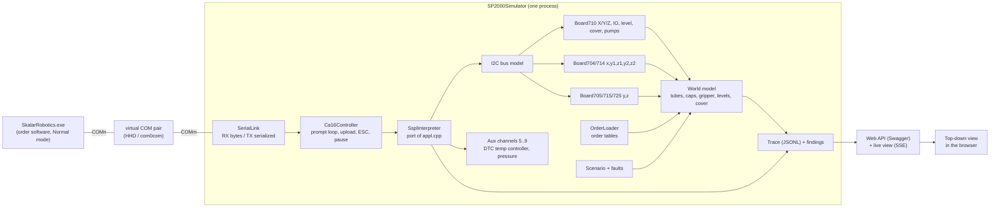

# Virtual Robot Simulator — Design

> **Goal:** A PC-side simulator of the SP2000 robot controller (CA16 board plus its motor/IO boards) on a virtual COM pair. Unmodified order software runs against it in **Normal** mode, so every action, sensor check and error branch runs its real code. Joost can then verify about 90% of a B-feature before the robot reaches him, and the robot can go straight to the lab.
> **Approach:** The firmware is the oracle. The controller behaviour below is read from `roboticsonefirmware` (CA16 `2CA16700/robot/appl.cpp`, the motor-board firmware, the DTC), not from the 2015 SSPL manual. The structure follows the in-house TOC simulator (ASP.NET Core Web API on a COM bridge), with test practice borrowed from the BV simulator (`fwsimulator`). The robot's world state (tubes, caps, gripper, levels, cover) is built from the order's own tables, and faults are injected per scenario.
> **Outcome:** Design only. No simulator code exists yet. The first slice is defined: replay RB-418 (99407519) end to end, error 121 → method 64 → recap → put-back, which Emulate could not show.
> **Scope:** Covers the standard templates (Testkit, BOD, Waters, Soil, Lutum) and the pack's own SSPL path. Waters ALS Canada (plugin path, `DILK`) is a later target. Open questions are in §12. Corrects several findings of `Virtual Robot SSPL Surface Spike.md` (§11).

**Date:** 2026-10-20
**Inputs:** `roboticsonefirmware` (master `f6eaf97`), `tocsimulator` (TOCSimulator, v1.9.0), `fwsimulator` (master), `SSPLv1.10.docx` (2015 manual), `Virtual Robot SSPL Surface Spike.md`, `Virtual Robot Simulation Test Plan.md`, the RB-418 analysis and logs.
**Repos:** cloned at the workspace root next to `robotics-core`, git-ignored: `roboticsonefirmware/`, `fwsimulator/`, `tocsimulator/`. Clone from `https://bitbucket.org/skalaranalytical/<name>.git` (same workspace as `robotics-core`); the simulator itself from `https://github.com/SkalarJoostE/Robotic-Simulator` into `Robotic-Simulator/`.

---

## 1. What "done" looks like

A developer implements a B-feature, builds it in the app, and then:

1. Starts the simulator against the order: it reads the order's tables and lays out the robot.
2. Loads a scenario, e.g. "PHRA tubes empty", "cap slips during decap", "no tube in rack 2 pos 19".
3. Runs the application with `Run-AppTest.ps1`. The robot is in Normal mode on the simulator's COM pair, the diluters are on the PSD6 simulator, and the meters are in Emulate.
4. Watches the top-down view live, and gets a trace afterwards: every program received, every reply, every state change, and every rule the simulator flagged (XY move with the probe down, an untaught position, a firmware hang).

**Acceptance for the first slice (S3):** the RB-418 analysis on 99407519 runs in Normal mode. With PHRA removed in the scenario, the log shows `GetErrorHandlingMethod: Error 121, Handler 64`, then `Action(00x0J)` recap and put-back with the gripper status `CAP` from the simulator. Afterwards the decapper is empty in the world state.

**What it will not do** (the remaining ~10% for the lab): taught coordinates against the real deck, liquid handling, real sensor tuning, mechanical clearance.

---

## 2. Fidelity rules

1. **Behave like firmware 5.1, quirks included.** Port `appl.cpp` structurally (one C# method per firmware function, each citing `file:line`) rather than writing a clean grammar. The quirks are the point: a program the robot rejects must be rejected here too.
2. **Strict where the firmware is strict, and louder.** Where the real controller silently misbehaves (an expression broken by a space, a `NEXT` without `FOR`, PRINT text containing `%`), the simulator does exactly what the firmware does *and* raises a **finding** in the trace. That is better than the robot, which says nothing.
3. **Hangs are silence plus a finding.** `LOCK`, a motor on a board that isn't fitted, homing with no sensor, and a negative `WAIT` all hang the real CA16. The simulator goes silent the same way (the PC times out as it would on hardware) and flags the cause.
4. **Unsupported means fail loudly, never optimistic success.** This is the rule that separates the simulator from Emulate.
5. **The world comes from the order's tables**, never from comments in `SSPLGenerated` (they disagree with the tables on 99407519's gripper polarity; see the spike report §5.1).
6. **Every rule names its source:** the firmware line, the order table row, or "engineering assumption — calibrate from logs".

---

## 3. Architecture



### 3.1 Solution layout (TOC naming)

| Project | Responsibility | Borrowed from |
|---|---|---|
| `SP2000Simulator.WebAPI` | Startup, command-line options, DI, controllers, static UI, SSE trace stream | TOC `Program.cs`, `ConfigurationSettings.cs`, controller style |
| `SP2000Simulator.Communication` | `ISerialLink` (real `SerialPort` or in-memory), byte channel, serialized writes | TOC `SimulatorService` serial handling, but **not** its fire-and-forget threading; fwsimulator `ISocketConnection` seam |
| `SP2000Simulator.Firmware` | `Ca16Controller` (prompt loop, upload, `D` block library, `B` matrix, `Q`/`L`/`U`/`R`/`Z`, ESC, 0x7F pause, pause button) and `SsplInterpreter` | Port of `appl.cpp` |
| `SP2000Simulator.Boards` | Motor/IO boards behind a register-level I2C model, TMC429 trapezoidal timing, homing, move-till-sensor, IO expanders 0x20–0x23 | Port of `21088710/704/705/724/725/726` |
| `SP2000Simulator.World` | Deck, vessels, caps, gripper contents, liquid levels, cover, sensor rules, geometry | New; spike §5 |
| `SP2000Simulator.Order` | Reads the order's tables (§7.1) into the world and the board configuration | New; reuses the `Profile.md` / table-reading logic idea |
| `SP2000Simulator.Aux` | Devices behind the CA16 aux ports: dual temperature controller (DTC), pressure sensor | Port of `DTC/Main.c` reply formats |
| `SP2000Simulator.Tests` | xUnit; in-memory serial link; `FakeTimeProvider`; golden replays of real logs | fwsimulator `SimulatorTests` (MockTcp, `TestScheduler`); TOC has none |

### 3.2 Threading

The CA16 is strictly sequential, so the simulator is too:

- **RX:** the serial callback pushes bytes into a `Channel<byte>`. **ESC (0x1B) is handled on the RX path itself**, as the firmware's RX interrupt does: it cancels the interpreter and reboots the controller state (`srlprt3.cpp:255-259`).
- **One controller task** runs the prompt loop and the interpreter and consumes the channel. 0x7F is checked only where the firmware checks it: after each keyword statement, and only as the first unread byte (`appl.cpp:2248-2253`).
- **TX** is a single serialized writer. The order of bytes on the wire is part of the protocol.
- Board motion runs on simulated time, and a waited `MOTOR` blocks the interpreter until the board reports idle, as on hardware.

### 3.3 Time

- Everything is behind .NET `TimeProvider`. A clock rate (as the PSD6 simulator's `clockRate`) speeds up moves, `WAIT`/`WAITMS`, the `S` seconds counter and heater ramps.
- **Limit:** the PC side waits in real time (its `SerialRead` timeouts, incubation and planner timers, BOD's 10 s resend). The simulator cannot compress those. Long applications still need shortened timing tables in the sandbox copy, as `Run-AppTest.ps1` runs do today.
- Tests use `FakeTimeProvider` for deterministic stepping.

### 3.4 Control API and UI

TOC-style attribute routing, Swagger always on, on its own port (TOC and BV both use 5140; pick another, e.g. 5180).

| Controller | Endpoints (sketch) |
|---|---|
| `Simulator` | `GET available-ports`, `POST start-listening/{port}`, `POST stop-listening`, `POST crash` (go silent), `POST reset`, `POST pause-button` |
| `Order` | `POST load` (order folder path), `GET profile` (boards, motors, IO map as loaded) |
| `Scenario` | `POST load` (JSON), `GET current`, `POST step/{id}` (fire a scheduled fault now) |
| `World` | `GET state`, `PUT vessel/{rack}/{pos}` (present, capped, volume), `PUT gripper`, `PUT cover` |
| `Signals` | `PUT input/{port}/{bit}` (force or stick), `PUT level/{n}`, `DELETE overrides` |
| `Clock` | `GET`/`PUT` rate, motion-time scale |
| `Trace` | `GET` (JSONL download), `GET stream` (server-sent events for the UI), `GET findings` |

The **top-down view** is a static page served by the WebAPI, fed by `Trace/stream`. TOC and BV have no UI (Swagger only), so this part is new. It draws:

- the deck from the order's `Position` rows in motor units, not from the RobotLayout designer, whose cup pitch is only visual;
- one marker per manipulator, coloured by Z (above or below travel height);
- vessel state (present, capped, in gripper, in decapper);
- a Z strip per manipulator, and the current program and its replies.

It is the same viewer that the log-replay idea needs, so it can also replay a real robot's `.glf` (§9).

### 3.5 Configuration and packaging

- Command line via System.CommandLine, as TOC: `--comPort`, `--order <path>`, `--scenario <file>`, `--clockRate`, `--firmware 5.1|5.00`.
- NLog with a configurable log folder (not TOC's hardcoded `c:/temp`).
- Packaging copies TOC: `.docker` socat modes (`local`, `tcp-listen`, `tcp-connect`) for CI, the `.pipeline` hbs generation, `.versionrc` + release bot, `build.bat` single-file win-x64, and `.editorconfig`.
- From fwsimulator: `TreatWarningsAsErrors`, and XML doc comments in Swagger.
- Target **net8.0** to match TOC's current branch. Its .NET 10 upgrade is in progress on a branch; follow whichever the team standardises on.

---

## 4. Wire protocol (CA16, firmware 5.1)

**Port:** 19200 8N1 (`robot.cpp:85,119`). On a virtual pair the baud rate is ignored, but keep it for fidelity.

| PC sends at the `A\r` prompt | Controller does |
|---|---|
| (startup) | After ~1.5 s plus board probing, sends `ESC CR`, then `A\r` (`appl.cpp:2296-2394`) |
| any command byte `c` | Echoes `c\r` first (`:2419`) |
| `A` + program | Stores the bytes; **echoes each line when its `CR` arrives**; `|` ends the upload and is **not** echoed; **one more byte is read and discarded** (`:2104-2117`). The PC's `END\r|\r` ends with exactly that byte. Then `A\r` |
| `C` | Runs the program. `PRINT(0,…)` → `H\r0\r` + text + `\n\r`. `END` → `|\r`. Then `A\r` (`:930-933`, `:1507-1597`) |
| `D` + library | As `A`, but `|` becomes `END\r` and the library runs at once (registers its `DEFBLOCK`s, sends `|\r`). Later uploads go after it (`:2120-2138`) |
| `E` | Forget the block library (`:2428`) |
| `B` + numbers | Matrix load, every byte echoed, replies an XOR checksum (`:2073-2098`); unused afterwards |
| `R` | Stirrers 1–3, pumps 1–4, magnets 1–2 off (`:2276-2294`) |
| `Q` | `0`/`1` + `\r`: cover lock sensor bit (`:2431`) |
| `L` | Lock cover, LED on, reply sensor bit (`:2430`); the 710 waits up to ~1.5 s for the sensor |
| `U` | Wait 300 ms, unlock, reply sensor bit, **then set Paused** (`:2429`) |
| `Z` | Dump program buffer, one byte per 20 ms (`:2432`) |
| ESC (any time) | **Hard reboot**: program, variables and blocks lost; re-announces `ESC\r` + `A\r` after ~1.5 s (`srlprt3.cpp:255-259`) |
| 0x7F (during a run) | Only if it is the first unread byte, checked after keyword statements: sends `7F 0D`, then discards everything up to and including `D` (not echoed), then resumes (`appl.cpp:2248-2253`) |
| pause button (sim API) | While running: `P\r` + `A\r` before the next statement, and the program **keeps running**. While idle: `P\r` or `N\r` (paused) (`:2146-2151`, `:2401-2413`) |

**Errors:** `F\r` + the offending line (≤ 80 bytes), then stop and prompt `A\r` (`:2262-2274`). A `NEXT` without `FOR` or an `ENDWHILE` without `WHILE` stops **silently** (no `F`, no `|`). The manual's `SSPL-ERROR n` messages do not exist.

**Other channel 0–3 output:** `INPUT` → `B\r<ch>\r` then blocks until CR. `GET` → `C\r`, blocks one byte. `INKEY` → `I\r<ch>\r`, then a non-blocking read. `CLS` → `K\r`.

**PC-side variants the simulator must satisfy** (spike §1.2): the BOD-family handshake reads one line per line sent; the others wait for `A` after the last chunk. The plugin client (`Translator\SP2000_1`) sends `\n`, where the pack sends `\r`. **The firmware treats LF as part of the line and fails it**; check what the plugin path actually puts on the wire before declaring the plugin path supported (ALS Canada only, §10).

---

## 5. Interpreter (port of `appl.cpp`)

`interprete.cpp` is dead code (not in `robot.hwp`). Everything is in `appl.cpp`.

| Aspect | Firmware behaviour | Cite |
|---|---|---|
| Model | Raw text, line by line, no tokenising; 20,000-byte buffer | `appl.h:181` |
| Line ends | **CR only.** Blank lines, leading spaces, LF and comments are syntax errors. Uppercase only | `appl.cpp:2153-2235` |
| Matching | Prefix match against the keyword table, in table order; then CHAR-array assignment; then `var=` assignment; else `F` | `:15-72`, `:2153-2235` |
| Variables | 260 × 16-bit signed; `A`–`Z` + optional digit; **`A0` = `A`** | `appl.h:184`, `:2020-2045` |
| `S` | var[18], +1 per second, unsigned 16-bit seen as signed (negative after 32767 s), writable | `:100`, `SOSX/sosx.cpp:356-367` |
| `$` | 240-char string; boot version string; written by `INPUT(ch,$)` | `appl.h:83`, `:2309` |
| Expressions | **Left to right, no precedence, no parentheses**; `+ - * / &`, **`^` = OR**; any other character skipped, so a space silently drops the rest of the term | `:2047-2064` |
| Conditions | `IF`/`WHILE` with a variable on the left; `= < <= <> > >=`; no `ELSE` | `:978-1004` |
| Nesting | `WHILE` and `FOR` ≤ 9 levels; `BLOCK` call depth ≤ 5; **none checked** | `appl.h:43-63` |
| `FOR` | Test after the body (`V++ == b`): runs at least once; V ends at b+1 | `:1842-1858` |
| Blocks | A block exists only after its `DEFBLOCK` line has executed | `:885-922` |

**Keywords to implement for the standard templates:** `IF`/`ENDIF`, `WHILE`/`ENDWHILE`, `FOR`/`NEXT`, `DEFBLOCK`/`ENDBLOCK`/`BLOCK`, `END`, assignments, `PRINT`, `WAIT`, `WAITMS`, `MOTOR(0–10)`, `PORTIN`/`PORTOUT`/`PORTINBIT`/`PORTOUTBIT`, `GRIP`, `READLEVEL`, `LEVEL`, `MAGNET`, `PUMP`, `STIRRER`, `OPEN`/`FLUSH`/`INPUT`/`INKEY`/`BINKEY`/`GET` on aux ports 5–9.

**Later:** `DILK` (ALS Canada), `CHAR`/`INT2ASC`, `LIFT`/`TUBEA`/`BRIDGE`/`TROLLEY` (legacy, partly broken in firmware; flag on use).

**Hangs to reproduce** (silence plus a finding): `LOCK`; a motor or board that isn't fitted; homing with no sensor; `MOTOR(8)` that never sees the sensor below `maxpos`; negative `WAIT`; `GET`/`INPUT` with no reply; DILK diluter overload (bit 4).

**Findings the simulator adds** (the robot is silent about these):
- a space inside an expression;
- `%` in PRINT text (the firmware passes it to `vsprintf`);
- PC-port output over 127 bytes;
- an upload line over ~127 bytes;
- nesting over the unchecked limits;
- `MOTOR(6)` truncating a position beyond ±32767;
- a `MOTOR(3)` position beyond ±32767.

---

## 6. Boards and motion

| Motor | Board (I2C addr) | Axes |
|---|---|---|
| 0, 1, 2 | 710 (0x75) | X, Y (**board negates Y**), Z |
| 3–7 | 704 (0x77) | x, y1, z1, y2, z2 |
| 8–12 | 714 = second 704 (0x7A) | as 704 |
| 13, 14 | 705 (0x76) | y, z |
| 15, 16 | 715 (0x78) | y, z |
| 17, 18 | 725 (0x79) | y, z |

- **Fitted boards come from the order's motor numbers**, not from guesswork: the enabled `MotorConfiguration` rows, routed as the CA16 does (0–2 the 710, 3–7 the 704, 8–12 the 714, 13–14 the 705, 15–16 the 715, higher the 725). The 710 is always fitted. *(Corrected 2026-10-20, S2/S3.)* `DeviceConfiguration.FirmwareVersion` does **not** say which boards are fitted, because it is often a template default. 99444892 (BOD) carries 99407519's string `1088 version 5.00 714: 705:3.0 710:5.2 715:3.0` but drives a 704. The string only supplies the versions of the boards the motors justify (`SP2000Simulator.Order`, `OrderSnapshot.FittedBoards`/`BoardSpec`). Only a log's `$` register shows a board that no motor uses, such as 99407519's `714:`. A command to a board that isn't fitted hangs (rule 3).
- **Motion:**
  - TMC429 trapezoidal ramp, 16 microsteps. `MOTOR(1)` sets VMax/AMax in raw chip units (0–2047), default VMax 1000 and AMax 500, pulse_div 3, ramp_div 7 (`tmc429.cpp:45-48, 592-646`).
  - Steps/s = f_clk·v / (2^pulse_div · 2048 · 32). **f_clk is not in the source** (§12).
  - Until it is known, calibrate a scale factor from real logs: `MOTOR(0,14,1525,1)` returned `A` 1.36 s after `C` on 99407519. The RB-418 log has thousands of timed moves to fit against.
- **Correction factor** `MOTOR(4,m,f)`: board steps = f·pos; readback = raw/f; the sign follows the homing direction (`MOTOR(5)` flips it). Default 1.
- **Homing** `MOTOR(5,m,dir,move[,sensor[,reset]])`: run at VMax to the sensor, stop, 500 ms, back off at v=30 until clear, stop, 500 ms, zero if reset. With `move=0`, only declare here = 0 (`danalyzer.cpp:31-218`).
- **Mid-move positions** are needed: the BOD/Waters/Soil family polls `MOTOR(6)` every 100 ms during a non-waited move (spike §1.2). The board model therefore exposes position as a function of simulated time.
- **IO:**
  - `PORTIN`/`PORTINBIT` ports 1/2 are I2C expanders 0x22/0x23; `PORTOUT` ports 1/2 are 0x20/0x21. Which bit is which sensor is wired per system, so it comes from `IOConfiguration` (`Board`, `Port`, `InvertedSensor`, `ActivateOutputBit`).
  - `GRIP(0,n)` is the 710 reed, `GRIP(1,n)` the 710 opto bit, `GRIP(2,…)` the raw `LOCKSENS` (bit 0 lock, bit 1 pause button, active low).
  - `READLEVEL(n)` is the level input.
  - **`MAGNET(3) ON` unlocks the cover.**

---

## 7. World model

### 7.1 Built from the order's tables

| Table | Gives |
|---|---|
| `MotorConfiguration` | Motor numbers per manipulator axis, travel heights, speeds; `HomeWithIO` + `IOHomeSensor` |
| `ManipulatorDefinition` | Manipulator → X/Y/Z motors, group, `FillPump`, sprayer IO |
| `Position`, rack CoordX/CoordY, `HeightDefinition` | Where every vessel is, and which Z means "in the vessel / at the cap / clear" |
| `IOConfiguration` | Every input and output: board/port/bit, polarity (`InvertedSensor`, `ActivateOutputBit`), grip and level-detect rows |
| `GripperManipulatorConnection` | Gripper output, `Sensor1`/`Sensor2`, decapper bellow and rotate motor |
| `PumpSettings` | Pump → level detector (fill-stop programs) |
| `ShakerConfiguration`, `CapFlipper*` rows | Cylinders and their end-stop sensors |
| `TemperatureBoardConfiguration`, `RobotSettings` | Aux port numbers (DTC, pressure sensor), `BypassCoverLock`, new-lock flag |
| SampleAnalysis / reagent tables of the run | Initial deck contents: which slots hold tubes, which are capped, reagent volumes |

### 7.2 State and sensor rules

Entities: **manipulators** (pose per motor), **vessels** (location: rack slot / gripper / decapper / waste; capped; volume), **caps** (on vessel / in gripper), **gripper** (jaw open/closed, holding), **decapper** (bellow clamped), **cylinders** (shaker, cap flipper: commanded vs reached, with lag), **level detectors** (enabled, liquid at probe tip), **cover** (closed, locked), **outputs** (pumps, stirrers, magnets).

Every sensor reading is a rule over that state, keyed to an `IOConfiguration` row and inverted per `InvertedSensor`. The first rules (spike §5.2, RB-418):

| Sensor | Reads active when |
|---|---|
| Gripper cap-presence (99407519: in 1.8) | An object top (cap or capped tube) is inside the gripper window at the current Z |
| Gripper jaw sensors (2-sensor grippers) | Jaw state + object present → CLOSED/OPEN/CAP |
| Level detector n | Enabled, and the probe tip Z is below the liquid surface of the vessel under it |
| Home sensor | Axis at its home end |
| Shaker/flipper end stops | Cylinder has reached the commanded end (after its travel time) |
| Cover lock (`LOCKSENS` bit 0) | Cover closed and locked |

Transitions follow the outputs: gripper closes on an object inside the window → holds it; holding + Z up → the object moves with the gripper; decap (bellow clamped + rotate) → the cap stays in the gripper and the tube stays in the bellow; open at drop height → released into the vessel location under it.

**Geometry rules flagged as findings, not failures:** an XY move while a Z axis is below travel height; a target that resolves to 0,0 (untaught); two manipulators closer than `CollisionSettings.SafeDistance` at move endpoints; a vessel entered while capped.

### 7.3 Scenarios and faults

A scenario is JSON next to the test, versioned with it:

```json
{
  "order": "99407519",
  "deck": { "reagents": { "PHRA": [] } },
  "faults": [
    { "when": "decap", "nth": 1, "do": "cap-slips" },
    { "input": "1.8", "stuck": 1, "from": "sample:3" },
    { "level": 2, "never": true }
  ],
  "pauseButton": [{ "atSeconds": 120 }],
  "expect": { "worldAtEnd": { "decapper": "empty" } }
}
```

Faults are single toggles on the world state (cap slips, tube missing, sensor stuck, level never reached, cylinder never reaches its end stop), plus controller events (pause button, ESC/power loss, crash = silence). That is how a B-feature's error branch gets exercised on purpose.

---

## 8. Aux devices

- **Dual temperature controller** (DTC v3.03, 9600 baud, CR-terminated, no echo):
  - `STA n`/`STB n` → `RSTA=…`; `THA`/`THB` → `%4.1f\r` with no prefix; `TCA`/`TCB`, `TSM`, `RAPS` → `%4.2f\r` bar.
  - On a sensor fault it replies `999.9\n` (**no CR**, so a waiting `INPUT` blocks).
  - Model a first-order heater ramp. The knock-out timer zeroes both setpoints when nothing arrives in time (`Timer.c:158-171`).
- **Pressure sensor** (`PRESSURECHECK` → `RAPS`): a scenario value.
- **Diluters stay on the PSD6 simulator.** Kloehn through `DILK` is ALS-only and later. Rule from the PSD6 work: nothing else may use a COM name that a simulated device is on, not even an emulated device.

---

## 9. Trace, findings and the log-replay viewer

- **Trace (JSONL):** every byte block in and out, every program with its echoes, each statement with its result, board commands, world-state changes, scenario events and findings. Each line carries simulated and wall time.
- **Findings** have stable IDs (as `Validate-Package.ps1` rules do) and a severity, and are listed at the end of a run with the program line and the PC-side action that sent it.
- **Correlation with the PC log:** `Assert-RunLog.ps1` already compares the app's action trace against a baseline. Add a check that every `F` (syntax error) and every finding is zero, or explicitly accepted.
- **Replaying a real robot's log** uses the same viewer: feed it the `Outgoing data` lines and movement captions from a `.glf` (Loupe) instead of the live stream. That serves RB/ES tickets, where the real robot's IO is in the log.

---

## 10. Integration with the existing tools

| Tool | Change |
|---|---|
| `Set-EmulationMode.ps1` | Add a mode that puts the **robot** in Normal on a given COM port (`DeviceConfiguration` robot row `OperationalMode` = Normal, `PortNumber` = the PC end of the pair), keeps diluters on the PSD6 simulator or emulated, and leaves meters in Emulate. `-Restore` puts it back byte for byte, as today. It still refuses an SVN working copy. |
| `Run-AppTest.ps1` | `-Simulator <url>`: load order + scenario, start listening, run, collect the trace and findings, stop. |
| `Assert-RunLog.ps1` | Fail on unaccepted simulator findings or `F` errors. |
| `Validate-Package.ps1` | Its static pass runs first; the simulator is the runtime pass. |
| Diluter Upgrade Kit | Unchanged; already uses the PSD6 simulator. The two simulators run side by side on separate COM pairs. |

**Plugin path** (Waters ALS Canada): it sends `\n` line ends, and the firmware only accepts CR. Capture what really goes on the wire (a real ALS log) before supporting it.

---

## 11. Corrections to `Virtual Robot SSPL Surface Spike.md`

| Spike said | Firmware says |
|---|---|
| `G` = overload; ALS answers `D`/`W` | **No stall/overload detection exists** (StallGuard disabled, `danalyzer.cpp:152`). `D` only resumes from a 0x7F pause; `E` resets the block pointer; `F` is the syntax-error prefix. The PC's `G`/`D`/`W` handling is dead on firmware 5.1 |
| Interpreter needs `$` register semantics from a spec | `$` is a 240-char string, the boot version string or the last `INPUT` (§5) |
| `S` resolution and rollover unknown | 1 s, unsigned 16-bit seen as signed (§5) |
| Integer vs float unknown | 16-bit signed integers only; `MOTOR(4)` takes a double factor |
| `GRIP`, `READLEVEL`, `MOTOR(5/8)` need a spec | Answered in §6 |
| Motion timing needs a spec | Formula known; f_clk missing (§12) |
| The echo comes from the controller | Confirmed, with the exact rules (§4) |
| `SSPL-ERROR n` (manual) | Doesn't exist; only `F\r` + line |

---

## 12. Open questions and decisions

1. **Field firmware versus the repo — mostly answered (2026-10-20).** Git cannot show it: the repo is one import (2023-01-31). The changelog at the bottom of `2CA16700/robot/version.h` can: 5.00 = expanded cover lock (ROF-9), **5.1 = "Implement Continue in de firmware" (ROF-14)**, 5.2 = print the 714 version (ROF-16; the string still says 5.1). So 99407519 (5.00) differs from the repo only by ROF-14, almost certainly the pause → continue path. Build to 5.1 and make Continue a switch; confirm the exact change from the ROF-14 Jira ticket. The motor boards differ too (99407519: 710 5.2; repo: 710 5.7).
2. **TMC429 clock (f_clk) — not known by anyone.** Fit a scale factor from the RB-418 log's timed moves in S2.
3. **Where the simulator lives — decided (Joost, 2026-10-20).** A private GitHub repo, `SkalarJoostE/Robotic-Simulator`, cloned inside the workspace at `Robotics-AI\Robotic-Simulator\` (git-ignored, like `robotics-core`). Sessions open at the Robotics-AI root. It can move to a company organisation, or to Bitbucket if the simulator team adopts it. CI is GitHub Actions instead of TOC's Bitbucket pipeline.
4. **Virtual COM driver — com0com recommended** (free, open source, signed, scriptable with `setupc.exe`), with socat in Docker for CI. HHD stays for the PSD6 simulator for now. On Joost's PC the HHD pair is currently **COM1 ↔ COM2**; COM3 is a physical port.
5. **Wiring knowledge not in any table.** Which physical sensor sits on which `PORTIN` bit is in `IOConfiguration` per order. Anything the software reads but no table describes (e.g. home sensors on boards without `HomeWithIO`) needs a default and a finding.

---

## 13. Delivery slices

| Slice | Content | Proof |
|---|---|---|
| **S0 Skeleton** | Solution layout, options, serial link (real + in-memory), Swagger, trace, packaging copied from TOC | Starts on a COM pair; `ESC` → `ESC\r A\r` |
| **S1 Protocol + interpreter** | §4 and §5 for the standard keywords; strict errors; findings | **Golden replay:** feed the RB-418 log's `Outgoing data` programs and compare the echo/`A`/`H`/`|` stream byte for byte (the 101k "Unexpected default" lines in that log are the expected echoes) |
| **S2 Boards + motion** | Motor map, timing, homing, mid-move positions, IO expanders, cover | `ConnectAndReset` + `InitRobot` + `HomeAndGetPositions` of 99407519 and of the BOD template pass in Normal mode; move durations within a set tolerance of the log |
| **S3 World + RB-418** | Order loader, world model for the 99407519 gripper/decapper/bellow, scenarios | §1 acceptance: error 121 → method 64 → recap → put-back end to end |
| **S4 Viewer** | Top-down view + Z strip, live and from a `.glf` | RB-418 run watched live; the same view replays the 7 Oct customer log |
| **S5 Template rollout** | BOD/Waters/Soil polling family, level-detect fill stop, shaker, cap flipper, Lutum temperature blocks via the DTC | A smoke run per template |
| **S6 Later** | ALS Canada (plugin path, `DILK`), firmware-version switches | — |

S0–S3 is the decision point: if RB-418 runs end to end, the approach is proven for the template Emulate hides most.
