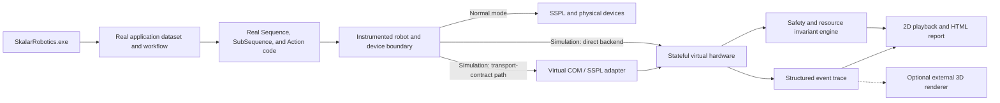

# Virtual Robot Software-in-the-Loop Test System — Implementation Plan

> **Status: PROPOSED.** Created 2026-08-03. This plan describes a staged route from the current
> optimistic emulation mode to a deterministic software-in-the-loop (SIL) test system. It does not
> authorize changes to Robotics Core, Robotics Plugin, application templates, SVN, Jira, or release
> packages. Estimates are provisional until the Phase 0 architecture spike is complete. Consolidated
> on 2026-08-03 with the useful static-validation and virtual-COM ideas from
> `Robot Test Harness Plan.md`; this document is the authoritative implementation roadmap.

## Decision summary

Build a Skalar-specific, deterministic virtual robot that runs the real `SkalarRobotics.exe` host,
the real application dataset, the real workflows, and the real `Skalar.Pack1.dll` action code. Only
the physical hardware and communication boundary is replaced.

The recommended sequence is:

1. Build a context-aware static package validator and a trace auditor around current emulation.
2. Run a time-boxed virtual-COM/SSPL feasibility spike against representative real programs.
3. Add a distinct **Simulation** mode with stateful virtual motors, sensors, IO, and devices.
4. Add automated scenarios, safety assertions, semantic regression traces, and reporting.
5. Roll the system out template by template.
6. Add a 3D renderer only if the deterministic kinematic model leaves a demonstrated gap.

Do not make a general-purpose physics simulator or a separate implementation of the Skalar
workflow engine. The real production workflow and action code must remain the system under test.

## Problem statement

Current emulation is useful for checking whether software can start and proceed through a workflow,
but it is optimistic at the hardware boundary. It cannot reliably answer questions such as:

- Did the intended manipulator move to the intended physical position and height?
- Did an XY move occur while a probe, needle, or gripper was still below travel height?
- Could two parallel branches collide or wait forever on each other's resources?
- Was a manipulator, motor, IO, pump, diluter, or vessel lock leaked?
- Did a pump, valve, stirrer, gripper, or meter perform a physically meaningful operation?
- Does initialization, error recovery, stop, and finalization leave the system safe?
- Did a new feature change the behavior of another application in the same software package?

The target is not to eliminate physical FAT. The target is to catch software, sequencing,
configuration, kinematic, resource-ownership, and device-state errors immediately after a change,
before robot time is required.

## Current-state evidence

The current architecture is suitable for an incremental SIL system:

- The XML is the runtime source of truth. It is compiled by the application into
  `SkalarPacks/Skalar.Pack1.dll`; the generated `SkalarPackSolution` is only a developer mirror.
- Actions already execute through the real Sequence/SubSequence engine and carry `SequenceInfo`,
  sample context, and `ProcessID`.
- `Action20x00` resolves the actual table-driven location, rack position, sample position, and
  target height before calling `MoveToPositionXY` or `MoveToPositionXYZ`.
- The movement layer already has safe-travel logic, coordinate calculation, endpoint collision
  handling, current/target motor positions, and manipulator definitions.
- Motors, IO, and pumps already use the central `ObjectLock` structure keyed by resource name and
  owned by `ProcessID`.
- Current SSPL emulation returns success without serial communication. A waited motor movement
  subsequently sets its current position directly to the target. This is why a workflow can pass
  without proving realistic motion or feedback behavior.
- The serial controller receives complete SSPL programs through the `A` / chunked program / `C`
  exchange. Generated programs use control flow, input, timing, motor, IO, and device-specific
  operations, so a virtual COM controller is potentially a firmware interpreter rather than a
  small command stub.
- `MotorConfiguration` supplies motion parameters and current/target state, but it is not a complete
  source of mechanical minimum/maximum limits or collision geometry. Those values need a separate,
  versioned and reviewable source.

Relevant BOD template entry points used for the initial design:

- `SSPL/SSPL_Serial.cs`: `Emulation`, serial bypasses, and `RunSSPL` fake return behavior.
- `SSPL/SSPL_Functions.cs`: `MoveMotor`, position updates, homing, IO, and raw SSPL functions.
- `Structure/2 - Movements/Tables and Functions/Motor.cs`: safe movement, collision checking, and
  motor locking.
- `Structure/1 - General/Tables and Functions/CommonActions.cs`: `ObjectLock`, `CheckObjectFree`,
  `LockObject`, and `UnlockObject`.
- `Structure/0 - SplitMergeSub`: action execution and parallel split/merge behavior.
- `Generated/Workflow`: application lifecycle state machines.

## Goals

The system must:

- Execute production workflow and action code, not a rewritten test copy.
- Load the selected template or order's real configuration tables.
- Validate action, subsequence, table, setting, hardware, and coordinate references before runtime,
  including recursively inherited `SequenceInfo` values.
- Model motor and manipulator state over time rather than snapping directly to success.
- Preserve and inspect existing `ProcessID` resource locking and parallel behavior.
- Detect general safety and consistency violations automatically.
- Support deterministic device replies and deliberate fault injection.
- Produce a replayable, reviewable record of every meaningful operation.
- Run a repeatable smoke/regression suite across all relevant applications in a package.
- Test the selected package with its exact Core and Plugin versions unless a version migration is
  itself the subject of the test.
- Keep Normal mode behavior unchanged and make simulation impossible to enable accidentally on a
  production installation.

## Non-goals

The first production-capable version will not attempt to model:

- Exact fluid dynamics, splashing, bubbles, wet chemistry, or probe response physics.
- Mechanical backlash, belt stretch, tube routing, cable drag, wear, or manufacturing tolerances.
- Calibration of real rack and height coordinates against a physical bottom plate.
- High-fidelity cap deformation, needle flex, or gripper contact forces.
- A photorealistic 3D representation of every order.
- Replacement of final physical FAT and safety validation.

These may be added later when a concrete defect class justifies the cost.

## Proposed architecture



### Architectural rule: two observation levels

A low-level SSPL emulator alone would have to infer meaning from motor numbers and command strings.
A high-level action simulator alone could miss malformed raw SSPL and device behavior. Use both:

1. **Semantic events** at the movement, IO, pump, diluter, gripper, measurement, and lock APIs.
   These events retain manipulator name, logical location, coordinates, `ProcessID`, action ID, and
   sample context.
2. **Virtual hardware responses** below those APIs. This layer owns motor progression, sensors,
   acknowledgements, timeouts, and device replies.

The production path must use the same high-level methods. Simulation changes only the backend and
adds passive observation/assertions.

The virtual-COM path is a compatibility and transport-contract adapter, not automatically the main
test oracle. It can prove that the real application serializes valid SSPL and can support unchanged
historical binaries. It cannot, by itself, recover action identity, inherited `SequenceInfo`, sample
context, `ProcessID`, or lock ownership. Expanding it into a general SSPL/firmware emulator requires
an explicit go/no-go decision after the Phase 0 command-coverage measurement.

### Runtime mode

Keep the existing behavior available as **Emulate** and introduce a separate **Simulation** mode.

| Mode | Purpose | Hardware behavior | Validation |
|---|---|---|---|
| Normal | Production and FAT | Real serial/devices | Existing runtime checks |
| Emulate | Fast optimistic/manual checks | Existing immediate fake success | Existing checks only |
| Simulation | SIL and regression tests | Stateful deterministic virtual hardware | Full invariant engine |

Phase 0 must decide how to represent the new mode without breaking compatibility with the existing
external `OperationModes` enum. A separate simulation profile/configuration is safer for the first
prototype than changing a shared enum used by historical binaries.

### Where the implementation should live

Keep substantial simulation logic out of per-order XML:

- A versioned external simulation runtime should own virtual state, scenario parsing, assertions,
  trace storage, and reporting.
- Application/template code should contain only thin, stable hooks at semantic operation and lock
  boundaries.
- The lowest-level robot/device transport should select either the real or virtual backend.
- Any C# hooks added to an application pack must be synced back to the XML source of truth using
  `Sync-ActionCode.ps1`; changes in the generated mirror alone do not run.

The Phase 0 spike must compare three injection approaches before code is committed:

1. A shared external DLL called by thin hooks in the pack's `Robot` partial class.
2. A virtual `Device`/transport implementation selected through `DevicePool`.
3. A host-level service exposed through Robotics Core and accessed from the pack.

The likely result is a hybrid of 1 and 2: semantic hooks are needed because `ObjectLock` and logical
movement context are inside the pack, while a virtual transport is needed for realistic feedback.

## Major components

### 0. Static package validator

Run a read-only validator before launching a scenario. It should load the runtime XML sources and
report definite errors separately from warnings.

Minimum checks:

- Every enabled `MethodType`, Sequence, SubSequence, action, and nested method reference resolves.
- Sequence/SubSequence traversal is recursive, ignores disabled `SequenceNumber = -1` rows, and
  detects missing targets and cycles that are not explicitly supported.
- Required action fields are evaluated after resolving inherited `SequenceInfo` through the parent
  action/subsequence chain; a field absent on a child row is not automatically an error.
- Logical locations, manipulators, motors, racks, rack positions, heights, IO, pumps, diluters,
  probes, devices, settings, and dropdown references resolve consistently.
- Action existence is checked against the runtime sources in `SkalarPacks.TreeDatabase.Xml` and all
  relevant `ExtensionUnit.*.xml` files, not only the generated `SkalarPackSolution` mirror.
- Shared versus per-application table placement is respected when validating settings and rows.
- Coordinates are finite and complete; mechanical envelopes are checked only when a reviewed
  machine profile supplies them.

The validator should emit stable rule IDs and machine-readable output so the same checks can run
locally, in CI, and as part of a scenario evidence bundle.

### 1. Simulation orchestrator

Responsibilities:

- Select a software package, application, method, and scenario.
- Verify the package builds and load the real compiled pack.
- Prepare settings, SampleAnalysis rows, standards, blanks, QCs, and virtual-device scripts.
- Start, pause, stop, and wait for the real application lifecycle.
- Collect completion state, exceptions, trace, invariant violations, and coverage.
- Restore or discard the temporary analysis dataset after the run.
- Preserve and report the package's original Core and Plugin fingerprint. Do not replace historical
  plugins with newer emulation implementations unless the scenario explicitly tests that upgrade.

The first version may drive a visible application window. Headless execution is desirable, but it
must not delay proving the virtual hardware and invariant model. A separate host-automation spike
will determine whether Robotics Core can safely expose a command-line test entry point.

### 2. Structured event stream

Use a versioned append-only format such as JSON Lines. Each event should include where applicable:

- Simulation time and monotonic sequence number.
- Software/template identity and core/plugin fingerprint.
- Application, method, Sequence/SubSequence, action class, and action description.
- Sample identity, rack, position, and parameter.
- `ProcessID`, thread/branch, resource name, and lock owner.
- Manipulator, logical location, X/Y/Z start and target, movement flags, and speed.
- IO, pump, valve, stirrer, gripper, diluter, meter, and sensor state.
- Result, error code, exception, and correlation ID.

The trace contract must be semantic and versioned. Regression comparison should ignore volatile
fields such as timestamps and thread IDs unless timing/ordering is itself under test.

#### Trace comparison and determinism contract

Parallel branches execute on real OS threads: `ParallelSubSequenceExecutor` and `PlanAndExecute`
use `BackgroundWorker`. Cross-branch interleaving is therefore not reproducible without replacing
the production execution engine, which this plan forbids. Determinism means **semantic equivalence
under a partial order**, not global byte equality.

Each branch execution must carry both its hierarchical `ProcessID` and a stable
`branchInstanceId`. A `ProcessID` describes the branch path but can be reused when the same flow is
executed again; the instance ID distinguishes those executions. It must be deterministically
assigned or canonicalized from branch creation order and parentage for comparison.

- **Within a branch instance:** semantic events must be identical between runs in event identity,
  order, and normalized payload.
- **Across branches:** incidental OS-thread interleaving is ignored, but causal relationships are
  preserved.
- **Automatic causal edges:** parent action to child action, split to branch start, device request
  to response, lock release to the next acquisition, and branch completion to merge are recorded
  and compared automatically.
- **Scenario-declared ordering:** a scenario may add required happens-before relationships, such as
  decap completing before a needle enters a vessel. These supplement the automatic causal edges.
- **Normalized out:** wall-clock timestamps, thread IDs, canonicalized correlation/branch IDs,
  virtual-time values that do not affect behavior, and unconstrained cross-branch event position.
- **Never normalized:** event identity, semantic payload, per-branch order, error/exception content,
  resource ownership, and automatic or declared causal edges.

Comparison uses a canonical serialization. Strict byte equality of the normalized trace is
required only for single-branch scenarios; multi-branch scenarios must satisfy the partial-order
contract above.

### 3. Virtual robot state

Build the model from the selected software's tables rather than hard-coding one BOD layout:

- `MotorConfiguration`: availability, motor number, direction, speed, acceleration, conversion,
  current/target position, and travel height.
- `ManipulatorDefinition`: manipulator group and X/Y/Z motor mapping.
- `Position` and rack/tray definitions: X/Y geometry and sample pitch.
- `HeightDefinition`: travel, dispense, measure, rinse, and other named heights.
- `IOConfiguration`, pump settings, and level detectors.
- `DeviceConfiguration`, probes, flow cells, diluters, grippers, and PBF configuration.

Mechanical limits and collision geometry must come from a versioned machine profile. Every profile
value must name its provenance: firmware constraint, mechanical drawing, validated positioning
data, measured reference robot, or reviewed engineering assumption. Do not infer complete motor
bounds from `MotorConfiguration` alone.

Minimum state model:

- Motor pose, target, velocity, busy/idle, homed, and fault state.
- Manipulator pose and swept path.
- Cover open/closed/locked.
- Digital inputs and outputs.
- Pumps/stirrers/valves on/off and resource ownership.
- Vessel identity, occupied/empty, capped/decapped, and optional approximate volume.
- Device connected/initialized/zeroed/calibrated state and scripted measurements.

### 4. Transport adapters and SSPL feasibility

Support two replaceable routes into the same virtual-hardware state where practical:

1. An in-process backend used by most deterministic SIL scenarios.
2. A virtual-COM/`DevicePool` adapter used to exercise the real serial and SSPL serialization path.

The virtual-COM adapter must implement the real handshake and preserve every received program and
response as evidence. Its supported SSPL grammar and commands must be explicit and versioned.
Unknown syntax or unsupported device operations fail clearly; they never return optimistic success.

Phase 0 must capture representative programs from initialization, Park, Syringe Check, and one
multi-sample analysis. Continue expanding the adapter only if that corpus shows tractable coverage
and the maintenance cost is justified. Otherwise retain it for focused transport-contract tests and
use the in-process backend for the main simulator.

### 5. Deterministic virtual time

Real analyses contain sleeps, polling loops, incubation, timeouts, and background workers. A useful
regression suite cannot wait in wall-clock time.

Introduce a clock abstraction for new simulation-facing waits and progressively route existing
wait helpers through it. In Simulation mode:

- Motor duration is calculated from distance, configured speed, and acceleration using a simple,
  deterministic approximation.
- `Thread.Sleep`-style process waits advance virtual time where safely interceptable.
- Sensor and device scripts schedule replies on virtual time.
- Repeating the same scenario produces the same per-branch behavior, causal relationships, and
  normalized output under the trace determinism contract.

Do not attempt a broad mechanical replacement of every `Thread.Sleep` at once. Start with the
shared `Utilities.Wait`, motor polling, device timeout, and initialization paths required by the
pilot scenarios, then expand from measured coverage.

### 6. Safety and consistency invariant engine

Every invariant carries both a **data tier** and a **minimum execution capability**:

- **Tier A — configuration/model derived.** Evaluable from the package tables, scenario initial
  state, semantic event stream, and virtual state without separately authored mechanical limits or
  3D geometry. Some Tier A rules need only static/trace data; position-dependent Tier A rules require
  the Phase 2 stateful motor model.
- **Tier B — machine-profile dependent.** Requires separately authored and reviewed mechanical
  limits, endpoint envelopes, or physical geometry. The rule identifies whether it needs a simple
  machine-profile envelope or full swept-volume geometry.
- **Capability: Static, Trace, or Stateful.** This records whether a rule can run in the package
  validator, needs runtime semantic events, or needs the stateful virtual backend.

A rule must not be enabled until its required data and execution capability exist and have been
reviewed. Until then it reports **`NotEvaluated`**, never `Pass`. Every report shows Pass, Fail, and
`NotEvaluated` counts, with the missing input or capability for every unevaluated rule.

The first invariant catalogue should include:

#### Geometry and movement

- Every logical target resolves to finite X/Y/Z coordinates. **(Tier A, Static/Trace)**
- Every target lies within the configured motor bounds or an explicitly approved envelope.
  **(Tier B — machine-profile limits, Stateful)**
- XY movement starts only when every affected Z manipulator is at or above travel height, unless
  the action explicitly declares and satisfies a reviewed exception. **(Tier A, Stateful)**
- The complete swept path remains outside rack, vessel, frame, and manipulator exclusion volumes.
  **(Tier B — authored geometry, Stateful; deferred until a recurring defect class justifies it)**
- Manipulator-to-manipulator separation stays above the configured safe distance at movement
  endpoints. **(Tier A using `CollisionSettings.SafeDistance`, Stateful)** Full-path separation,
  including concurrent motion, is **Tier B — authored geometry**.
- A move to a sample, source, rinse, waste, maintenance, or instrument position uses the expected
  rack/position and target-height category. **(Tier A, Trace)**
- Motor current and target state remain internally consistent after completion, stop, and failure.
  **(Tier A, Stateful)**

#### Resource ownership and concurrency

These rules are Tier A and require Trace capability unless a rule explicitly states otherwise.

- Only the owning `ProcessID` can release a lock.
- A process cannot command an incompatible target on a resource owned by another process.
- All locks acquired by an action/branch are released at the expected merge or terminal state.
- No lock remains after finalization.
- A wait-for graph is maintained; a cycle fails immediately as a deadlock instead of waiting 60
  seconds repeatedly.
- Split/merge completion cannot hide an exception from a child branch.

#### Process and hardware state

These rules are Tier A and generally require Stateful capability. A future rule requiring physical
clearance or authored geometry is Tier B.

- A capped vessel is not entered with a probe/needle unless the configured operation permits it.
- Pumps, stirrers, valves, reels, and continuous motors do not remain active after their owning
  action, stop flow, or finalization.
- A measurement requires the configured device, probe, initialization, and any required blank or
  calibration state.
- A diluter cannot dispense more than its modeled syringe contents or through an invalid port.
- Initialization establishes the required home and connected states before analysis movement.
- Graceful and abrupt finalization both end in an explicitly defined safe state.

Invariant severity should be `Error`, `Warning`, or `Information`. Only reviewed suppressions tied
to a specific action/template/order may downgrade a rule; global suppression should be avoided.

### 7. Scenario definition

Store scenarios as reviewable JSON or YAML outside production application XML. A scenario contains:

- Software package and application selector.
- Exact Core, Plugin, pack, XML, simulator, machine-profile, and expectation versions.
- Method and application settings overrides.
- SampleAnalysis rows and selected parameters.
- Initial virtual hardware state.
- Scripted device values, delays, and faults.
- Expected terminal state and optional semantic milestones.
- Enabled invariant profile and reviewed exceptions.

Example intent:

```yaml
name: bod-syringe-check-two-samples
application: SyringeCheck
method: Syringe check
samples:
  - { rack: 1, position: 1, type: Sample }
  - { rack: 1, position: 2, type: Sample }
devices:
  cover: closed
expect:
  terminal_state: Finished
  no_error_invariants: true
  final_location:
    TRANSPORT: RINSE
```

The format is illustrative; Phase 0 owns the final schema.

### 8. Reporter and playback

Produce one self-contained HTML report plus machine-readable JSON/JUnit output. The report should
show:

- Pass/fail summary by scenario and invariant.
- First causal failure, not only downstream consequences.
- Application → Sequence → SubSequence → Action execution tree.
- Timeline grouped by `ProcessID` and resource.
- Lock ownership and wait-for graph.
- Top and side views of manipulator trajectories.
- IO/device state timeline.
- Action, branch, location, and hardware-operation coverage.
- Semantic differences from an approved baseline trace.
- Pass, Fail, and `NotEvaluated` invariant counts, including the missing input or capability for
  every unevaluated rule.

The 2D viewer should be generated from the same table-driven model used by the invariant engine.
It must never be the source of truth for pass/fail.

## Test strategy

### Test pyramid

1. **Static package validation** — buildability; recursive Sequence/SubSequence traversal; inherited
   `SequenceInfo`; runtime action sources; shared/per-application tables; references; table
   consistency; and required coordinates.
2. **Component tests** — virtual motors, geometry, lock graph, device scripts, and invariant rules.
3. **Application SIL scenarios** — real host/workflow/action execution with virtual hardware.
4. **Template regression suites** — all critical applications and feature combinations.
5. **Physical correlation tests** — selected simulator traces replayed once on a robot to validate
   model assumptions.
6. **Physical FAT** — remains mandatory for delivery acceptance.

### Required scenario families

For each template, maintain at least:

- Initialization-only and finalization-only scenarios.
- Park, rinse/flush, maintenance, and hardware-control smoke scenarios.
- One sample per enabled primary parameter.
- Representative multi-parameter samples.
- Multiple samples sufficient to exercise planner concurrency and split/merge behavior.
- Blank, meter blank, standard, QC, calibration, and recalibration flows as applicable.
- Pause/resume, graceful stop, abrupt stop, and restart/recovery.
- Cover open, communication timeout, sensor stuck, meter error, diluter error, and pump/level timeout.
- Feature-specific scenarios for each B-feature or custom action.

Use pairwise or risk-based combinations rather than attempting the full Cartesian product of every
setting. Add a scenario whenever a field or FAT defect exposes a missing behavior class.

### Regression baselines

Golden traces are useful but can become brittle. Baseline only semantic events and approved state
transitions. The comparison system must classify differences:

- Expected behavior change — reviewed and baseline updated.
- Unexpected behavior change — test failure.
- Non-semantic noise — automatically ignored.

A new feature is not complete until its new expected trace is reviewed and the unaffected
application smoke suite remains clean.

## Delivery phases

Estimates below are rough engineering effort for one experienced C# engineer with regular input
from a robotics/domain engineer. Re-estimate after Phase 0.

### Phase 0 — static validation, architecture spike, and baseline (2–3 weeks)

Deliverables:

- Select the BOD template as the initial platform and record exact core/plugin versions.
- Inventory every existing emulation bypass and hardware operation reached by the pilot flows.
- Build a first context-aware static validator for methods, recursive Sequence/SubSequence flow,
  inherited action inputs, runtime action sources, configuration references, and coordinates.
- Author a first versioned BOD machine profile covering known per-motor mechanical minimum/maximum
  limits and endpoint collision inputs. Record the provenance of every supplied value—firmware
  constraint, mechanical drawing, validated positioning data, measured reference robot, or reviewed
  engineering assumption—and inventory missing swept-volume geometry without authoring it by
  default.
- Capture current emulation logs for Park, Syringe Check, and one representative analysis.
- Capture the complete SSPL programs produced by those flows and classify their grammar, commands,
  response requirements, timing behavior, and device dependencies.
- Build a minimal virtual-COM/`DevicePool` proof of concept that completes the real `A` / chunked
  program / `C` exchange for one initialization path and one short workflow.
- Capture or identify one known-good physical trace for correlation.
- Decide the runtime mode representation and the semantic/transport injection points.
- Define event, scenario, result, and invariant contracts.
- Prove that Normal mode can run without loading or calling simulation code.
- Write a short architecture decision record with the selected design and rejected alternatives.

Exit criteria:

- A minimal hook can observe one real `Action20x00` movement with action, `ProcessID`, logical
  location, and resolved coordinates.
- A prototype can observe one lock acquisition/release pair.
- The static validator finds seeded broken references without misreporting values inherited through
  a parent subsequence.
- The virtual-COM spike ends with a documented go/no-go decision: main Simulation transport,
  focused contract-test adapter, or rejection, based on captured SSPL coverage and maintenance cost.
- A versioned BOD machine profile exists, every supplied value names its provenance, missing values
  and geometry are explicit, and a domain engineer has reviewed it. Rules lacking required inputs
  are tiered and report `NotEvaluated` rather than `Pass`.
- The selected injection approach has an XML synchronization and release strategy.
- The team agrees which physical BOD configuration is the reference geometry.

### Phase 1 — trace auditor proof of concept (2–3 weeks)

Deliverables:

- Harden the Phase 0 validator with stable rule IDs, machine-readable results, and evidence-bundle
  integration.
- Structured trace collector, initially using existing logs plus minimal hooks where needed.
- Table loader for motors, manipulators, racks/positions, and heights.
- Basic 2D top/side playback.
- First invariants—Trace capability only, with no dependency on modeled motor position: unresolved
  or incomplete coordinate, unresolvable logical target, incompatible lock use, lock leak, lock
  release by a non-owning `ProcessID`, and incomplete observable final state. In Phase 1, final state
  means locks and commanded output states visible in the semantic event stream.
- Position-dependent rules—motor range, unsafe XY-at-low-Z, travel-height compliance, and physical
  final pose—are deferred to Phase 2. Current emulation snaps waited moves to their target, leaves
  unwaited movement state stale, and can overwrite position with zero through `GetPosition()`.
- HTML result for a manually initiated emulation run.

Seeded-defect demonstrations:

- Change one move to the wrong logical location and show it in the trace/playback.
- Attempt to release a resource using a non-owning `ProcessID`, and report the attempted owner,
  actual owner, resource, action, and originating Sequence/SubSequence row.
- Omit an unlock and report the owning `ProcessID` and acquisition site.
- Create incompatible parallel motor targets and show the wait relationship.

Exit criteria:

- The auditor catches all four seeded defects with actionable messages.
- The pilot package passes static validation with no unexplained Error-level findings.
- A known-good pilot run produces no unexplained errors.
- The team judges the trace/playback useful enough to fund the stateful backend.

The 2–3 week estimate assumes this rescope. Implementing a trustworthy shadow position model in
Phase 1 would move stateful-backend work forward and require re-estimation.

### Phase 2 — stateful virtual robot MVP (4–6 weeks)

Deliverables:

- Separate Simulation mode.
- Virtual motor movement with busy/idle, target progression, homing, and feedback through the
  selected in-process or transport backend.
- Cover, digital IO, pump, stirrer, valve, and basic sensor models.
- Virtual clock for pilot-path waits and timeouts.
- Wait-for graph and immediate deadlock detection.
- Deterministic fault injection for cover, input, motor, and communication failures.
- Normal/Emulate/Simulation isolation tests.
- Position-dependent invariants evaluated against modeled position: unsafe XY-at-low-Z,
  travel-height compliance, and machine-profile-gated motor range.

Seeded-defect demonstration:

- Force an XY move below travel height and fail the run with the modeled Z position, action,
  `ProcessID`, and requested XY target.

Exit criteria:

- Repeating a multi-branch scenario produces traces equivalent under the determinism contract:
  every branch instance has identical normalized semantics and all automatic and scenario-declared
  causal edges hold.
- Repeating a single-branch scenario produces byte-equivalent canonically serialized normalized
  traces.
- Motor position is not set to its target until the virtual movement completes.
- Existing safe-travel, collision, and lock code still executes in Simulation mode.
- A stopped or failed scenario leaves no active outputs or unexplained locks.
- Normal mode behavior and binaries are unchanged except for reviewed passive hooks/backend
  selection.

### Phase 3 — scenario runner and BOD regression suite (3–5 weeks)

Deliverables:

- Scenario loader and temporary analysis-data preparation.
- Assisted or headless host launcher, based on the Phase 0 result.
- JUnit/JSON/HTML outputs suitable for CI and local use.
- Semantic baseline comparison and reviewed baseline-update workflow.
- BOD smoke suite covering critical applications, lifecycle paths, and representative concurrency.
- One-command local test entry point.

Initial performance targets:

- A basic feature scenario completes in under one minute on a development PC.
- The BOD smoke suite completes in under fifteen minutes without UI interaction.
- A failed run identifies the first causal action/invariant without manual log searching.

Exit criteria:

- A developer can change a BOD feature, build the real application pack, run the suite, and receive
  an actionable report without a robot.
- All enabled BOD applications are either covered or explicitly listed with an owner and reason.
- At least one historical software defect is reproduced as a failing scenario and its fix passes.

### Phase 4 — device depth and template rollout (incremental)

Suggested order:

1. Waters or Soil, to validate a different measurement/manipulator pattern.
2. Testkit, including photometer blank/zero behavior.
3. Remaining Soil variants.
4. Clay Fraction/Lutum, Beer, and special hardware such as PBF.

For each template:

- Map configuration and unsupported hardware.
- Port only thin hooks; reuse the shared simulation runtime.
- Author and review the template's machine profile before enabling any Tier B invariant for that
  template, and add scenario profiles. Every report lists which Tier B rules remain `NotEvaluated`
  and why. Full 3D/swept-volume geometry remains deferred until a recurring defect justifies it.
- Correlate selected traces against a real robot.
- Record supported and unsupported operations visibly in every report.

Exit criteria per template:

- Critical application smoke suite passes.
- Unsupported operations fail explicitly rather than silently succeeding.
- A domain engineer approves the geometry and safe-state assumptions.

### Phase 5 — optional 3D/physics visualization

Do this only if 2D swept-volume checks cannot represent an important recurring defect class.

Evaluate an adapter that consumes the existing event stream, keeping the simulator engine and test
oracle independent of the renderer. Candidate tools include
[Webots](https://www.cyberbotics.com/doc/guide/installation-procedure?version=develop),
[CoppeliaSim](https://manual.coppeliarobotics.com/en/remoteApiOverview.htm), and
[RoboDK](https://robodk.com/doc/en/RoboDK-API.html).

Selection criteria:

- Custom multi-axis gantry and multiple-manipulator support.
- Headless/batch operation and deterministic stepping.
- Collision geometry import and tolerance envelopes.
- Stable external API from a Windows/.NET environment.
- Licensing, deployment, and long-term maintenance cost.

Do not make CI dependent on GPU rendering. The deterministic invariant engine remains authoritative.

## Work breakdown backlog

| ID | Work item | Phase | Depends on |
|---|---|---:|---|
| SIM-001 | Inventory emulation bypasses and hardware boundaries | 0 | — |
| SIM-002 | Define versioned event and result contracts | 0 | SIM-001 |
| SIM-003 | Select mode and injection architecture | 0 | SIM-001 |
| SIM-004 | Capture BOD emulation and physical baselines | 0 | — |
| SIM-005 | Implement context-aware static package validator prototype | 0 | SIM-001 |
| SIM-006 | Capture representative SSPL corpus and classify coverage | 0 | SIM-004 |
| SIM-007 | Build virtual-COM/DevicePool feasibility spike and decision record | 0 | SIM-003, SIM-006 |
| SIM-008 | Author and review the BOD machine profile: mechanical limits, endpoint collision inputs, missing-geometry inventory, and provenance | 0 | SIM-004 |
| SIM-009 | Tier the invariant catalogue and implement `NotEvaluated` reporting | 1 | SIM-002 |
| SIM-010 | Implement movement/action event hook | 1 | SIM-002, SIM-003 |
| SIM-011 | Implement lock/wait event hook | 1 | SIM-002, SIM-003 |
| SIM-012 | Load table-driven geometry | 1 | SIM-004 |
| SIM-013 | Implement first invariant rules | 1 | SIM-010–012 |
| SIM-014 | Build HTML timeline and 2D playback | 1 | SIM-010–013 |
| SIM-015 | Harden static validator and integrate its results into reports | 1 | SIM-005, SIM-014 |
| SIM-020 | Implement virtual motor backend | 2 | SIM-003, SIM-007, SIM-010 |
| SIM-021 | Implement virtual IO/sensor backend | 2 | SIM-003 |
| SIM-022 | Introduce virtual clock on pilot paths | 2 | SIM-020, SIM-021 |
| SIM-023 | Implement wait-for graph/deadlock detection | 2 | SIM-011 |
| SIM-024 | Implement fault scripts | 2 | SIM-020–022 |
| SIM-025 | Implement stateful travel-height and profile-gated motor-range invariants | 2 | SIM-008, SIM-009, SIM-020, SIM-022 |
| SIM-030 | Define and load scenarios | 3 | SIM-002 |
| SIM-031 | Automate application/analysis setup | 3 | SIM-030 |
| SIM-032 | Add semantic trace comparison | 3 | SIM-014, SIM-030 |
| SIM-033 | Produce JUnit/CI integration | 3 | SIM-031, SIM-032 |
| SIM-034 | Build and review BOD regression suite | 3 | SIM-020–033 |

## Verification of the simulator itself

A simulator can create false confidence if its model drifts from the robot. Validate it explicitly:

- Unit-test geometry, motor interpolation, lock graphs, device scripts, and every invariant.
- Run contract tests that feed the same command sequences to deterministic fakes and assert exact
  state transitions.
- Replay the captured SSPL corpus through the virtual-COM adapter and fail on unsupported grammar,
  commands, or response behavior.
- Record selected known-good real-robot traces and compare semantic commands and end states.
- Seed known defects deliberately and require the relevant rule to fail.
- For each model assumption, record its source: configuration table, code, mechanical drawing,
  measured robot, or engineering decision.
- Version geometry/model data with the simulator and show the version in every report.
- Treat an unsupported command/device as an error, never as automatic success.

## Production isolation and safety

- Simulation must require an explicit launch option/profile and display a persistent visual banner.
- A simulation run must never open a real serial port or connect to a configured network device.
- Normal mode must not accept scripted sensor/device replies.
- Test analyses and modified datasets must live in a temporary copy, not the production order folder.
- The simulation runtime must never be required for a production package to start.
- Release packaging must either exclude simulation tooling or disable it through a separately
  controlled engineering build/profile.
- A passed simulation report must state that physical FAT remains required.

## Risks and mitigations

| Risk | Consequence | Mitigation |
|---|---|---|
| The model repeats the same mistake as production code | False pass | Independent invariants, physical trace correlation, seeded defects |
| Hooks are copied inconsistently across templates | Different behavior by template | Thin hooks, shared DLL, scripted audit, template-by-template acceptance |
| XML/mirror confusion | Tested code is not runtime code | Sync through XML and verify rebuilt `Skalar.Pack1.dll` |
| UI-bound host blocks automation | No reliable CI | Ship assisted runner first; isolate headless host work as a spike |
| Real-time sleeps make suites slow | Developers stop running tests | Incremental virtual clock focused on covered paths |
| Parallel scheduling is nondeterministic | Flaky traces and an exit gate that cannot be met without changing the execution engine | Compare stable branch instances under the partial-order determinism contract; require byte equality only for single-branch scenarios; preserve automatic and declared causal edges |
| Device model scope grows without limit | Project stalls | Model only states used by selected scenarios; unsupported means explicit fail |
| Per-order geometry is inaccurate | Collision false positives/negatives | Load order tables, add tolerance envelopes, correlate against measured robot |
| Baseline traces become brittle | Excess maintenance | Compare normalized semantic events, not raw logs/timestamps |
| Virtual COM grows into an unbounded firmware emulator | Delivery stalls and behavior drifts | Time-box the spike, measure real SSPL coverage, version supported grammar, retain it as a narrow contract adapter if needed |
| Simulation accidentally reaches hardware | Safety and data risk | Hard transport isolation tests and visible Simulation profile |

## Team and ownership

Minimum ongoing involvement:

- **C# platform engineer:** runtime mode, hooks, virtual backend, runner, and reporting.
- **Robotics/application engineer:** movement semantics, safe-state rules, sequences, and template
  differences.
- **Lab/FAT engineer:** physical correlation, geometry validation, and acceptance of rule behavior.
- **Feature author:** scenario and expected semantic change for each new feature.

One technical owner must approve the event/scenario contracts and prevent per-template forks of the
simulation engine.

## Definition of done for a feature after adoption

A feature is ready for physical FAT when:

- The XML source builds into the real pack successfully.
- Static package validation has no unexplained Error-level findings.
- A feature-specific scenario exists and passes.
- Relevant application smoke scenarios pass.
- No unexplained Error-level invariant exists.
- New movement/device trace differences have been reviewed.
- All locks and active outputs are clean at termination.
- Unsupported simulation areas are called out in the report.
- Every relevant `NotEvaluated` rule is visible and explicitly accepted for physical follow-up.
- The remaining physical checks are listed explicitly.

Simulation success is evidence for software readiness, not physical release approval.

## Success measures

Track these after the BOD MVP:

- Percentage of enabled applications covered by at least one passing smoke scenario.
- Action IDs and SubSequence branches covered.
- Number of seeded/historical defects correctly detected.
- Median time from feature build to simulation result.
- Number of issues found before versus during physical FAT.
- False-positive and false-negative findings from physical correlation.
- Number and age of `NotEvaluated` rules by missing capability or model input.
- Number of template-specific simulator code forks; the target is zero.

## Immediate next steps

1. Approve BOD as the pilot template and nominate a physical reference configuration.
2. Select three pilot flows: Park, Syringe Check, and one representative multi-sample analysis.
3. Prototype the static validator against the BOD package, including recursive inheritance cases.
4. Capture current emulation traces, complete SSPL programs, and one known-good physical trace for
   those flows.
5. Run the virtual-COM feasibility spike and record whether it will be a main backend or a focused
   transport-contract adapter.
6. Author and review the first BOD machine profile, tier the initial invariant catalogue, and make
   missing model inputs explicitly `NotEvaluated`.
7. Complete Phase 0 by deciding the injection points, contracts, and safety isolation strategy.
8. Build the Phase 1 trace auditor and demonstrate the four seeded defects.
9. Make the Phase 1 go/no-go decision before committing to the stateful backend.

The first useful deliverable is therefore not a complete digital twin. It is a BOD trace auditor
that can show the actual calculated path, resource ownership, and first safety violations from a
real application run. That provides value quickly and creates the event foundation required for
the full virtual robot.

---

# Handover log

**This section is the single handover point for this project.** Every time work lands, add an entry
here: what was built, what state it is in, and what still needs to happen. Do not scatter progress
across other documents.

**Scope rule (deliberate):** this project stays in its own lane until it is funded and past the
Phase 1 go/no-go. Do **not** promote it into `AI_WORKSPACE_PLAN.md`, and do not add it to the
workspace improvement checklist. The plan header's "does not authorize changes" clause still holds.

Related documents:
- `Virtual Robot Simulation Test Plan - Review.md` — the review of this plan, its finding
  scorecard, and the replacement-text appendix.
- `Robot Test Harness Plan.md` — superseded. Retained only as evidence/workings; not a plan of
  record.

Entry format: date, what changed, state, what is still open.

---

## 2026-08-03 — `SIM-005` static package validator, first working version

**Built:** `Tools&Scripts\Validate-Package.ps1`. Read-only. No build, no host application, no
robot, no VPN. Runs in seconds per package.

It walks every enabled `MethodType` through `Sequence` → `SubSequence`, resolving inherited
`SequenceInfo` down the parent chain, and reports references that cannot resolve. Rows with
`SequenceNumber = -1` are skipped as intentionally disabled.

**Key design decision — required-field rules are derived, not hardcoded.** The script scans the
package's own action C# in `SkalarPacks.TreeDatabase.Xml` and `ExtensionUnit.*.xml` for
`SequenceInfo.<Field>` usage per action class, and only demands a field where that action actually
reads it. This came out of the 99441075 Waters case: `Action40x00` consumes `LOCATION` in Waters but
is not a `LOCATION` consumer in BOD. A hardcoded list would be wrong on at least one template and
would rot as actions change.

**Rules implemented:**

| ID | Check | Severity |
|---|---|---|
| SKV001 | Enabled `MethodType` with no `Sequence` rows for its `MethodNumber` | Error |
| SKV002 | `SubMethodNr` target has no `SubSequence` rows (dangling) | Error |
| SKV003 | Cycle in `SubSequence` traversal | Error |
| SKV004 | `SequenceAction` with no matching Action class in the runtime sources | Error |
| SKV005 | Action reads a `SequenceInfo` field unresolvable after inheritance | Warning\* |
| SKV006 | `LOCATION` + manipulator group resolves to no `Position` row | Warning\* |
| SKV007 | `TargetHeight` resolves to no `HeightDefinition` row | Warning\* |
| SKV008 | Manipulator has no `ManipulatorDefinition` row | Warning\* |
| SKV009 | `SubSequence` method unreachable from any enabled `MethodType` | Warning |
| SKV010 | `Settings.MethodToRun` missing or pointing at a disabled `MethodType` | Error |
| SKV011 | Action reads a field unset here; may be runtime-supplied | Information |

\* Context-dependent rules are **not yet calibrated** and report as Warning by default. `-Strict`
promotes them to Error. See "still open" below.

**Baseline across the five checked-out templates:**

| Template | Errors | Warnings | Action classes | Traversal hits |
|---|---|---|---|---|
| BOD | 1 | 14 | 110 | 1,482 |
| Waters | 3 | 13 | 82 | 447 |
| Testkit | 1 | 77 | 201 | 13,312 |
| Soil | 1 | 29 | 112 | 502 |
| Lutum | 1 | 13 | 156 | 499 |

All 7 errors are `SKV001` — an enabled method that appears in the dropdown and does nothing when
selected: Waters `Fluoride calibration` (14) and `Chloride calibration` (15); BOD and Testkit
`Measure only COD150` (29). **Candidate findings, not confirmed defects** — they need someone who
knows the templates to say whether those methods are deliberately parked.

**Two false-positive bugs found and fixed during the run**, both caught only by running against
five templates rather than one:

1. Action codes are not hex. The class-matching regex `[0-9A-Fa-f]{2}x[0-9A-Fa-f]{2}` silently
   missed `Action00xT1`, `Action00xAI`, `Action00xGA`. Testkit reported **109 errors** for actions
   that exist. Widened to `\w{2}x\w{2}`: Testkit now finds 201 action classes instead of 171 and
   `SKV004` is zero across all five templates.
2. Findings needed deduplication. BOD initially reported 535 errors that were 17 distinct defects,
   each reached by many traversal paths. Output now collapses to distinct defects with an
   occurrence count and affected-method list, which reads as blast radius.

**One finding worth a look on its own:** `SKV007` flags `SAMPLE / GROUP: TRANSPORT / MeasureHeight`
as having no `HeightDefinition` row in BOD. `Positioning.FindHeight` logs a Trace on a miss and
**returns height 0** silently, so if that combination is genuinely reached the manipulator moves to
Z=0 rather than raising an error. Either the row is missing or the traversal pairs those two values
wrongly; both answers are useful.

### Still open

- **Calibrate SKV005–008 (blocking `-Strict` becoming the default).** Seed the known defects from
  case 99441075 into a copy — strip `LOCATION` from a top-level `Sequence` row — and confirm they
  are caught. Then walk the current warnings with a domain engineer to separate real gaps from
  context-merging artefacts. This is the Phase 0 exit criterion "finds seeded broken references
  without misreporting values inherited through a parent subsequence".
- **Triage the 7 `SKV001` errors** with someone who knows each template.
- **Shared vs per-application tables.** `MethodType` is currently loaded and merged from every file
  that contains it (hence `x12` on the BOD `SKV001`). Per-application differences are not yet
  distinguished, which `SKV010` needs before it can be fully trusted. See the plan's §0 requirement
  "Shared versus per-application table placement is respected".
- **Cross-table coherence rules not yet implemented** — e.g. "a calibration sequence exists for
  parameter X but no `CalibrationStandards` row has `XYesNo=true`", which is the second root cause
  in case 99441075.
- **Not yet done:** stable machine-readable rule catalogue documentation, CI wiring, and evidence
  bundle integration (`SIM-015`, Phase 1).

### Not started

Everything else in Phase 0: the frozen reference-package snapshot, `SIM-001` emulation-bypass
inventory, `SIM-004` baselines, `SIM-006` SSPL corpus, `SIM-007` virtual-COM feasibility spike,
`SIM-008` BOD machine profile, contracts, and the architecture decision record.

**Recommended next action:** the frozen reference-package snapshot (half a day, not currently a
numbered backlog item) before any baseline capture, since a `Sync-Templates.ps1` run would
otherwise invalidate every captured baseline without anyone noticing.
